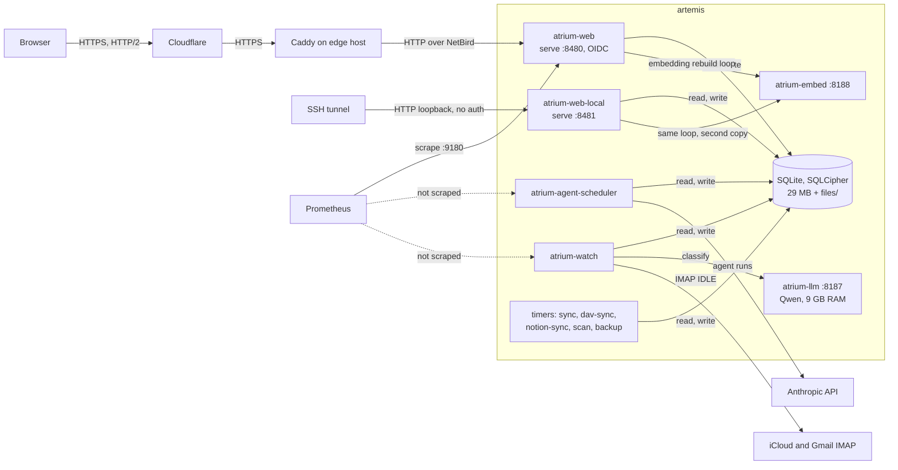
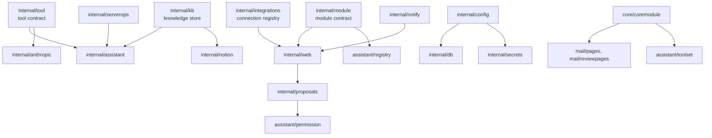
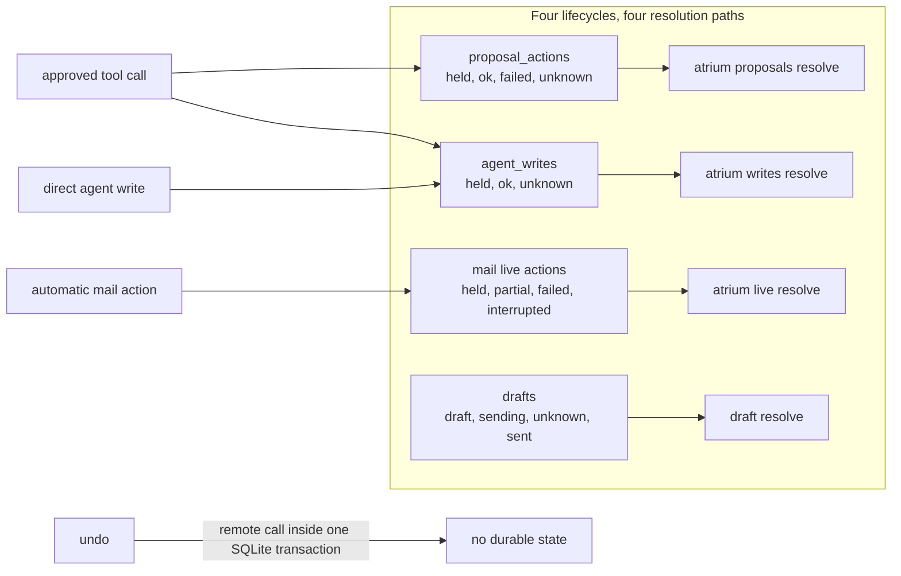
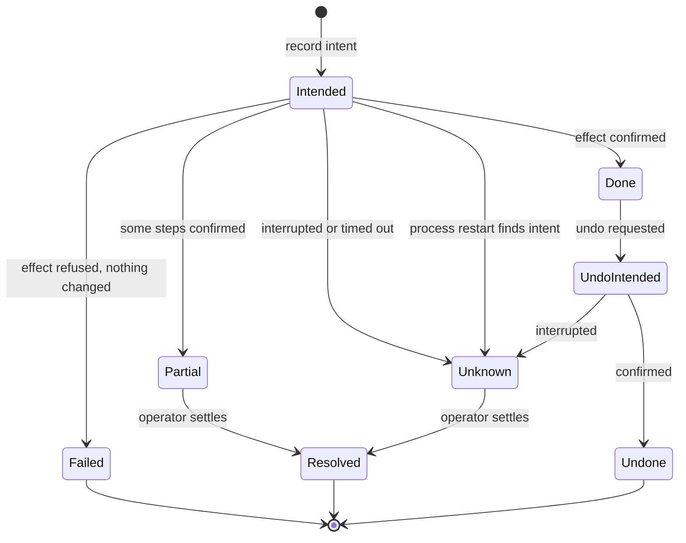
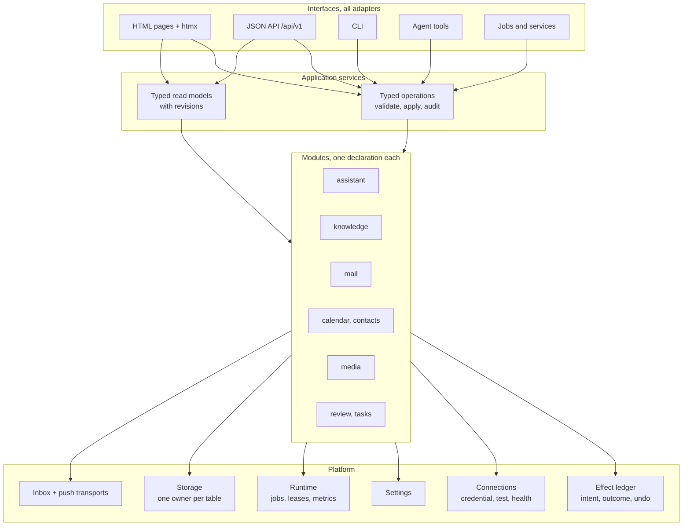
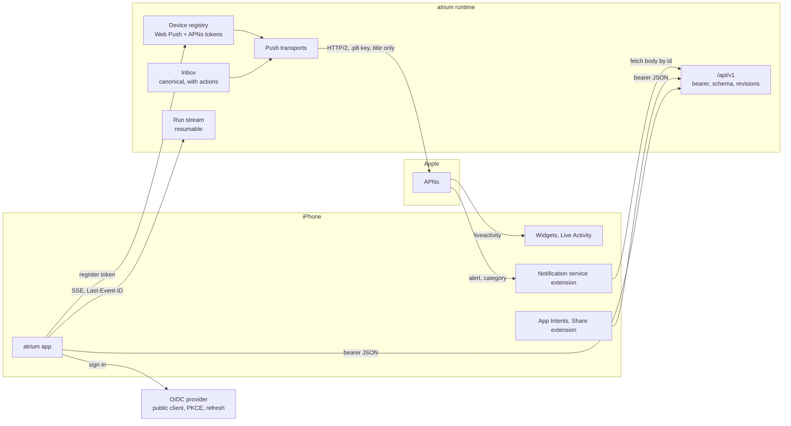
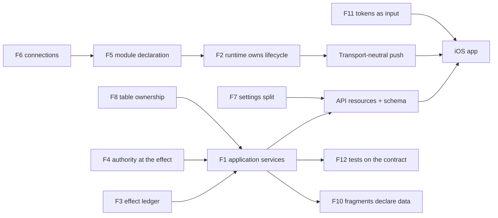

# Architecture review, November 2026

Review of atrium at `836d4321` and of its deployment in `cornn-flaek` on
artemis. Review only: no code changed. This document is the input for the
v3 breakdown session: the decision log says what to build toward, and
"Decisions" at the end fixes the scope. It contains no steps.

## Method

- 25 read-only review lanes, one per subsystem or question, each returning
  findings with `path:line` evidence. One lane measured the live system on
  artemis with read-only commands.
- 114 of the high-impact claims went to a second set of agents whose task
  was to refute them. Result: 88 confirmed, 25 narrowed, 1 refuted and
  dropped. Items marked **V** below survived that pass; narrowed items
  carry the narrowed statement. Items without **V** have one reader only.
- Nothing was built or run in the repository. Tests were read, not run.

## Answers to the eleven questions

| # | Question | Verdict |
|---|---|---|
| 1 | Are the systems correct? | The safety design is sound; its implementation has gaps. 108 verified findings, concentrated in four places: outcomes of external writes, permission checks that use stale state, knowledge visibility and marks, and credentials read from the wrong source. |
| 2 | Does the host setup make sense? | Mostly. Native OIDC behind Caddy, persistence and backup are right. Three problems: a second full `serve` process for loopback access, metrics scraped from one of seven processes, and operator preferences pinned in Nix. |
| 3 | Is the system fragile? | Yes, at the seams. 142 of 294 recent `fix` commits land within 24 hours of a feature in the same area. A typical feature touches 17 files. Invariants live in conventions between packages. |
| 4 | Are the systems consistent? | No. The same job is done several ways: four lifecycles for external writes, three Google OAuth implementations, two health tables, eight ways to declare route access, two code paths per action for HTML and API. |
| 5 | Are the integrations modular? | Partly. Nine integrations use the connection registry. Mail accounts, Google, iCloud DAV and EZTV do not. A module declares pages, tools and settings, but not jobs, approvals, undo, proposal kinds or connections. |
| 6 | Is the architecture sensible? | The domain split is sensible. The dependency direction is not: shared packages import their consumers, and the HTTP server is the only place background work can start. |
| 7 | Do features fit the design system? | Colors, fonts and the main screens match. Primitives (buttons, inputs, badges, toasts) come from Basecoat defaults, not the system. Touch targets are 28 to 32 px against a 44 px rule. The export is copied by hand. |
| 8 | Are features overengineered? | A few. The administrator and non-administrator split protects nothing. The public `sdk` has no consumer. About 189 of 384 settings are tuning constants. Most other machinery checked is justified for one operator. |
| 9 | Is it performant? | The server is fast: pages render in 1.3 to 4.4 ms. Each public round trip costs 205 to 355 ms, so responsiveness depends on round trips, and several are avoidable. |
| 10 | Are the tests valuable? | Half of them. Of 30 sampled tests, 15 assert an operator outcome and 14 assert markup, prose or table rows. Every authority boundary has at least one e2e. |
| 11 | Can a new person use it? | Not from the documents and interface alone. The documented install creates a plaintext database that then refuses credentials, the default sign-in mode does not match the bootstrap link, and safety explanations exist only as hover tooltips. |

## The systems today

### Runtime on artemis

Which processes exist, what they share, and what observes them.

Derived from `nix/module.nix`, `cornn-flaek/modules/atrium/default.nix`,
`cornn-flaek/modules/edge/default.nix`, `internal/core/coremodule/register.go`
and `systemctl` on artemis. Measured: web 161 MB, web-local 158 MB,
scheduler 63 MB, watch 87 MB; no restarts or OOM kills in seven days.

### Dependency direction

Which shared packages import the packages that use them. Every arrow is an
import that points from a more stable package to a more volatile one.

Derived from `go list` on the main checkout. The cause of most of these is
one fact: `web.Module` is the only lifecycle hook under `serve`, so
anything that must run in the background registers as a web module
(`integrations/web.go:63-70`, `notify/web.go:63-72`,
`coremodule/register.go:131-155`, `assistant/pages/module.go:60-96`).

### External writes

How many lifecycles an external write can follow today.

Derived from `internal/proposals/pipeline.go`, `internal/writes/writes.go`,
`internal/mail/live/state.go`, `internal/mail/drafts/drafts.go` and
`internal/assistant/approval/approval.go`. An approved tool call records in
two of them and each blocks separately.

## Decision log

Each fix is stated as what the system should have been. The problems it
resolves are listed under it. This is a design direction, not a plan.

### F1. Every interface is an adapter over one set of application services

HTML pages, `/api/v1`, the CLI, agent tools and jobs call the same typed
operations and read the same typed read models. Validation, defaults,
rollback and audit live in the operation.

- **V** Starting a thread is coded twice and has drifted: only HTML resolves `@thread` references and attachments, only the API deletes the thread when the run is refused (`assistant/pages/chat.go:199-275`, `api.go:249-297`).
- **V** Stop, the subagent read-only check and error mapping are copied between HTML and API, and the copies differ (`thread.go:94-118`, `api.go:356-418`).
- **V** A message queued while a run is active skips knowledge retrieval (`service/service.go:382`, `loop/loop.go:448-470`).
- **V** The mail account lifecycle (validation, probe, SQL, secrets, health) lives in an HTTP handler package, and its test uses a password login even for XOAUTH2 (`mail/accountpages/accountpages.go:199-352`, `imapclient/login.go:24`).
- **V** A mail correction moves the message at once from an htmx request and on the next pass from a plain form (`mail/pages/messages.go:145-153`).
- Adding a torrent is implemented twice, in the page and in the tool (`media/pages/add.go:23-102`, `assistant/tools/media/media.go:263-305`).
- The "about" chip builds model context with raw SQL and a remote calendar call in a page handler; the API cannot request it (`assistant/pages/chat.go:85-122`).
- The link between a scheduled job and its setting is written in a handler and read in the scheduler (`assistant/pages/scheduled.go:167-196`, `scheduler/builtin.go:101-115`).
- API approvals are audited with source `ui` (`mail/reviewpages/api.go:22`).
- Templates read domain structs and `map[string]any` rows through reflection helpers, so a renamed field blanks the page with no compile error (`assistant/pages/views.go:91-131`, `web/tpl/funcs.go:35-150`).
- HTML and API map the same rows through separate mappers; the API transcript drops references, citations and digest cards (`assistant/pages/api.go:71-82`).
- Branching a thread drops thinking, web search and cost cap (`service/branch.go:93-98`).
- About 175 HTML routes against 20 API routes.
- **V** Adding a torrent and watching a show are each implemented in the page and in the tool with different rules: the page accepts any magnet link and backfills by default, the tool requires a v1 hash and never backfills (`media/pages/add.go:37-92`, `assistant/tools/media/media.go:274-418`).
- **V** The assistant has no tool to search for a show or preview releases; only the page can. `media_channel_add` needs an id and a pattern the model cannot see (`assistant/tools/media/media.go:38-85`).

### F2. The process owns the lifecycle; the web server is one listener

One runtime starts services and jobs that modules declare. A listener
serves requests and owns nothing else. Jobs carry their own policy: whether
they spend money, how long they may run, what a failure means.

- **V** `atrium-web` and `atrium-web-local` are two full `serve` processes. Both run the embedding rebuild, and the second swap can drop the generation the first activated, leaving no active index (`nix/module.nix:157,296`, `embed/index.go:94-124`).
- **V** The monthly Anthropic budget pause skips every scheduled job, including reminders, media sweeps, export and the model-free ops sampler (`scheduler/runs.go:48-120`).
- **V** Job leases expire after 30 minutes and are never renewed, so a long job can be claimed twice (`scheduler/runs.go:67,131`).
- **V** Dreaming runs two groups but ties only the first thread to the job, so the job settles as done while the second group runs (`dreaming/dreaming.go:96-133`, `scheduler/runs.go:223`).
- **V** Metrics are counted in each process and served only by `atrium-web`. Mail sync, scheduled runs and tool calls never reach Prometheus; the live histograms for them are empty (`obs/metrics.go:23-52`).
- **V** A pass that never completed once is never reported stale (`passrun/passrun.go:47-129`).
- **V** An ops change is lost when the worker is busy or the budget is spent, in the default mode (`serverops/supervise.go:132-193`).
- Scheduled jobs are declared in three places and only run while the assistant module is on (`scheduler/builtin.go:64-77`, `cmd/atrium/main.go:77`).
- Domain packages import `internal/web` to get a lifecycle (see the dependency diagram).
- Every gated command opens and migrates the database twice; the open sequence is copied in 13 places (`module/gate.go:180-257`).
- Module state is a snapshot taken at start; `context.md` says modules toggle at runtime (`module/gate.go:129-243`).
- **V** The migration lock and the mail-pass lock are the same file, without a timeout (`db/migrate.go:442`, `mail/run/run.go:222`).
- All units, including backup and loopback access, start after both model servers (`nix/module.nix:167-171`).
- Three of 20 `atrium-sync` runs and four of 20 `atrium-dav-sync` runs ended as failed units for a transient upstream error.
- API idempotency keys live in process memory and are lost on restart (`web/idempotency.go:39-47`).
- One process removes the isolation the units give today, so the runtime must supply it: each service runs under a supervisor that restarts it with backoff, a panic in one service does not stop the listener, and shutdown drains. Drain means: stop taking jobs, let a running external write reach a recorded outcome, and mark what could not finish as unknown before exit. A deploy restarts everything at once; without drain every deploy creates unknown outcomes.
- **V** The media sweep is recorded as successful while qBittorrent is down; the failure is neither returned nor logged (`media/organizer.go:371-379,414-418`, `media/mediacmd/mediacmd.go:79-80`).
- **V** An event-candidate drafting run that fails leaves its messages queued with no attempt count, so each scheduled run sends them to the assistant again (`calendar/candidates/draft.go:52-66`).
- **V** One unit runs `calendar sync` then `contacts sync`. With no iCloud account it fails every 15 minutes, and a calendar failure skips the contacts sync (`nix/module.nix:262-274`).
- **V** `internal/cli` is both the argument parser and the application bootstrap: it installs settings and configuration and starts tracing (`cli/cli.go:210-233`).

### F3. One state machine for anything that changes the outside world

Record the intent, perform the effect, record the outcome. Outcomes are
done, failed, partial and unknown, each visible and resolvable by the
operator. Undo is itself an effect with an intent.

- **V** A partial automatic move stays `held` with an error, and a partial label becomes `partial`; neither can be resolved or undone (`mail/applier/applier.go:363-372,467`, `mail/live/resolve.go:44-64`).
- **V** An approved relabel that adds labels and then fails to remove labels drops its record, so the added labels have no ledger entry and no undo (`mail/mailops/mailops.go:398-414`, `mail/executors/executors.go:282-285`).
- **V** On non-Gmail accounts, triage archive and snooze create folders without an intent (`mail/executors/triage.go:211,264`).
- **V** Automatic flagging records an interrupted STORE as a failure and may retry it (`mail/applier/applier.go:616-620`).
- **V** In shadow mode a snooze inserts a real pending row, and a real snooze that comes due in shadow is marked returned while the message stays in Snoozed (`mail/executors/triage.go:228`, `mail/applier/snoozes.go:89-153`).
- **V** The conflict check for unresolved mail writes omits the account (`ledger/ledger.go:47-52`).
- **V** `writes.Undo` calls the calendar over the network inside the single write transaction and records nothing first; a crash after the remote call lets the undo run again (`writes/writes.go:367-387`).
- **V** A direct write left `held` by a crash cannot be resolved, and does not block further calendar writes (`writes/writes.go:145,217,247`).
- **V** A proposal that failed after some batches succeeded cannot undo those batches (`proposals/pipeline.go:586-670`).
- **V** Resolving a direct write and recording the resolution are two statements without a transaction (`writes/writes.go:226-240`).
- **V** File replace and draft create or update change the resource first and record undo second (`assistant/tools/files/files.go:174-184`, `tools/mail/drafts.go:91-151`).
- **V** The Notion client retries `POST /v1/pages` on 5xx, so the export can create duplicate pages (`notion/api.go:200,301`).
- **V** Changing the export parent keeps updating pages under the old parent (`kb/export/notion.go:39-131`).
- **V** Package delivery advances `notified_status` before the inbox row exists; a failed insert is only logged (`mail/tracking/tracking.go:603-635`).
- **V** A reminder is recorded as sent only when a push is delivered, so with no device it adds an inbox row every five minutes (`tasks/remind/remind.go:42-52`).
- **V** The attention query omits blocked proposals and unknown drafts that Review counts (`attention/sources/proposals.go:18`, `mail/reviewpages/review.go:17-20`).
- An approved tool call that ends unknown blocks in two ledgers; resolving one does not resolve the other (`assistant/approval/approval.go:107-139`).
- Recovery text names the wrong service: every blocked proposal says "Check the mailbox", every unknown write says "Check the calendar" (`reviewpages/templates/_proposal.gohtml:251-255`).
- **V** Calendar writes made through approval cards record only in `proposal_actions`; the guard that blocks a calendar after an unknown outcome reads only `agent_writes`. Create, update and reply are outside the guard, against `context.md:363-366` (`calendar/proposals.go:209-221,278-280`, `writes/writes.go:246-248`).
- **V** A 409 on Google insert is treated as success. The event is tracked, and its undo would delete an event atrium did not create (`calendar/calendar.go:156`, `calendar/proposals.go:278-291`).
- **V** iCloud delete returns success when it finds no event, and undo then reports the event deleted (`calendar/icloud.go:77-96`).
- **V** `media_add_magnet` discards its write record when qBittorrent returns an error, including a read timeout after which the add may have happened; mail and calendar tools record that case as unknown (`assistant/tools/media/media.go:297-299`).
- **V** Undoing an operator edit of a knowledge record does not restore `private` (`kb/write.go:51-60,383-386`).
- **V** The mirror writer deletes every local collection absent from the server listing, so an empty listing empties the mirror (`davmirror/davmirror.go:73-89`).

### F4. Authority is checked where the effect happens, against current state

- **V** Tools are admitted at the start of a step. Marks added later in the step, by a queued reference, a web search or an earlier tool in the same batch, do not change what the rest of the batch may do (`loop/loop.go:571-583`, `loop/dispatch.go:253`).
- **V** `search_threads` returns summaries from private projects to any thread (`assistant/tools/memory/search.go:50-59`).
- **V** `kb_write` and `kb_retract` are offered to marked threads. `context.md:458` says they are not; `context.md:101` describes what the code does. One of the two statements is wrong.
- **V** A `lookup` child cannot read files attached to its parent thread (`subagents/lookup/lookup.go:224`, `tools/files/files.go:213-226`).
- **V** A signed-in non-administrator can approve proposals, send drafts and undo writes, but cannot resume mail or read the inbox (`mail/reviewpages/module.go:105-124`).
- **V** Route access is declared in about eight ways. The administrator check matches the decoded path while the router uses the raw path; no reachable bypass was found (`web/server.go:280-292`).
- **V** `action_link_key` also signs login links and seals the OIDC wizard draft, so revoking phone links breaks both (`auth/loginlink/loginlink.go:48`, `auth/oidc/wizard.go:365`).
- **V** With a public OIDC client on an encrypted database, the pending nonce and verifier are read back empty: sign-in fails and the nonce check is skipped (`auth/oidc/seal.go:23-87`). artemis uses a confidential client and is not affected.
- **V** Proxy mode trusts `Remote-Groups` from any peer, and the module default is proxy mode on `0.0.0.0` (`web/identity.go:54-60`, `nix/module.nix:418-427`). artemis uses OIDC mode and is not affected.
- **V** The phone-link mint cap of 20 an hour suppresses the notification itself (`actionlink/notify.go:32-36`).
- **V** The system-prompt profile takes any pinned, confirmed record with no check of private scope, so a pinned record of a private project enters every thread. Nothing stops the operator from pinning one (`kb/profile.go:24`, `kb/operator.go:63-115`).
- **V** A chat or scheduled thread outside a private project can retract, by id, an unconfirmed agent-written record of that project (`kb/write.go:174-185,308-322`).
- **V** A knowledge record takes the marks of the thread that wrote it, not of its source. Any `kb_search` hit marks the thread, and the nightly prompt requires a search before writing, so the records of a nightly run carry marks unrelated to their sources. Threads marked only `personal` go to the marked group (`kb/write.go:197-231`, `assistant/tools/kb/kb.go:126-139`, `dreaming/dreaming.go:29,144-163`).
- **V** Confirming a record clears only `untrusted`. Retrieval and the profile also exclude `pii` and `messages`, so a confirmed record from a thread that read mail stays out of the prompt until the operator clears the marks by hand. `context.md:121-123` says confirmation is enough (`kb/operator.go:193`, `kb/retrieve.go:50-51`).
- **V** An operator edit of an agent-written record leaves the agent as writer, so the agent may later overwrite or retract the correction (`kb/operator.go:107-110`, `kb/write.go:176-181`).
- **V** An operator's undo of their own knowledge edit becomes a "mistake" signal for dreaming and starts a paid marked run that cannot cite it (`dreaming/dreaming.go:340-353`).
- The API has no rate limiter and no way to revoke a bearer token. Both are needed once the API is the public path for the app.

### F5. A module is one declaration, and everything else is derived from it

Pages, API resources, tools, approval executors, undo handlers, proposal
kinds, jobs, services, attention sources, settings and connections come
from the module's registration. Turning the module off removes all of them.

- **V** Core mounts `/loops`, `/watches` and `/drafts` and their navigation whether or not mail is on (`core/coremodule/register.go:65-70`).
- **V** The `propose` tool's schema is correct only because mail is listed before assistant in `main.go` (`tools/propose/propose.go:24,86`, `module/set.go:281-285`).
- **V** The default phone-action kinds match one registered proposal kind out of six (`actionlink/policy/policy.go:17`).
- **V** `module.IsEnabled(ctx, "sandbox")` checks a module that does not exist (`assistant/pages/composer.go:78`).
- **V** The mail settings page shows `snooze_choices`; nothing reads it (`mail/reviewpages/loops.go:15`).
- **V** A module that fails to evaluate starts as core only with exit 0, and its commands exit 0 without work (`module/gate.go:184-240`).
- Runtime tools, the documented catalog, approval executors and undo handlers are four separately kept lists (`module/set.go:280-293`, `assistant/toolset/toolset.go:35-95`).
- Server-ops is split across three modules: tools in assistant, sampler gated on grafana, findings card in core.
- The settings `Module` field is a free string (`assistant`, `export`, `action_links`, `permissions`) that decides environment variable names and settings pages.
- The public `sdk`, `withModules` and `module_migrations` have one user, a test fixture. The Nix module rejects settings of an external module.
- `internal/tool` imports the assistant, Anthropic and writes packages (`tool/bound.go:8-10`, `tool/tool.go:7-11`).
- **V** The settings generator and the integrations documenter each keep their own import list. The generator's output is the schema the NixOS module validates settings against, and no check ties its list to the shipped binary (`tools/settingsgen/registered.go:3-26`, `nix/module.nix:11,48-51`).
- **V** The digest's "may be outdated" line matches an alias named `conflict` that no prompt or tool tells the model to write, so it never appears (`digest/digest.go:219-221`).
- The event-candidates stage is a mail-pass stage that lives in `calendar` and reads the `messages` table. Media jobs, undo handlers and the tool's cap live in core and assistant packages.

### F6. A connection is one kind of record for every external system

Credential source, test, health, transport and expiry are properties of the
connection. A provider with several capabilities, such as Google, is one
connection with one token source.

- **V** Google Calendar reads its client secret from the process environment only; the OAuth wizard stores it in the database. A calendar set up in the wizard stays in needs-settings (`calendar/settings.go:156`, `calendarmodule/module.go:68-69`).
- **V** Google has one health row for two capabilities, Test checks only the Calendar token, and the Gmail health hook is never wired (`integrations/google.go:254-321`, `mail/gmailauth/gmailauth.go:199`).
- **V** Health keys for mail accounts and endpoints share a namespace; an account named `chat` or `embed` collides (`mail/accountpages/accountpages.go:74`, `endpoint/settings.go:183`).
- **V** The Gmail token source is built per connection, so concurrent callers each refresh the token (`mail/gmailauth/gmailauth.go:199`).
- **V** `notion.Writer` and most wiki edit helpers have no callers (`notion/writer.go:10-136`).
- Google consent and refresh are written three times with three sets of endpoint URLs (`integrations/google.go`, `calendar/googleauth.go`, `mail/gmailauth/gmailauth.go`).
- Endpoints keep two health stores: `endpoint_probes` gates the module, `integration_health` drives the badge.
- `httpx` finds an endpoint's key, CA and proxy by URL prefix in the request context; without it the request goes out with no key and no CA (`httpx/httpx.go:31-55`).
- iCloud DAV has no record, no test, no health and no CA or proxy setting; contacts logs in through calendar code.
- **V** A reply to an iCloud invitation finds the operator only as `mailto:` plus the `icloud_apple_id` setting. With the setting empty, or an invitation sent to an alias, the reply fails as "not an attendee" (`calendar/proposals_update.go:171-181`).
- **V** Updating one occurrence of a recurring event changes the whole series on iCloud and one occurrence on Google (`calendar/proposals_update.go:102-145`, `calendar/google.go:75-103`).
- **V** An iCloud calendar is identified by its path when read and by its display name when written, so the assistant cannot filter by the name it writes with (`calendar/mirror.go:62-72`, `calendar/icloud.go:46-50`).
- **V** Each Google calendar operation builds a new token source and refreshes the token (`calendar/calendar.go:119-126`).

### F7. Three kinds of configuration, kept apart

The host supplies infrastructure and bootstrap values. The operator's
choices live in the application. Tuning constants are code.

- The generated reference lists 384 settings: 121 shown in the interface, 240 advanced, 16 secret, 7 bootstrap. A first classification gives 95 operator choices, 100 host or account values and 189 tuning constants.
- **V** Secret writes skip the definition's validator (`settings/store.go:129-152`).
- **V** Pinned values are validated one at a time; cross-setting rules run only on stored changes (`config/pins.go:85-177`).
- The host pins operator preferences, which makes them read-only in the interface: `ops_condenser`, `notion.wiki_root`, `webpush_subject`, and `icloud_apple_id`, which repeats the mail account login (`cornn-flaek/modules/atrium/default.nix:104-126`).
- The Obsidian export folder has two configuration paths and only one grants the unit write access (`nix/module.nix:58,113-115,194-195`).
- `internal/config` opens and migrates the database and reconciles mail accounts (`config/state.go:51-102`).
- The fallback time zone is Port of Spain (`config/config.go:39`).
- The permission table has 24 independent settings; 12 have the same default and cannot differ in effect.
- Module flags cannot be set from the interface; the settings page shows Off with no action.
- 23 advanced media settings are tuning constants.

### F8. Each table has one owner, and derived data records what it was derived from

- **V** Embedding fill marks a record embedded after the remote call without checking that the content is unchanged; an edit or retract in between is lost, and a retracted record returns to the index (`embed/embed.go:257-307`).
- **V** Memory summaries are written from text already clipped to the node limit (`memory/memory.go:252-256`, `memory/jobs.go:172`).
- **V** Knowledge vector search runs on the read pool, not on the dedicated KNN connection (`assistant/tools/kb/kb.go:120`, `kb/retrieve.go:279`).
- **V** The Knowledge page searches with `LIKE '%q%'`; the FTS5 table exists and other paths use it (`kb/kb.go:209-212`).
- **V** The legacy projection tables have no readers and are still deleted from (`assistant/context/context.go:19-27`).
- **V** `atrium backup` snapshots the database and copies `files/` later without a lock (`backup/backup.go:96-124`).
- `threads` is written by five packages; `agent_writes` by three.
- The rule "writes use `WithTx`, vector search uses KNN" is a convention on three raw handles.
- Dormant schema still shapes code: `skills`, `runs.skills_json`, `ntfy_channels` reused for content mode, seeds that are deleted on every migrate.
- `internal/kb` builds the assistant's prompt profile, reads thread internals and imports Notion.
- **V** The knowledge visibility rule exists in five variants with different mark masks: 7 in retrieval and the profile, 14 in export, and no expiry check in the digest (`kb/kb.go:130-142,277-282`, `dreaming/dreaming.go:452-455`, `digest/digest.go:200`).
- **V** `expires_at` is filtered on every knowledge read and written by no code path.
- **V** iCloud reads come from a mirror refreshed every 15 minutes while writes go live, so `find_slot` can offer a slot that was just booked (`calendar/calendar.go:276-278`, `calendar/icloud.go:69-75`).
- **V** A hand-written JSON encoder with 32 call sites can write `NaN` and panics on a marshal error; it and the argument parser carry behavior copied from Python, though `context.md` says v2 is not a port (`jsonx/jsonx.go:24-105,316`, `cli/cli.go:378`).
- **V** Two functions named `FloatRepr` give different output for the same value. One formats stored timestamps, and that string is hashed into a proposal fingerprint (`numx/numx.go:44-45`, `jsonx/jsonx.go:242-262`, `mail/backlog/backlog.go:96-107`).
- **V** Two clip helpers cut at a byte index and can split a character, in package status text and in text sent to the model (`mail/tracking/tracking.go:332-337`, `assistant/tools/memory/search.go:139-143`). Clipping exists as two shared functions and about 12 private ones.
- Knowledge search is implemented three times: in `search.go`, again in `retrieve.go`, and as `LIKE` in `List`. The one-shot Notion import is still shipped.

### F9. One ledger for paid inference, with reservation

- **V** The summarizer makes up to three calls and records at most one; three overlong answers record nothing (`memory/jobs.go:206-256`).
- **V** Memory spend is excluded from the monthly budget (`usage/usage.go:197-202`).
- **V** A resumed run gets its full step allowance again (`loop/loop.go:307,372,544`).
- **V** The `between_tools` thinking mode is offered and validated and never sent (`loop/request.go:123-126`).
- **V** An empty `end_turn` finishes as success; `context.md` says it is a run error (`loop/stops.go:73-82`).
- Cost caps price the prompt only and reserve nothing, so parallel subagents can each pass against the same remainder (`loop/loop.go:704-756`).

### F10. A fragment asks for the data it shows; static bytes are prepared once

Measured on artemis: pages take 1.3 to 4.4 ms on the loopback and 205 to
355 ms to first byte through the public path. The network round trip is
the cost, so the gaps are the round trips that need not happen.

- **V** Static assets have versioned URLs and an ETag and no `Cache-Control`, so every asset is revalidated at 223 to 479 ms each (`web/staticserve.go:52-56`).
- **V** Responses are gzipped per request at best compression: `app.css` goes from 0.16 ms to 4.2 ms. WOFF2 files are compressed again and grow (`web/gzip.go:83`).
- **V** Every htmx fragment runs the sidebar, review count and mail mode queries (`web/render.go:88-95`).
- **V** The thread page and the API transcript load the whole history on each request (`service/view.go:531-584`, `assistant/pages/api.go:310-329`).
- **V** After a stream error the client waits two seconds, closes the stream and replays the run from event zero (`web/assets/app.js:650-676`).
- **V** Live tool rows are rendered by `app.js` with different markup from the server template, so a row changes shape when the run ends (`app.js:554-590`, `_macros.gohtml:121-160`).
- The stream handler polls SQLite twice every 300 ms for each open tab (`assistant/pages/events.go:82-105`).
- Review loads one message per reply draft; the home strip loads all pending proposals to show three (`mail/drafts/drafts.go:645-667`).
- A message the operator sends is not shown until the server answers.
- `app.css` is 332 KB raw, 34 KB compressed.
- The local model holds 9 GB of host memory for 139 s of GPU work in 61 hours.
- **V** Each media page handler, including every poster and thumbnail request, reloads 28 settings and 2 secrets and builds three new HTTP transports, so no connection is reused (`media/settings.go:242-287`, `media/pages/module.go:39-45`).
- **V** Thumbnails are generated by ffmpeg inside the web request under one process-wide lock, for up to about 240 s (`media/artwork.go:193-196,257-258`).
- **V** A media torrent is not added stopped, and file selection straight after a magnet add finds no files yet, so selection waits for the ten-minute sweep (`media/qbit.go:394-404`, `media/organizer.go:448-451`).
- Every agenda render parses every `.ics` file again (`calendar/mirror.go:42-84`).

### F11. The design system is an input to the build

`tokens.json` generates the CSS variables and, later, the native app's
constants. Primitives are adapted to the system in one place.

- The export is synchronized by hand. Colors and fonts agree; spacing, radii and sizes are separate literals (page padding is 24 px in the export and 32 px shipped) (`nix/static.nix:46-64`, `web/assets/input.css:77-180,541`).
- Buttons and inputs are 28 to 32 px on a phone against a 44 px minimum, and the ask field is 15 px against 16 px (`input.css:559-578`).
- **V** In rail mode the Review count is hidden (`input.css:315-322`).
- **V** The phone Threads tab is never marked current, and Today is marked current on the thread list (`web/tpl/templates/base.gohtml:39-40`).
- The thread context panel is 384 px from 768 px wide; the system says 320 px from 1024 px.
- Approval cards say "Approve" where the system requires the name of the effect, and proposals and drafts are two different card structures.
- Notifications, Google and module pages each use a different save pattern inside `SettingsGroup`.
- No component covers media, mail rules, activity, usage, the command palette or the inbox.
- The export is web only: 24 components as HTML and CSS, phone layouts for Home and Thread, a tab bar, 89 icons, two logos. A native app has no source for these parts: navigation (stacks, sheets, the split view on iPad), notification layouts with action buttons, widgets, the Live Activity, the share sheet, text sizes under Dynamic Type, the app icon and launch screen. The native app also needs every area in the line above, and the phone layout of Review, Knowledge, Settings, Integrations, Schedules, Tasks, Projects and Search, which the export shows only as desktop components or not at all.

### F12. Tests assert what the operator gets, through the same contract a client uses

- 14 of 30 sampled tests assert markup, exact prose, class names or table rows (`cmd/atrium/web_shell_test.go:30`, `settings_tabs_test.go:26`, `asst_plain_send_test.go:26`).
- The model stub selects its answer by matching production system prompts (`internal/testutil/llmstub/llmstub.go:26-90`).
- Some tests accept a result that proves nothing: dedup passes with zero proposals in both scans, restore runs over the source it was taken from (`scan_dedup_test.go:32`, `backup_driver_test.go:24`).
- The golden suite injects in-memory mail clients, so the IMAP adapter is outside it (`golden_test.go:196-207`).
- CI runs the full suite four times.
- **V** CI builds 19 checks on each of two architectures, including those that do not depend on the architecture (`.github/workflows/ci.yml:47-56`). A second SQLite driver that cannot open the production database is kept for tests.
- **V** The shipped binary is compiled with `-O2` and, on x86_64, `-mavx2`; the checks are not. The cgo environment is written in four places (`nix/go-package.nix:32`, `flake-modules/go-checks.nix:9-13`).
- **V** The restore drill's plaintext case starts from the v1 fixture, a database shape v2 never writes (`flake-modules/restore-drill.nix:11,44-46`).
- **V** `just changed` defaults to a base ref, `v2-develop`, that does not exist (`justfile:22`).

### F13. The product owns the first hour

- The documented Nix example gives no database key, so the database is created plaintext and then refuses API keys; the repair is to stop every unit and convert it (`docs/operator/nixos.md:26-37`).
- The module default is proxy authentication; the bootstrap login link needs OIDC mode (`docs/operator/nixos.md:63`).
- The welcome screen suggests mail prompts when mail is off.
- Shadow mode, live mode and the seven-day Google token warning are explained only in `title` tooltips, which a phone does not show.
- Confirm, pin and marks on a knowledge record change what the agent may do and what enters the prompt; the page does not say so.
- The host runbook describes the disabled v1 deployment (`cornn-flaek/docs/runbooks/atrium.md:3-19`).

## Special cases

Removed by the fixes above:

- The loopback listener as a second application (F2).
- `/actions/` hard-coded as a CSRF exemption and declared public twice (F4).
- The administrator role and its six selectors (F4).
- Mail listed before assistant so the proposal schema is right (F5).
- Open-Meteo never "configured" because it has no URL or secret (F6).
- Endpoint settings rebuilt from hard-coded defaults when the request context lacks them (F6).
- `auto` and `full` as two names for one notification mode (F7).
- Retry on create in the Notion client (F3).
- The two-second stream reset (F10).
- `sandbox`, `skills_json`, the projection deletes, the `web` and `notion` seeds (F5, F8).
- Login links, and `action_link_key` signing three unrelated things (F4).
- The public `sdk`, `withModules` and `module_migrations` (F5).
- Python-compatible JSON, number and argument handling (F8).
- Treating a 409 on create as success, and a delete that finds nothing as deleted (F3).

Kept, because the system still needs them:

- The mail gate, shadow mode, pause, protected folders and write caps.
- Marks, the six situations and the floors on people and internet channels.
- COPY, STORE Deleted, UID EXPUNGE for moves, and the UIDPLUS requirement.
- Embedding generations and the dedicated KNN connection.
- Rekey through a verified copy, and the key history.
- Doom-loop and step caps, and per-model cost caps.
- One-use, expiring, HMAC-signed phone links, and the exclusion of permission requests from them.
- A loopback emergency path.
- Additive migrations for mail data. Whether v3 starts from a new baseline with an import, as v2 did from v1, is for the breakdown session; the v2 baseline stays frozen while v2 is deployed.

## Target shape

How the parts should relate after the fixes. Arrows are calls; nothing
calls upward.

## Mobile app readiness

The interactive figure `figures/reach-gauge.html` (light:
`figures/reach-gauge-light.html`) shows the gap: 22 operator feature areas,
the web interface covers 21, `/api/v1` covers 2 fully, 9 partly and 11 not
at all. The target is both interfaces on the same services, not a second
row built beside the first.

| Area | Web | API today |
|---|---|---|
| Home and today brief | yes | none |
| Threads | yes | list, create, read, send, stop, answer, events |
| Composer options | yes | at creation only; no catalog, no update |
| Attachments and files | yes | metadata only |
| Projects | yes | filter only |
| Review, Needs you | yes | `/pending`; findings omitted |
| Proposals | yes | pending and actions; no single read |
| Permissions | yes | decisions; no policy |
| Drafts | yes | full |
| Undo and activity | yes | undo subset |
| Knowledge library | yes | none |
| Tasks | no page | none |
| Schedules | yes | none |
| Mail rules | yes | none |
| Media app | yes | none |
| Wiki | yes | none |
| Notification inbox | yes | read |
| Device registration | Web Push | none |
| Settings | yes | none |
| Integrations | yes | none |
| Usage | yes | none |
| Search and palette | yes | thread search only |

### What the architecture needs before an app is a first-class client

Derived from `internal/web/api.go`, `internal/assistant/pages/api.go`,
`internal/mail/reviewpages/api.go`, `internal/notify/notify.go`,
`internal/notify/webpush.go`, `internal/auth/oidc/bearer.go` and Apple's
APNs provider documentation.

Capabilities that do not exist yet:

1. **Shared operations and read models (F1).** Without them every feature the app gains is a second implementation.
2. **A schema for the API.** DTOs are handwritten; there is no OpenAPI source to generate a Swift client from.
3. **Revisions.** Responses are `no-store` with no ETag, so the app fetches everything again on every open. It needs conditional reads. A change feed with tombstones is needed only for offline use, which is out of scope (decision 8).
4. **Bounded lists.** The transcript endpoint loads the full history; `/pending` is not paginated.
5. **Durable command identity.** `Idempotency-Key` is optional and held in memory for ten minutes. A phone on a poor network retries.
6. **A stream contract.** Replay works while events are retained; a new run clears them and an expired cursor returns an empty stream with no signal.
7. **Transport-neutral notifications.** The device registry requires Web Push fields, delivery calls Web Push directly, and actions are stored only in the first push payload, not in the inbox.
8. **Actions as commands.** Approve and dismiss from a notification are HMAC links today. A native action needs the same decision as a bearer command, and the same exclusion of permission requests.
9. **One principal.** The API has an administrator variant of each route helper for a role that should not exist.
10. **Attachments.** Upload and download are HTML only.
11. **Outbound access to Apple.** The host must reach `api.push.apple.com:443`.

### Uses of the Apple developer account

| Capability | Use in atrium | Needs on the server |
|---|---|---|
| APNs, token key | Replace Web Push on the phone; delivery works with the app closed | Provider key, team id, bundle topic, device token registry, sandbox and production hosts |
| Notification categories | Approve and Dismiss buttons on a proposal notification | A category per proposal kind policy; actions call the API with the app's token |
| Notification service extension | Keep the `title` privacy mode: APNs carries an id, the phone fetches the text over the API | A read endpoint for one inbox entry |
| Time Sensitive notifications | Approvals with a deadline and delivery exceptions break through Focus | A priority field on the inbox entry |
| Live Activities over APNs | A running agent run or a parked approval on the lock screen | Live Activity token registry, run progress as push updates |
| Background push | Refresh Needs you and the day before the app opens | The same small summary read model as widgets; Apple limits these to a few per hour |
| WeatherKit | Replace Open-Meteo; 500,000 calls a month are included | Already in the plan; a second weather connection |
| Associated Domains | Universal links from mail and notifications into the app; passkeys shared with the web sign-in | `apple-app-site-association` on the public host |
| App Intents, Siri, Shortcuts | "Ask atrium", add a task, approve the next item, by voice or automation | The same API operations; no extra surface |
| Share extension | Send a page, file or text to atrium as an "about" chip | Attachment upload and a generic "about" reference |
| Widgets, App Groups | Needs you count and next event on the home screen | A small summary read model |
| App Attest | Bind API calls to the genuine app on a known device | Optional for one operator; assertion check on registration |
| TestFlight | Install on the operator's devices without App Store review | None |
| Sign in with Apple | Not needed while the instance has its own OIDC provider | None |

On-device EventKit and Contacts need no account capability. They could
give the assistant calendar and contact reads without iCloud app
passwords, at the cost of the phone becoming a data source.

## What the change needs, in dependency order

Which fixes must exist before others can land. No steps, only order.

## Decisions

The operator settled these on 2026-11-10 and 2026-11-11. They fix the scope
of the work.

Frame:

- **This is v3.** The operator is the only consumer, so breaking changes are acceptable: unit names, environment variables, settings keys, the `/api/v1` shape and the database layout may change. Mail is the exception. Its learned rules, corrections, ledger and safety behavior need care; derived data such as embeddings may be rebuilt.
- **Feature freeze** until the v3 work lands.
- **Nothing is fixed ahead of v3.** The live defects wait. One operating rule follows: do not change the embedding endpoint or model on the current deployment, because that starts the rebuild that two `serve` processes can corrupt.
- **Row rewrites are approved** where a fix needs them, with a trial on a database copy first.
- **No compatibility test net is required** before the refactor, except for mail.

Shape:

1. **Processes.** One `atrium serve` owns the scheduler, the mail watch and the sync passes. The separate units, the timers and `atrium-web-local` go away, and the host configuration changes with it (F2). Supervision and drain are part of this (F2).
2. **Web interface.** It stays server-rendered and calls the application services in-process. A check that every operation has an API route keeps the API complete (F1).
3. **App reach.** The app is a full replacement for the web interface, so the API must reach all 22 feature areas, settings and media included (F1).
4. **Offline.** Not required. The app still needs bounded lists, durable command identity and a resumable stream for poor networks; a local store and a change feed are out of scope.
5. **Network path.** Cloudflare is the path for the browser and the app. The VPN is for emergency access only. The API is therefore public: it needs a rate limiter and a way to revoke a bearer token (F4).
6. **Emergency access.** Loopback only, reached over the VPN. Login links are removed, which also ends the reuse of `action_link_key` for them (F4).
7. **Administrator role.** Removed. One principal (F4).
8. **Marked threads and knowledge writes.** The code is right: a marked thread may write unconfirmed records that carry its marks. `context.md:458` is the statement to correct (F4).
9. **Public `sdk`.** Deleted for now, with `withModules` and `module_migrations` (F5).
10. **Tuning settings.** The tuning constants leave the settings registry and become code (F7).
11. **Memory spend.** It counts toward the monthly budget, in the one inference ledger (F9).
12. **App sign-in.** The public-client OIDC defect is fixed when the app needs it, not before (F4).

13. **API schema.** The OpenAPI document is generated from the Go operation types, committed, and CI fails on drift. The Swift client is generated from it. The run stream gets its own written contract (F1).
14. **Local chat model.** Dropped. Mail routing's last stage, flags, scans, open loops, watches, the invitation judge and the ops condenser move to Haiku; the operator accepts that mail text goes to Anthropic. The classifier call has no tools and a fixed output schema. The inference ledger comes first (F9), or the monthly budget pause stops mail triage. The chat endpoint, its settings and `atrium-llm` go away.
15. **No separate mail binary.** Embeddings serve knowledge, Notion and mail alike and are reached over an HTTP endpoint, so they run wherever the endpoint is.
16. **Host.** atrium moves off artemis to a server, for uptime and for latency. The embedding server moves with it: retrieval embeds every chat message on the send path, so an embedding endpoint left on artemis keeps both problems.

17. **Media agent on artemis.** The work that needs the media filesystem stays on artemis as a second command of the same binary: filing by hardlink, the library scan, thumbnails and serving library files. It holds no atrium database. The main process keeps channels, the poll, the tools, the pages, settings and the effect ledger, and reaches the agent as a connection with test and health (F6). Filing must be safe to repeat, because a call across hosts can end unknown (F3). The agent also serves the library over the VPN, which replaces the two per-library file servers in the host configuration; qBittorrent is then the only other service media needs.
18. **Public media links stay.** The signing key stays in the main process. It checks the signature and expiry, then streams the file from the agent over the mesh. The mesh is WireGuard, so plain HTTP between the two is acceptable; the agent accepts those requests only from the main process's peer. Consequences: video bytes pass through the server and count against its transfer; range requests must pass through unbuffered; a stream holds a connection in the one `serve` process for its length.

Open, needs the operator:

- **Where atrium runs, and how it embeds.** The model today is EmbeddingGemma 2 (`ggml-org/embeddinggemma-2-GGUF`, Q8, 310 MB, 768 dimensions) on llama.cpp. Measured on ricklent on 2026-11-11 with one thread: a chat query of 18 tokens takes 132 ms (median of 15), a 1,500-character document of 320 tokens takes 1.97 s (median of 8), a batch of 16 documents takes 31 s, and the server holds 475 MB. ricklent has one virtual CPU and 2 GB of memory, of which about 1 GB was free before the test, and it also runs the NetBird proxy replica, DNS, game ingress and the qBittorrent tunnel exit. Every embedding blocks its only core. ricklent as it is cannot hold atrium and a local embedding model. The choices:
  1. A server with at least two cores and 4 GB, and EmbeddingGemma 2 kept. The stored vectors stay valid, and no new vendor sees mail text.
  2. A hosted embedding API such as `voyage-4-lite` at $0.02 per million tokens. No model server at all and a full re-index for under $1, but a third vendor, a network call on the chat send path with no published latency, and no retrieval when it is down.
  3. A smaller English model such as `gte-modernbert-base` (149M parameters). About half the compute, a full re-index, and still a model server.
- **Edge path.** The Caddy edge is on alda and ricklent is in Atlanta. If atrium on ricklent is still entered through alda, a mesh hop remains. The latency gain needs atrium's hostname to terminate on the host that runs it.

Research result on alternatives to embeddings (sources in the session report, not re-verified here): keep dense vectors as one side of the existing hybrid with full-text search and rank fusion. Lexical match carries entity-heavy queries, and hybrids beat either side alone. Graph memory systems show no gain over a plain hybrid for factual recall. Putting the whole knowledge base in the prompt costs more than the budget. Cheap gains: truncate vectors to 512 dimensions (68.41 against 68.46 on English MTEB), and let chat retrieval answer from the lexical side when the embedding call misses a deadline.

## Not checked

- No test, build or browser run. Design-system findings come from templates and CSS, not rendered pages.
- Authenticated timings through the public path, and the stream through Caddy and Cloudflare.
- How much of the 205 to 355 ms public round trip is the NetBird hop from the edge host to artemis. The move removes only that part; measure it before the move is planned around latency.
- The contents of the host environment file, the firewall on artemis, the OIDC provider's client configuration.
- The cause of two `FOREIGN KEY constraint failed` errors on `POST /chat/{id}/messages` and of the failed `weekly-review` job seen in the last 24 hours.
- Whether any tool is unused in practice; there was no usage data.
- Whether chat retrieval degrades cleanly when the embedding endpoint is down.
- Embedding speed on any server other than ricklent, the latency of any hosted embedding API, and recall after truncating or quantizing EmbeddingGemma vectors.
- The cost of moving the local chat model's work to Haiku. The volume is low (139 s of GPU work in 61 hours); no estimate was made.
- The reach-gauge figure was checked in a browser in both themes and both states. The anatomy skill's line-end check and 4x close-ups did not run, because they need a local Chrome.
