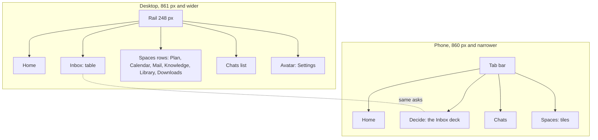
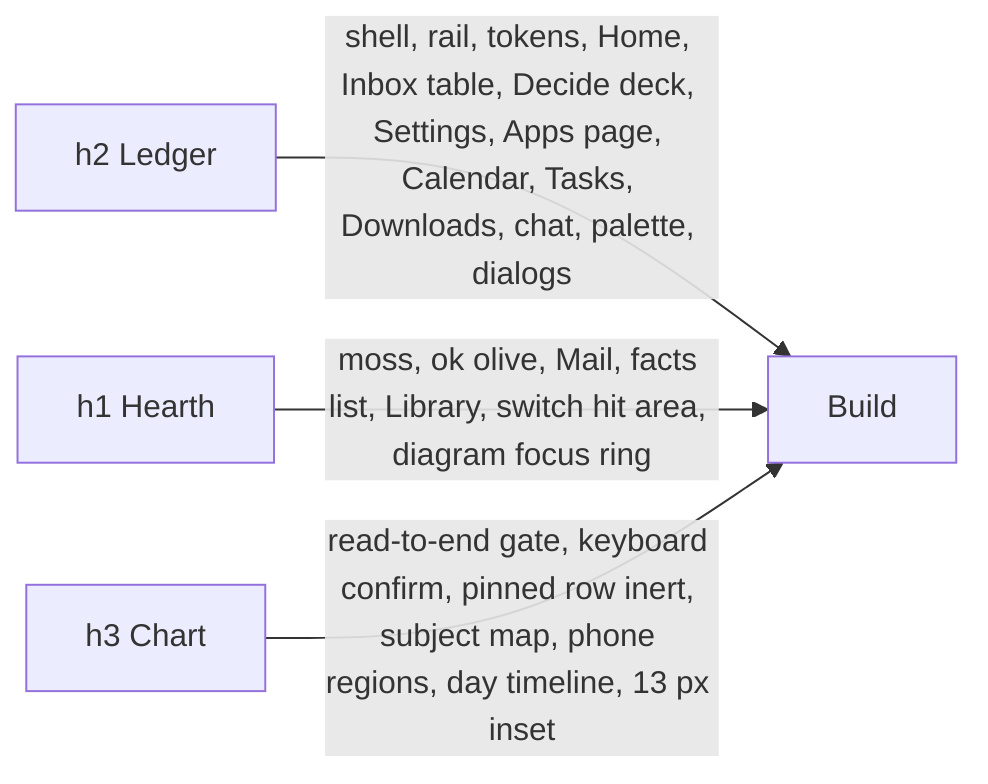
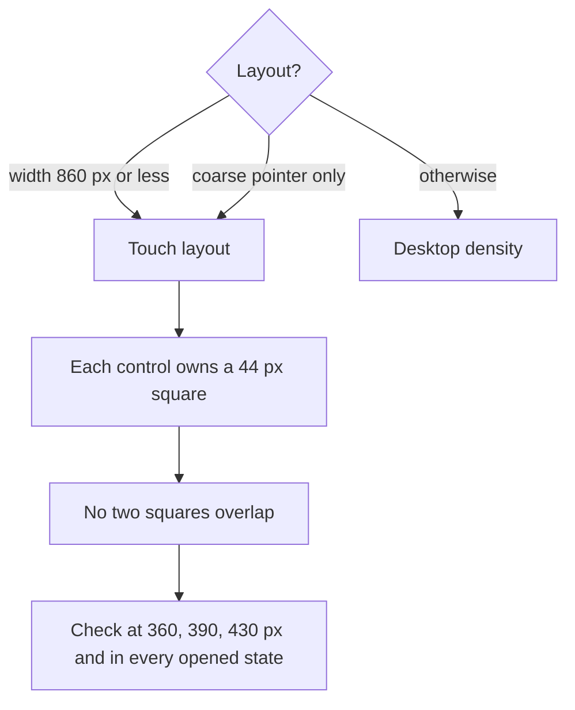
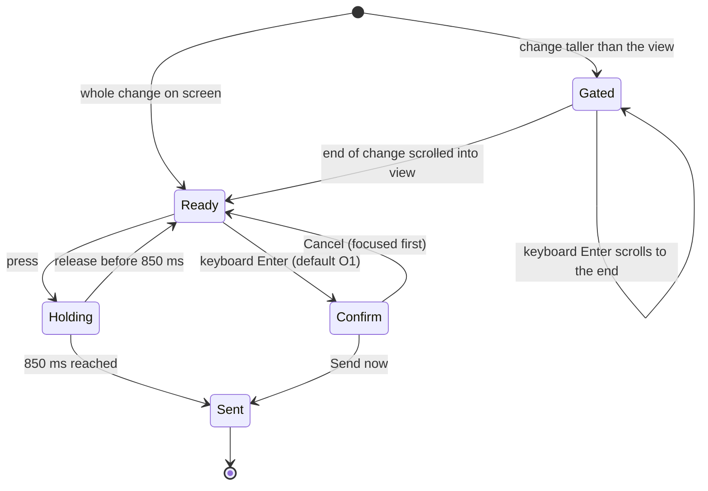

# Final design spec: the chosen hybrid

Status: build source for the implementation plan (D44). Written 2026-11-15 after round 4 decisions D36 to D44 ([decisions.md](decisions.md)); updated the same day with the rounded-corner audit (`hybrid-evaluation.md` §10) and with every open point resolved to its default (§8), because the build is authorized and runs unattended. The implementer does not choose anything listed in §8; the operator may veto any default.

No single prototype shows the chosen design. It is h2 Ledger as the base (D36), with h1 Hearth's moss accent and olive "ok" (D37), h1's Mail, Knowledge facts and Library (D38), h3 Chart's subject map, read-to-the-end gate and optional day timeline (D39, D40, D42). This file says where each part lives in the prototypes, what to change, and how to check the result. The reasoning is in research notes: `reports/02-design-and-ux.md` §10.

Conventions:

- The prototypes, the screenshots and the design notes cited by bare file name (`hybrid-evaluation.md`, `information-architecture.md`, `modern-web-guidance-notes.md`) are research notes kept outside the repository; every such reference is plain text.
- Prototype paths name research notes: `prototypes/design/h1/`, `h2/`, `h3/`. Line numbers are as of 2026-11-15.
- Screenshots are in research notes: `hybrid-shots/`.
- "Computed" means I calculated the value from the token values (OKLab distance, WCAG contrast from OKLCH converted to sRGB). It was not measured on a rendered screen.
- `[INFERENCE]` marks anything not observed.

## Contents

1. [Decisions this spec builds](#1-decisions-this-spec-builds)
2. [Provenance: where each part comes from](#2-provenance-where-each-part-comes-from)
3. [Tokens](#3-tokens)
4. [Component kit](#4-component-kit)
5. [Layout rules per form factor](#5-layout-rules-per-form-factor)
6. [Interaction rules](#6-interaction-rules)
7. [Acceptance checks](#7-acceptance-checks)
8. [Open points: defaults taken](#8-open-points-defaults-taken)
9. [Never checked](#9-never-checked)
10. [Sources](#10-sources)

## 1. Decisions this spec builds

| Id | Decision | Where it lands here |
|---|---|---|
| D27, D28 | A's design system and desktop structure; C's phone interface; browns, beiges and tans; no blue; no serif; rounded corners; real size variation | §3, §5 |
| D30 | Plain Svelte 5 with sv-router and TanStack Svelte Query | §4 (components are built in it) |
| D32 | Sends that cannot be undone: press and hold on phone, 10 s Undo on desktop | §6 R-HOLD |
| D36 | Base h2 Ledger: A's system and desktop shell, C's phone, rebuilt Apps settings page, one-row phone composer | §2 |
| D37 | Accent moss; "ok" its own olive with check icon and outlined tag; brown neutrals; no blue | §3.1 |
| D38 | Tables only for Inbox and Settings; Mail, Knowledge facts, Library keep A's cards and lists as in h1 | §2, §5 |
| D39 | Knowledge opens on a page; subject map one key or tap away | §2, §5 |
| D40 | Home: compact weather card; day timeline optional | §2 |
| D41 | Strict touch rule in touch layouts only; desktop keeps density | §5.3, §7 |
| D42 | P2.1 and P2.3 accepted; inbox named "Inbox"; phone tab stays "Decide" | §6 |
| D43 | Every visible surface, control, row group, table, image and diagram node is rounded | §3.5, §7 |

Navigation in the build:

Rail and tab labels beyond "Inbox", "Decide" and "Home" are defaults taken in §8 (O5, O6); the operator may veto them.

## 2. Provenance: where each part comes from

| # | Part | Reference (file, function or selector, line) | Change required by the decisions | Screenshot |
|---|---|---|---|---|
| 1 | Tokens, base layer | `h2/style.css` `@layer tokens` lines 30 to 103 | Replace the four `--umber*` tokens with h1's `--moss*`; replace `--olive` as "ok" with h1's `--ok` (§3.1). 134 lines reference `umber` across `h2/style.css` (100), `ledger.css` (14), `spaces.js` (12), `core.js` (4), `app.js` (4) | `hybrid-shots/q1-h1-today-desktop-light.png` (moss), `hybrid-shots/q1-h2-today-desktop-light.png` (shell) |
| 2 | Desktop shell and rail | `h2/style.css` `.app` grid line 137, `.rail-link` lines 157 to 174; `h2/app.js` `renderRail` line 217; rail width 248 px at `h2/ledger.css` line 49 | Accent swap; rail labels per §8 O5 | `hybrid-shots/h2-today-desktop-light.webp` |
| 3 | Home | `h2/app.js` `renderHome` line 272, `handledDigest` line 364 | Accent swap only | `hybrid-shots/q4-h2-today-desktop-light.png` |
| 4 | Home weather card | `h2/app.js` `weatherCard` line 320; `h2/ledger.css` home weather line 206 | Keep as the default (D40) | `hybrid-shots/q4-h2-today-desktop-light.png` |
| 5 | Day timeline, optional view | `h3/diagrams.js` `daylineSVG` line 273, `A.dayline` line 313 | Re-skin in h2 tokens; reachable from the weather card (§8 O12); off by default (D40) | `hybrid-shots/q4-h3-today-desktop-light.png` |
| 6 | Phone composer, one row | `h2/ledger.css` lines 351 to 369 | Text inset while typing 13 px as in h3 (§8 O3); h2 has 5 px | `hybrid-shots/r4c-h1-composer-typing-phone.png` (5 px inset, h1 shares h2's composer) |
| 7 | Inbox, desktop table | `h2/spaces.js` `SPACES.review` line 729, table line 755; `h2/ledger.js` `A.dtable` line 17; `h2/ledger.css` `.dtable` lines 9 to 36 | Keep (D38); round the table container (D43) | `hybrid-shots/q2-h2-review-desktop-light.png`, `hybrid-shots/h2-review-desktop-light.webp` |
| 8 | Inbox on phone: the Decide deck | `h2/app.js` `renderTabbar` line 156 (tabs at line 148); hold handlers lines 943 to 963; `h2/core.js` hold button line 320; next card armed after 900 ms (`h2/style.css` line 1411; `h3/app.js` line 693) | Add h3's read-to-the-end gate (`h3/app.js` lines 857 to 871, `h3/core.js` line 333) for P2.1; keyboard path per §8 O1 (`h3/app.js` line 815); pinned row inert off screen per §8 O2 (`h3/app.js` line 871) | `hybrid-shots/r4b-h3-decide-draft-rest.png`, `hybrid-shots/r4b-h3-decide-hold-during.png`, `hybrid-shots/h2-t10-phone-after-hold.webp` |
| 9 | Mail | `h1/spaces.js` `SPACES.mail` line 171; `sankey` line 57; phone `flowStacks` line 98; `decRow` line 122; `ruleCard` line 131; `decInspector` line 150 | Port into the h2 shell with h2 tokens and moss. Do not use h2's Mail tables (`h2/spaces.js` lines 182, 205) (D38) | `hybrid-shots/h1-mail-desktop-light.webp`, `hybrid-shots/h1-mail-mobile-light.webp`, `hybrid-shots/r4b-h1-mail-band-focus.png` |
| 10 | Knowledge page (opening view) | `h2/spaces.js` `kbPage` line 425 (title first on phone, metadata margin on desktop); `SPACES.knowledge` line 486 | Opens on a page (D39). Facts render as h1's list rows, not h2's Facts table (`h2/spaces.js` line 509) | `hybrid-shots/q3-h1-knowledge-desktop-light.png`, `hybrid-shots/r4b-h2-knowledge-phone-light.png` |
| 11 | Knowledge facts list | `h1/spaces.js` `recRow` line 443 inside `SPACES.knowledge` line 446 | Port into the h2 shell (D38) | `hybrid-shots/h1-knowledge-records-desktop-light.webp` |
| 12 | Subject map, desktop | `h3/diagrams.js` `kmapSVG` line 103, `A.kmap` line 146, `A.twin` line 16 (list twin), `setView` line 26 (M and L keys) | Map is one key (M) away, not the opening view (D39); L returns to the list twin | `hybrid-shots/q3-h3-knowledge-desktop-light.png`, `hybrid-shots/h3-knowledge-desktop-light.webp` |
| 13 | Subject regions, phone | `h3/diagrams.js` `kOverview` line 121 | One tap from the page (D39); h3 opens on it, the build does not | `hybrid-shots/r4b-h3-knowledge-phone-light.png` |
| 14 | Library | `h1/spaces.js` `SPACES.library` line 805 | Port into the h2 shell. Do not use h2's Library tables (`h2/spaces.js` lines 900, 912) (D38) | `hybrid-shots/h1-library-desktop-light.webp` |
| 15 | Settings, including Health | `h2/spaces.js` `SPACES.settings` line 982, Health table line 993 | Keep tables (D38); add a row action so repair is two presses (§8 O9) | `hybrid-shots/h2-settings-desktop-light.webp` |
| 16 | Apps settings page with switches | `h2/spaces.js` lines 1062 to 1067; switch hit area as `h1/style.css` H1-1 rule after line 1610 (`button.switch`, 44 px hit, 44 by 26 track) | Keep (D36); place per report Q2.11 | `hybrid-shots/h2-settings-modules-desktop-light.webp` |
| 17 | Off app hides asks and counts | `h2/core.js` `appOn` and `A.openAsks` lines 185 to 186 | Keep (P2.3, D42) | `hybrid-evaluation.md` §9.6 (H2-9) |
| 18 | Calendar | `h2/spaces.js` `SPACES.calendar` line 323; `h2/core.js` `A.calSoft` line 78 uses `--umber-soft` | Accent swap in `A.calSoft` | `hybrid-shots/h2-calendar-desktop-light.webp` |
| 19 | Tasks (Plan) | `h2/spaces.js` `SPACES.tasks` line 633 | Accent swap only | `hybrid-shots/h2-tasks-desktop-light.webp` |
| 20 | Downloads | `h2/spaces.js` `SPACES.downloads` line 790 | Accent swap only | `hybrid-shots/h2-torrents-desktop-light.webp` |
| 21 | Chat and tool cards | `h2/app.js` `renderThread` line 381 | Accent swap only | `hybrid-shots/h2-ask-desktop-light.webp` |
| 22 | Command palette | `h2/palette.js` `A.openPalette` line 131; combobox line 45, listbox line 47 | Keep; it is the G6 combobox and listbox reference (§4) | none taken |
| 23 | Dialogs, sheets, canvas | `h2/index.html` `#canvas` line 79, `#navsheet` line 84, `#modal` line 85; `h2/core.js` `A.confirm` line 154, `A.toast` line 135 | Keep; round every surface (D43) | `hybrid-shots/h3-schedule-confirm-phone.webp` (same pattern) |
| 24 | Canvas as overlay between 861 and 1239 px | `h2/style.css` line 1309 | Keep | none taken |
| 25 | Focus ring on diagram parts | `h1/style.css` repair block after line 1599 (`#f-focus` filter, `svg g[tabindex]:focus-visible`) | Apply to Mail flow, subject map, timeline | `hybrid-shots/r4b-h1-mail-band-focus.png` |

## 3. Tokens

All colors use `light-dark()` with `color-scheme: light dark` as in h2 (`h2/style.css` line 30 onward). Light / dark.

### 3.1 Color

| Role | Token | Light | Dark | Source | Action |
|---|---|---|---|---|---|
| Page | `--paper` | `oklch(0.972 0.007 80)` | `oklch(0.188 0.008 75)` | `h2/style.css:32` | Keep |
| Page, recessed | `--paper-2` | `oklch(0.952 0.009 80)` | `oklch(0.162 0.007 75)` | `h2/style.css:33` | Keep |
| Surface | `--leaf` | `oklch(0.993 0.004 80)` | `oklch(0.228 0.009 75)` | `h2/style.css:34` | Keep |
| Surface, raised | `--leaf-2` | `oklch(0.982 0.006 80)` | `oklch(0.258 0.010 75)` | `h2/style.css:35` | Keep |
| Line | `--line` | `oklch(0.900 0.010 80)` | `oklch(0.320 0.010 75)` | `h2/style.css:36` | Keep, decorative only |
| Line, strong | `--line-strong` | `oklch(0.700 0.012 80)` | `oklch(0.520 0.012 75)` | `h2/style.css:37` | Recheck: light computes 2.46:1 on paper; see §3.2 |
| Ink | `--ink` | `oklch(0.255 0.014 70)` | `oklch(0.940 0.008 80)` | `h2/style.css:38` | Keep |
| Ink, secondary | `--ink-2` | `oklch(0.430 0.014 70)` | `oklch(0.800 0.010 80)` | `h2/style.css:39` | Keep |
| Ink, tertiary | `--ink-3` | `oklch(0.515 0.012 70)` | `oklch(0.700 0.010 80)` | `h2/style.css:40` | Keep |
| Accent | `--moss` | `oklch(0.470 0.085 150)` | `oklch(0.790 0.095 150)` | `h1/style.css:43` | **Replaces `--umber`** (`h2/style.css:43`) |
| Text on accent | `--moss-ink` | `oklch(0.975 0.012 150)` | `oklch(0.190 0.025 150)` | `h1/style.css:44` | **Replaces `--umber-ink`** (`h2/style.css:44`) |
| Accent tint | `--moss-soft` | `oklch(0.935 0.024 128)` | `oklch(0.300 0.032 128)` | `h1/style.css:1597` (repair; line 45 is the older hue 150 value) | **Replaces `--umber-soft`** (`h2/style.css:45`) |
| Accent line | `--moss-line` | `oklch(0.800 0.055 150)` | `oklch(0.440 0.060 150)` | `h1/style.css:46` | **Replaces `--umber-line`** (`h2/style.css:46`); decorative only (§3.2) |
| State: ok | `--ok` | `oklch(0.390 0.080 105)` | `oklch(0.700 0.120 108)` | `h1/style.css:1594` | **Replaces `--olive`** (`h2/style.css:49`) for every "ok" use |
| State: ok tint | `--ok-soft` | `oklch(0.945 0.030 105)` | `oklch(0.315 0.035 110)` | `h1/style.css:1595` | **Replaces `--olive-soft`** (`h2/style.css:50`) |
| State: needs you | `--honey` | `oklch(0.530 0.120 82)` | `oklch(0.850 0.125 88)` | `h2/style.css:51` | Keep h2's (§8 O11) |
| Needs you tint, line | `--honey-soft`, `--honey-line` | `oklch(0.950 0.045 90)`, `oklch(0.800 0.100 85)` | `oklch(0.320 0.050 82)`, `oklch(0.500 0.080 82)` | `h2/style.css:52-53` | Keep |
| State: risk | `--brick`, `--brick-soft` | `oklch(0.505 0.150 30)`, `oklch(0.945 0.030 30)` | `oklch(0.760 0.120 30)`, `oklch(0.300 0.050 30)` | `h2/style.css:54-55` | Keep |
| Info | `--taupe`, `--taupe-soft` | `oklch(0.480 0.030 60)`, `oklch(0.938 0.012 70)` | `oklch(0.780 0.030 72)`, `oklch(0.290 0.016 70)` | `h2/style.css:56-57` | Keep; outline treatment only (§8 O8) |
| Data series | `--d1` to `--d6` | moss 150, umber 52, ochre 75, olive 112, stone 80, brick 30 | same hues, lighter | `h1/style.css:58-63` | **Replaces h2's `--d1` to `--d6`** (`h2/style.css:60-65`) because Mail comes from h1 (§8 O7) |

Base rules that name the accent and must switch to moss: link color, `:focus-visible` outline and `::selection` (`h2/style.css` lines 122 to 124); primary button (lines 308 to 309); composer focus (line 345). h1 has the same rules already on moss (`h1/style.css` lines 121, 122, 343).

"ok" carries a second cue besides color (D37): a check mark before the label and an outlined tag (`h1/style.css` `.tag--moss` and `::before` "✓", lines 1599 to 1600).

### 3.2 Contrast and distance pairs to recheck after the swap

The evaluator measured h1's moss in h1's shell and h2's umber in h2's shell (`hybrid-evaluation.md` §9.4). Nobody has measured moss in h2's shell. The neutrals are identical in h1 and h2, so most pairs should hold `[INFERENCE]`.

| Pair | Need | Measured (h1 shell) | Computed (tokens) | Status |
|---|---|---|---|---|
| `--moss` text on `--paper` | 4.5:1 | 6.41 / 9.09 | 6.04 / 9.95 | Recheck on screen |
| `--moss` text on `--leaf` | 4.5:1 | not reported | 6.42 / 9.11 | Recheck |
| `--moss-ink` on `--moss` (primary button) | 4.5:1 | 6.12 / 9.84 | 6.12 / 9.85 | Recheck |
| `--moss` on `--moss-soft` (live chip) | 4.5:1 | not reported | 5.45 / 7.25 | Recheck |
| `--ok` on `--ok-soft` (ok tag) | 4.5:1 | 8.09 / 4.92 | 8.14 / 4.88 | Dark is close to the floor; recheck |
| `--ok` on `--paper` | 4.5:1 | 8.28 / 7.40 | 8.78 / 7.05 | Recheck |
| Focus ring (`--moss`) against adjacent surface | 3:1 | 5.4 to 9.1 | 6.0 to 10.4 | Recheck |
| `--moss-line` as a meaningful boundary | 3:1 | not reported | 1.69 / 2.46 | **Fails if used as the only boundary** of a control or a meaningful graphic. Keep decorative, or use L 0.62 in light (computed 3.28:1) |
| `--line-strong` as a control boundary | 3:1 | not reported | 2.46 / 3.36 | **Light fails if it is the only boundary of an input.** Proposed light value `oklch(0.640 0.012 80)` (computed 3.10:1 on paper, 3.30 on leaf) |
| `--honey` on `--honey-soft` (rail count) | 4.5:1 | not reported | 4.62 / 8.03 | Light is close to the floor; recheck |
| Placeholders | 4.5:1 | 4.5 or more in all three hybrids | not computed | Recheck in the h2 shell |

Accent to state distance (OKLab ΔE; below 0.06 confusable, 0.06 to 0.10 near and needs a second cue, 0.10 and up clear: `hybrid-evaluation.md` §9.3, §9.4):

| Moss to | Measured, h1 shell | Computed with the build's tokens | Reading |
|---|---|---|---|
| `--ok` (h1) | 0.102 / 0.120 | 0.102 / 0.121 | Clear; check mark adds a cue |
| `--honey` (h2) | 0.144 / 0.141 (with h1's honey) | 0.133 / 0.131 | Clear |
| `--brick` | 0.188 / 0.163 | 0.209 / 0.189 | Clear |
| `--taupe` (info) | not measured | 0.091 / 0.094 | **Near**; info uses outline and label (§8 O8) |
| h2 `--olive` | not measured | 0.048 (light) | **Confusable**; this is why h2's olive cannot be "ok" with moss |
| `--d1` (h1, moss 150) | not measured | 0.090 / 0.070 | Near; acceptable because series are labeled and have a table twin |

Data series pairs: the closest h1 pair is 0.057 light (`--d1` to `--d4`) and 0.059 dark (`--d2` to `--d3`), computed. h2's series has the same problem (0.062 / 0.053). Every diagram therefore keeps direct labels and a list or table twin (§6 R-VIS). Every h1 series color computes 3.15:1 or more on paper in light, so they pass 3:1 for graphics.

### 3.3 Type

| Token | Value | Use | Source |
|---|---|---|---|
| `--font-sans` | "Alegreya Sans", "Gill Sans", "Seravek", "Optima", ui-sans-serif, sans-serif | All UI and reading text | `h2/style.css:68` |
| `--font-read` | `var(--font-sans)` | Reading surfaces, longer line height | `h2/style.css:69` |
| `--font-mono` | "Fira Mono", ui-monospace, "SF Mono", Menlo, monospace | Ids, tool arguments | `h2/style.css:70` |
| `--t-xs` | 0.8125rem (13 px) | Meta, tool card labels | `h2/style.css:71` |
| `--t-sm` | 0.9375rem (15 px) | Secondary UI | `h2/style.css:72` |
| `--t-md` | 1.0625rem (17 px) | Body, transcript | `h2/style.css:73` |
| `--t-lg` | 1.25rem (20 px) | Card titles | `h2/style.css:74` |
| `--t-xl` | 1.625rem (26 px) | Space titles | `h2/style.css:75` |
| `--t-2xl` | 2.25rem (36 px) | Knowledge page titles | `h2/style.css:76` |
| `--t-3xl` | clamp(2.25rem, 1.6rem + 2.4vw, 3.25rem) | Home greeting | `h2/style.css:77` |
| `--lh-tight`, `--lh-body`, `--lh-read` | 1.15, 1.5, 1.65 | Headings, UI, reading | `h2/style.css:78-80` |

Rules: no serif anywhere (D27); 12 px floor; phone inputs 16 px so iOS does not zoom (`hybrid-evaluation.md` §2.1 rule 2) `[INFERENCE: the zoom reason is the common iOS behavior, not tested here]`.

### 3.4 Space, size, layout

| Token | Value | Source |
|---|---|---|
| `--s-1` to `--s-9` | 4, 8, 12, 16, 24, 32, 48, 64, 96 px | `h2/style.css:83-84` |
| `--rail-w` | 272 px; 248 px at 861 px and wider | `h2/style.css:100`; `h2/ledger.css:49` |
| `--read-w` | 46rem | `h2/style.css:101` |
| `--target` | 44 px | `h2/style.css:102` |
| `--row` / `--row-phone` | 36 px / 48 px table rows | `h2/ledger.css:5` |

### 3.5 Radius (D43)

| Token | Value | Applies to | Source |
|---|---|---|---|
| `--r-sm` | 10 px | Buttons, inputs, rail links, tags, images in lists, diagram nodes | `h2/style.css:87` |
| `--r-md` | 16 px | Cards, table containers, row groups, composer, menus | `h2/style.css:87` |
| `--r-lg` | 24 px | Dialogs, sheets (top corners), canvas | `h2/style.css:87` |
| `--r-pill` | 999 px | Chips, counts, segmented controls, switch track | `h2/style.css:87` |

Rule P2.4 (D43; `hybrid-evaluation.md` §10.5):

| Rule | Detail |
|---|---|
| Radius only from the token scale | `--r-sm` controls, rows that stand alone, highlights, badges; `--r-md` cards, table frames, popovers; `--r-lg` sheets, the canvas, large panels; `--r-pill` chips and pills |
| A child may be square only where a rounded parent clips it | Parent uses `overflow: clip` or `hidden`; for example table cells, grid cells and list rows inside a framed list |
| Joined segments are rounded at the joints | Segments with a gap take `--r-sm` or half the bar height, whichever is smaller, at every end |
| Only edges that touch the window may be square | Window edges of the rail, the top bar, the tab bar and the bottom of a sheet |
| A pane that meets content inside the window | Either a hairline seam with no surface change, or rounded inner corners |
| The canvas beside the chat | Rounded inner corners (`--r-lg`) or floats with a gap; default in §8 O10 |

Enforcement (`hybrid-evaluation.md` §10.6): a stylelint `declaration-property-value-allowed-list` rule for properties matching `/radius/` that allows only `var(--r-*)`, `inherit`, and `0` with a `/* clipped by parent */` or `/* window edge */` comment; and the evaluator's corner audit script (§10.1, about 80 lines over computed styles and boxes) in the Playwright visual pass at 1440 and 390 plus overlay states (§7 C3). The fixes for the ten most visible cases are in §8 O10.

### 3.6 Shadow and motion

| Token | Value | Source |
|---|---|---|
| `--shadow-1` | `0 1px 2px` warm 6% / black 30% | `h2/style.css:90` |
| `--shadow-2` | two layers, up to `0 8px 24px` | `h2/style.css:91` |
| `--shadow-3` | two layers, up to `0 24px 64px` | `h2/style.css:92` |
| `--ease` | cubic-bezier(0.25, 1, 0.5, 1) | `h2/style.css:95` |
| `--ease-in-out` | cubic-bezier(0.65, 0, 0.35, 1) | `h2/style.css:96` |
| `--dur-1`, `--dur-2`, `--dur-3` | 120, 220, 380 ms | `h2/style.css:97` |

Motion animates transform and opacity only. Under `prefers-reduced-motion: reduce`, movement stops and only opacity changes remain, as in `h2/style.css` lines 864, 1257 and 1411. The hold progress still shows, as a fill without travel, and the hold time is 600 ms (`h2/app.js:933`) (default taken, operator may veto).

### 3.7 Breakpoints and pointer

| Range | Layout | Source |
|---|---|---|
| 320 to 860 px | Phone layer: tab bar, Decide deck, sheets, docked composer; strict touch rule | `h2/app.js:8` `(max-width: 860px)`; `h2/style.css` phone layer from line 1383 |
| 861 to 1239 px | Desktop with rail; canvas opens as an overlay | `h2/style.css:1309` |
| 1240 px and wider | Desktop with rail; canvas beside the conversation | `h2/style.css:1306` [INFERENCE: wide layout is the default outside the overlay range] |
| Any width with a coarse primary pointer and no fine pointer | Strict touch rule also applies (§8 O4) | Default taken, operator may veto |

Safe areas: `env(safe-area-inset-*)` on the tab bar, composer and sheets (`h2/style.css` lines 214, 269 to 287).

## 4. Component kit

Keyboard behavior follows the WAI-ARIA Authoring Practices pattern named in each row. "Touch" means the touch layout rule (§5.3): the control owns a 44 by 44 px square that overlaps no other. "Desktop" means the pointer layout: the visible target may be smaller (`--row` 36 px, rail links 40 px).

G6 in report 1 needs dialog, menu, combobox, tabs and listbox (research notes: `reports/01-frontend-extraction.md` lines 381, 689, Q1.5). They are marked **G6**.

| Component | States | Keyboard | Touch | Guide ids | Reference |
|---|---|---|---|---|---|
| Button: primary, secondary, quiet, danger | rest, hover, focus-visible, active, pending (spinner plus label kept), disabled with reason | Enter, Space | 44 square | `custom-button-actions`, `accessibility` | `h2/style.css:308` |
| Hold to send button | rest, gated ("More below. Read to the end to send", `aria-disabled`), holding (fill), sent, cancelled | See §6 R-HOLD and §8 O1 | 44 square; hold 850 ms | `accessibility`, `motion` | `h2/core.js:320`; `h3/app.js:815, 857-871`; `h3/core.js:333` |
| **Dialog** (confirm, modal) | open, closing, pending on confirm | Focus moves in; Tab cycles; Escape closes unless pending; focus returns to the opener; confirm for sends opens with focus on Cancel | Buttons 44 square | `dialog`, `declarative-dialog-popover-control`, `light-dismiss-a-dialog`, `platform-controls-dismiss-dialog`, `prevent-page-scroll-under-modal-dialog`, `animate-to-from-top-layer` | `h2/index.html:85`; `h2/core.js:154` |
| Sheet (phone dialog from the bottom) | open, dragging, closing | As dialog | Handle and buttons 44 square | `dialog`, `navigation-drawer` | `h2/index.html:84` (`#navsheet`) |
| Canvas (object beside the chat or as overlay) | open, overlay (861 to 1239 px), sheet (phone) | As dialog when overlay; region when beside | As sheet on phone | `dialog`, `size-aware-styling` | `h2/index.html:79` |
| **Menu** (row "More", avatar menu, card overflow) | closed, open, item focus, item disabled | Enter, Space or Down opens; arrows move; Home, End; Escape closes and returns focus; type-ahead | Items 44 tall | `menu`, `app-menus`, `viewport-aware-dropdowns`, `anchor-positioning-tab-underline` | none in h2; build new `[INFERENCE: no role="menu" found in h2]` |
| **Combobox** (palette input; place picker; folder picker in the correction panel) | empty, typing, results, no results, loading | Down opens or moves; Enter picks; Escape clears then closes; `aria-activedescendant` | Input 44 tall, options 44 tall | `viewport-aware-dropdowns`, `ime-safe-enter-submit` | `h2/palette.js:45` |
| **Listbox** (palette results; single choice lists) | option, selected, focused, disabled | Arrows, Home, End, type-ahead; Enter picks | Options 44 tall | `viewport-aware-dropdowns` | `h2/palette.js:47` |
| **Tabs** (Knowledge: Page, Facts, Review, About me; Mail: Flow, Mode; Settings sections) | selected, focus, disabled | Arrows move and select; Home, End; Tab leaves the tab list | Tabs 44 tall | `tabs`, `anchor-positioning-tab-underline` | h2 uses `aria-pressed` segment groups (`h2/spaces.js:506`); tabs must be built as `role="tablist"` |
| Segmented control (filters, theme, effort) | pressed, focus | Tab to each button, Space toggles | Each 44 square | `toolbar` | `h2/app.js:559, 645` |
| Switch (app on and off, rule on) | on, off, pending, set by host (read-only) | Space toggles | 44 square hit, 44 by 26 track | `switch` | `h1/style.css` H1-1; `h2/spaces.js:1062-1067` |
| Toast with Undo | shown 10 s, paused on hover or focus, dismissed | Undo reachable by Tab; does not steal focus | Undo 44 square | `persistent-toast-notifications` | `h2/core.js:135` |
| Data table (Inbox, Settings only) | rows, selected row, sorted, empty, loading skeleton | Tab into the table, arrows between rows, Enter opens; sort buttons `aria-pressed` | Phone rows 48 px; phone shows `phoneList` | `responsive-table`, `sortable-table`, `state-aware-sticky-headers` | `h2/ledger.js:17, 44`; `h2/ledger.css:9-36` |
| List row and card (Mail decisions, facts, Library) | rest, selected, unread where it exists, pending | Tab, Enter | 44 square per control | `interactions-in-complex-layouts` | `h1/spaces.js:122, 443` |
| Approval card (six parts) | needs you, pending, decided here, decided elsewhere (controls disabled with "Decided on iPhone at 09:02"), blocked | Tab order follows the parts; primary named for the consequence | Controls 44 square, at most four | `accessibility` | report §4 "Approvals" |
| Tool card | collapsed, expanded, running, failed | Enter toggles; collapsed text uses `hidden="until-found"` | Toggle 44 tall | `search-hidden-content` | `h2/app.js:381` |
| Composer | empty, typing (grows), sending, blocked (with reason) | Enter sends only when not composing (IME); Shift Enter newline | Send 44 square | `ime-safe-enter-submit` | `h2/ledger.css:351-369` |
| Field with validation | rest, invalid after interaction, required, saving, saved tick | Error linked with `aria-describedby`; announced politely | 44 tall | `validate-input-after-interaction`, `accessible-error-announcement`, `required-field-feedback`, `forms` | report §4 save modes |
| Tag and status | ok (check plus outline), needs you, risk, info (outline) | not focusable | n/a | `color` | `h1/style.css:1599-1600` |
| Diagram with twin (Mail flow, subject map, timeline) | default, focused node or band, filtered, twin view | Tab to nodes; Enter filters; M and L switch map and list | Nodes 44 square in touch layouts | `accessibility`, `scrollability-affordance-hints` | `h3/diagrams.js:16, 26`; `h1/spaces.js:57` |
| Tab bar (phone) | current (`aria-current="page"`), badge | Tab, Enter | Each tab 44 square or more | `navbar` | `h2/app.js:156` |
| Rail link (desktop) | current, count, live dot | Tab, Enter | 40 px tall on desktop; 44 px in touch layouts (`h2/style.css:1373`) | `navbar` | `h2/style.css:157-174` |
| Seven view states | empty, loading, error, offline, blocked, pending, partial | n/a | n/a | `accessibility` | report §4 R30 |

## 5. Layout rules per form factor

### 5.1 Desktop (861 px and wider, fine pointer)

| Screen | Layout | Density |
|---|---|---|
| Home | Composer as hero; Needs you list; compact weather card; Handled digest of at most five lines | A's |
| Inbox | Table (D38) with detail beside | h2: 36 px rows |
| Mail | h1's flow diagram above decision cards; rules beside decisions | A's cards (D38) |
| Knowledge | Opens on a page with metadata margin; M opens the subject map; Facts is a list | A's lists (D38) |
| Library | h1's cards and lists | A's (D38) |
| Settings | Tables for Health and Apps | h2 (D38) |
| Calendar, Plan, Downloads, Chats | h2's views | h2 |

### 5.2 Phone (360 to 860 px)

| Screen | Layout |
|---|---|
| Home | Weather card, Needs you list, one-row docked composer above the tab bar |
| Decide | One card at a time; full exact change visible; action row pinned; next card inert 900 ms after a decision |
| Inbox table | Becomes `phoneList` rows of 48 px (`h2/ledger.js:44`) |
| Mail | h1's stacked flow (`flowStacks`) and decision rows |
| Knowledge | Page with title first; subject regions one tap away |
| Spaces | Tiles for the remaining destinations |
| Objects from chat | Open as a bottom sheet |

The composer stays above the fold and above the on-screen keyboard. At rest it is 50 px tall and grows while typing (to 118 px in the evaluator's run) (`hybrid-evaluation.md` §9.1, §9.4).

### 5.3 Touch rule (D41)

Applies in every touch layout (§3.7), on every page and in every opened state (sheets, menus, dialogs). Each tappable control owns a 44 by 44 px square around its center that overlaps no other control's square and lies wholly on that control's hit area. The visible control may be smaller. On desktop with a fine pointer the rule does not apply; A's density stays.

## 6. Interaction rules

R ids are from `information-architecture.md` (summarized in report §4). P ids are from report §10.

| Id | Rule | Status |
|---|---|---|
| R1 | A switch or select never performs a commit-class change | Decided earlier |
| R2 | A model change is staged in the scope chip with its price effect and applies from the next message | Decided earlier |
| R7 | Read mode is the default; edit is entered on purpose | Decided earlier |
| R9 | A consequential button names its consequence ("Send email to Sam"), never "OK" | Decided earlier |
| R10 | Only Send starts paid work | Decided earlier |
| R11 | Opening a page, link or notification never writes | Decided earlier |
| R15, R16 | Irreversible actions confirm by naming object and verb; purge needs typing a name or count | Decided earlier |
| R17 | "Never ask again" is its own named action with its own confirm | Decided earlier |
| R18 | Stop says what stops and what already happened | Decided earlier |
| R20 | Single-key shortcuts act only on a visibly selected item, only for undoable actions, never in a text field | Decided earlier |
| R24 | A live update never replaces an element that holds focus, a selection, an open menu or unsaved input | Decided earlier |
| R25 | A card decided elsewhere stays, says where and when, and disables its controls | Decided earlier |
| R26 | New items wait behind a "2 new" chip | Decided earlier |
| R28 | Nothing opens, scrolls or takes focus on its own | Decided earlier |
| R30 | Every view defines seven states | Decided earlier |
| R31 to R33 | Response within 100 ms; result or progress within 1 s; INP at or under 200 ms; work over 10 s moves to Running work | Decided earlier |
| R36 | One approval card component everywhere | Decided earlier |
| R37 | One name per thing | Decided earlier, with one decided exception: the phone tab "Decide" opens the Inbox (D42) |
| R38 | Causes in plain words; no "9B" or "kNN" | Decided earlier |
| R40, R41 | 44 px targets in touch layouts; one primary per view | R40 sharpened by D41 |
| R-HOLD | A send that cannot be undone: press and hold 850 ms on phone (600 ms under reduced motion); 10 s Undo on desktop | D32; hold times from `h2/app.js:933`, handlers lines 943 to 963 |
| P2.1 | The full exact change is visible before and during a hold; a send cannot be held until the end of the change has been on screen | Accepted (D42) |
| P2.2 | An action row acts only on a card that is on screen; it goes inert when the card leaves and for a moment after it returns | Default taken (§8 O2), operator may veto |
| P2.3 | An app that is off hides its asks and leaves every count | Accepted (D42) |
| P2.4 | Every visible surface, control, row group, table, image and diagram node is rounded | Accepted (D43) |
| R-ARM | After a decision in Decide, the next card's controls stay inert for 900 ms; a double tap acts once | From C; verified in all hybrids (`hybrid-evaluation.md` §2.3) |
| R-SCHED | Creating a schedule needs a confirm ("Set up a daily check?") | Verified in all hybrids (`hybrid-evaluation.md` §2.3) |
| R-VIS | Every diagram has direct labels and a list or table twin; every node and band is focusable and filters the list | From D27 and report §4 |

Hold to send, phone and keyboard:

## 7. Acceptance checks

Each check runs in Chromium, Firefox and WebKit, in light and dark, unless the row says otherwise. Numbers in "Last seen" are from the hybrids, not from the build.

| # | Check | Method | Pass | Last seen |
|---|---|---|---|---|
| C1 | No blue | Every computed color on every screen, both schemes; hue of saturated colors | 0 colors with chroma above 0.03 and hue 170 to 300 | 0 in all three (`hybrid-evaluation.md` §9.6) |
| C2 | No serif | Computed `font-family` on every text node | Only `--font-sans` and `--font-mono` | Pass (`hybrid-evaluation.md` §2.1 rule 3) |
| C3 | Rounded corners (D43, P2.4) | Stylelint radius allowed-list on every build; the corner audit script from `hybrid-evaluation.md` §10.1 in the Playwright visual pass over every scenario at 1440 and 390 and the overlay states (popovers, menus, palette, toast, sheets, confirm, focus ring) | Lint passes. Audit: 0 class (a) "square by mistake", 0 "b-poke" (square corner poking out of a rounded frame); class (c) "flush with the window" only for allowlisted selectors (rail, top bar, tab bar, sheet bottom); the ten cases in §8 O10 fixed as specified | h2: (a) 2 components, 22 instances; (b) clipped 6 components, 165; b-poke 0; (c) 4 components, 54. h1: 2/22, 5/46, 0, 4/52 (`hybrid-evaluation.md` §10.2) |
| C4 | Contrast AA, both schemes | Text 4.5:1 (3:1 at 24 px or 18.66 px bold); controls, focus rings, graphics 3:1 | All pairs in §3.2 pass on screen | h1 moss pass in h1 shell; moss in h2 shell not measured |
| C5 | Strict touch | At 360, 390, 430 px, landing pages and opened states; 9-point and 25-point probes inside each 44 px square | 0 failures | 0 in all three after repair |
| C6 | No horizontal overflow | `scrollWidth` vs `clientWidth` at 320, 360, 390, 430, 768, 1024, 1280, 1440 px | 0 pages overflow | 0 at 320 to 430 after repair; wider widths not reported `[INFERENCE]` |
| C7 | Composer above the fold | Phone at 360 by 699, 390 by 763, 430 by 851 page size; Home and Chats | Composer fully visible at rest; stays above the keyboard while typing | 50 px at rest in all three (Chromium); keyboard not tested |
| C8 | Reduced motion | Emulate `prefers-reduced-motion: reduce` | No transform animation; hold still shows progress | Rules exist in `h2/style.css:864, 1257, 1411` |
| C9 | Keyboard reach | Tab through every screen; open every menu, dialog, sheet, tab list | Every control reachable; visible focus; focus returns after dialogs; no trap | Not run as a full walk on any hybrid |
| C10 | Hold gate (P2.1) | Long draft in Decide | Hold disabled with cue until end seen; full change visible during hold | h3 pass (`r4b-h3-decide-hold-during.png`) |
| C11 | Off app (P2.3) | Turn Packages off | Its asks gone; Home, rail, tab badge and Decide position drop by its count | 12 off, 13 on in all three |
| C12 | Console | Load every screen | 0 errors | 0 in all three |
| C13 | Ten tasks within budget | Count presses from the start screen | At or under the budget below | Table below |

Press budgets (from the hybrids' counts, `hybrid-evaluation.md` §2.3):

| # | Task | Start | Desktop budget | Phone budget (390 px) |
|---|---|---|---|---|
| T1 | Push to approved card | Push | n/a | 2 |
| T2 | Correct a mail, make a rule | Home | 5 | 6 |
| T3 | Ask; see tool calls and cost | Home | 2 | 2 |
| T4 | Find a person fact, confirm it | Home | 3 | 3 |
| T5 | Add a task, link it | Tasks | 3 | 5 |
| T6 | Undo overnight work | Home | 2 | 2 |
| T7 | Add a download | Downloads | 1 | 3 |
| T8 | Change the budget | Settings | 3 | 5 |
| T9 | Repair a connection | Settings | 2 (h2 needed 3; §8 O9) | 4 |
| T10 | Answer an invitation while Google is broken | Calendar | 4, then 10 s Undo | 6, with hold to send |

## 8. Open points: defaults taken

The build is authorized and unattended. Every point below is resolved to its default. Each is marked "default taken, operator may veto"; the implementer builds the default and does not choose.

| Id | Question | Default taken | Why | Status |
|---|---|---|---|---|
| O1 | Keyboard path through the hold gate | h3's: first Enter scrolls to the end; next Enter opens "Send this now?" with focus on Cancel (`h3/app.js:815`). No held-Space path | Holding a key is hard for some people and is not a standard pattern `[INFERENCE]`; a confirm names the action | Default taken, operator may veto (D42 is silent) |
| O2 | P2.2: action row acts only on a card on screen | Adopted: the row hides and goes inert when its card leaves the view, and stays inert briefly after it returns, as in `h3/app.js:871` | Prevents a pinned hold from sending for a card out of view (`hybrid-evaluation.md` §9.6, H3-10); report Q2.25 | Default taken, operator may veto |
| O3 | Phone composer text inset while typing | 13 px (h3) | h1 and h2 sit at 5 px (`hybrid-evaluation.md` §9.5) | Default taken, operator may veto |
| O4 | What counts as a touch layout | Width 860 px or less, or `(pointer: coarse)` with no fine pointer | Covers tablets in the desktop layout; laptops with touch keep density | Default taken, operator may veto (D41 says "touch layouts") |
| O5 | Desktop rail labels | Home, Inbox, Plan, Calendar, Mail, Knowledge, Library, Downloads; Assistant; chats; avatar for Settings | Report Q2.3 | Default taken, operator may veto |
| O6 | Third phone tab name | "Chats" (h3) rather than h2's "Ask" | Report Q2.6; "Ask" is also the name of a waiting item | Default taken, operator may veto |
| O7 | Data series set | h1's `--d1` to `--d6` | Mail comes from h1 and its diagrams were verified with them | Default taken, operator may veto |
| O8 | Info color near moss (computed 0.091 / 0.094) | Info is always an outline with a text label, never a fill beside moss | C's rule "information an outline" (report §6) | Default taken, operator may veto |
| O9 | Settings Health table costs a press for repair | Row carries its "Repair" action, so T9 is 2 on desktop | `hybrid-evaluation.md` §2.3 | Default taken, operator may veto |
| O10 | Fixes for the ten most visible corner cases (`hybrid-evaluation.md` §10.4) | See the table below | Rule P2.4 (§3.5) | Default taken, operator may veto |
| O11 | Honey hue | h2's (82 / 88) | Base is h2; moss computes clear of it | Default taken, operator may veto |
| O12 | Where the day timeline lives | A "Day" view toggle on the weather card, remembered per device, saved without confirm | D40 makes it optional; no place was named | Default taken, operator may veto |
| O13 | `--line-strong` light value | `oklch(0.640 0.012 80)` where it is a control's only boundary | Computed 2.46:1 today, under 3:1 | Default taken, operator may veto |
| O14 | Merged prototype before code | Not built; the build goes straight from this spec | D44; not requested | Default taken, operator may veto |

O10, the ten cases and their fixes. Selectors and crops are from `hybrid-evaluation.md` §10.3 and `hybrid-shots/corners/`.

| # | Case | Class | Selector in the prototypes | Fix to build | Crop |
|---|---|---|---|---|---|
| 1 | Unconfirmed fact band on Knowledge pages | (a) | `.kpage > div.kpage__lede.fact` | `--r-sm` on all corners, 4 px inline padding so text clears the curve | `corners/h2-a-kpage-lede-fact-1440.png`, `corners/h2-a-kpage-lede-fact-390.png` |
| 2 | Phone Calendar agenda rows, square on the striped left | (a) | `.agenda-day > button.agenda-row` | `--r-sm` on all four; the color stripe becomes an inset `::before` bar with `--r-pill`, not a border | `corners/h2-a-agenda-row-390.png` |
| 3 | Canvas left seam beside the chat at 1440 | (c) | `.stage > dialog.canvas` | Rounded inner corners `--r-lg` on the side facing the chat; window edges stay square | `corners/h2-c-rail-canvas-1440.png` |
| 4 | Phone tab bar top corners | (c) | `nav.tabbar` | Hairline top seam with no surface change (tab bar on the page background); window edges square; allowlisted | none (visible in every viewer shot) |
| 5 | Desktop rail right seam | (c) | `.app > nav.rail` | Hairline seam with no surface change against the stage; window edges square; allowlisted | `corners/h2-c-rail-canvas-1440.png` |
| 6 | Phone mail stacked bar joints | (b) | `.fstack__bar > i` | Each segment rounded at both ends with `min(var(--r-sm), height / 2)`; keep the 2 px gap | `corners/h1-b-fstack-bar-390.png` (Mail comes from h1) |
| 7 | Selected-row tint in tables | (b) | `.dtable td` selected row | Tint drawn as an inset highlight with `--r-sm`; the stripe as an inset `--r-pill` bar | `corners/h2-b-dtable-header-1440.png` |
| 8 | Week grid cells | (b) | `.week > div.week__day`, `.week__allday`, `.week__head > div` | Cells stay square, clipped by the `--r-md` week frame (allowed); any tinted cell (today, selection) uses an inset `--r-sm` highlight | `corners/h2-b-week-grid-1440.png` |
| 9 | Phone sheet bottom corners | (c) | `dialog.navsheet` | Square at the window edge (allowlisted); top corners `--r-lg` | `corners/h2-c-navsheet-390.png` |
| 10 | Pinned Decide action row top corners | (b) | `.ask__inner > div.ask__controls` | Hairline seam on the card's own background, no separate surface or shadow edge, so no corner shows | `corners/h2-b-ask-controls-390.png` |

Also from the audit: the tool-call summary header (`.tool > summary`) and h1's infobox head (`.infobox > div.infobox__head`) are clipped children and stay as they are; the h2 phone list rows (`.dt-list > li.dt-row`) are clipped children and stay square.

## 9. Never checked

| Item | What is unknown | Source |
|---|---|---|
| WebKit and iOS Safari | Only one page was checked in WebKit by builders; the evaluator used Chromium | `hybrid-evaluation.md` §9.8 |
| Real devices | Safe areas, the docked composer over the on-screen keyboard, sheets, hold to send on a notched iPhone | `hybrid-evaluation.md` §8, §9.8 |
| Firefox on NixOS, Helium | No hybrid run | report "Next step" item 5 |
| VoiceOver and other screen readers | No run | `hybrid-evaluation.md` §9.8 |
| People | No readability or task test with the operator or anyone else; press counts only, no timing | `hybrid-evaluation.md` §2.3, §9.8 |
| Moss in the h2 shell | Contrast and distance only computed (§3.2) | this file |
| Scale | 500 decisions, 300 knowledge pages, 40 chats | report "Next step" |
| Live updates under focus, offline | Not prototyped | report §4, "Next step" item 6 |
| Rounded corners in dark and on hover-only surfaces | The audit ran in light only and did not open hover-only surfaces other than the flow tooltip; SVG `path` boxes are not detected | `hybrid-evaluation.md` §10.7 |

## 10. Sources

- [decisions.md](decisions.md) D27 to D44.
- Research notes: `reports/02-design-and-ux.md` §4, §6, §10, Q2.3, Q2.6, Q2.11, Q2.25.
- Research notes: `reports/01-frontend-extraction.md` lines 381, 689, 698, Q1.5 (G6).
- `hybrid-evaluation.md` §2.1, §2.3, §8, §9.1 to §9.8.
- `information-architecture.md` rules R1 to R43.
- `modern-web-guidance-notes.md` and the prototypes' `NOTES.md` files for the guide ids in §4.
- Prototypes (research notes): `prototypes/design/h1/`, `h2/`, `h3/` (files and lines as cited).
- Screenshots (research notes): `hybrid-shots/` (files as cited).
