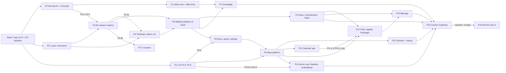

# Implementation plan: from the decided research to a built atrium

This plan turns the operator decisions D1 to D44 ([decisions.md](decisions.md)) and the register in research notes: `reports/00-open-questions.md` into a phased build, as D44 asks. It is written for unattended execution: the operator authorized coding agents to build it in worktrees of the atrium repository, merge pull requests without waiting for him, and deploy to and check the live host artemis (instruction relayed by Main after D44). The issue list is in [issue-index.md](issue-index.md) next to this file.

This revision applies the independent review in research notes: `plan/review.md` and the coordinator's rulings on the points it left open. Review points not adopted are listed in section 10.

Source ids used below:

- D-numbers: [decisions.md](decisions.md).
- R-numbers, N-numbers, C-numbers (conflicts) and the "Changes to fixed rules" list: research notes: `reports/00-open-questions.md`.
- Report findings: `r1` to `r6`, then the report's own id. Examples: `r1 F21`, `r5 F12`, `r6 prereq 3`, `r3 G06`, `r4 S12`.
- `rev` plus a number: an item of research notes: `plan/review.md`. `rev 3` is "Must fix before the build starts" item 3; `rev P1.4` is item 4 under "Must fix before P1". `ruling N` is the coordinator's ruling N.
- File references with line numbers are atrium files unless they name a research document. References that start with `cornn-flaek/` name files in the private host repository and carry no line numbers.
- `[INFERENCE]` marks a claim I derived and did not observe.

## 1. Summary

The plan delivers five things:

- the security fix and the removals the operator decided
- a contract the browser and a native client share
- a new Svelte client that grows at `/next/` beside the old UI on the live system
- the core object merges and the apps split
- removal of the old UI, after the operator confirms 14 days of daily use

It has 17 phases (P0 to P16) in four tranches.

| Tranche | Phases | What it gives on artemis |
|---|---|---|
| 1. Walking skeleton | P0 to P5 | The F21 security fix, the decided removals (Notion, phone links, import-v2, the Swift check, the modernc run and driver, dead code and tables), the connection defects fixed, the `/web/v1` contract, and a new client at `/next/` on real data. It has Home with composer and weather, Chats with live tool cards, and the Inbox with hold-to-send approvals. |
| 2. Core model | P6 to P8 | One inbox, one commitment object and a Tasks page; Knowledge as subject pages with facts, links, pinned instructions and spaces; one search; one Spend page; schedules; push on asks and failures; the new Settings and Connections. |
| 3. Apps | P9 to P14 | The apps platform (pause, registries, app contract, Apps directory with switches), then Torrents and Library, Calendar, the communications feed with Packages, the Mail app, and Server ops, Weather and CPU embeddings. |
| 4. Cutover | P15, P16 | Report 1's cutover conditions proven, then, only after the operator confirms 14 days of daily use, the old UI deleted. |

**Size.** 136 issues: 17 epics and 119 slices (counted in [issue-index.md](issue-index.md)), about 124 agent sessions. One slice is one agent session and one pull request. Atrium CI takes about 22 minutes warm and up to 2 hours 20 minutes cold per run (ruling 8), so merges, not coding, set the pace. Tranche 1 is about 3 to 4 weeks, and the whole plan is about 10 to 14 weeks before the 14-day daily-use window starts `[INFERENCE: from the slice count, the serialized trains in section 8.6 and the CI time; no measured agent throughput exists]`.

**First things that happen (already started, ruling 5 and 6):**

1. **Step 0:** `v3.0.0` is tagged, signed, on `c886439f`, the last release that carries `db import-v2` (register change 8, `rev 5`).
2. **D0:** the host is bumped from `2a25217e` to `v3.0.0` with no plan change, with the baseline captures and the one SELECT session (section 8.2).
3. **Train 1:** P0.1 (trusted-peer check, R1.47, `r5 F21`), P0.2 (Swift check plus the modernc test run), P0.5 (import-v2 removal), P0.9, and P3.1 (spec corrections).

**Explicitly not planned** (reasons in section 5):

- the native iOS client and its own OIDC client (N11, `r5 F18`)
- MCP (N22)
- a Web Vitals beacon (R1.37)
- build tags for apps (N21)
- setting-key renames that rewrite rows (R2.13, unless approved)
- generated app safety rules in `AGENTS.md` (needs separate approval, register change 10)
- the VPN listener removal (R1.27) until the operator states his playback method
- a per-app pause (`r6` options)
- dropping `skills` (ruling 2)

## 2. Rules for the whole build

### Branch, merge and release policy

**Trunk with `/next/`, in every phase.** Each slice is a short-lived branch, merged into `main` through a pull request with the required check, using `gh pr merge --auto --merge` (`AGENTS.md:28-41`). Every commit is made with `git commit -S -s`: signed and with the DCO sign-off (section 6.3). The new client grows at `/next/` in the same binary and session, beside the old UI (`r1` migration stage 2).

| Option | Verdict | Reason |
|---|---|---|
| Trunk plus `/next/` | Adopted for P0 to P16 | The live system keeps every fix. Each deploy is checked on real data. Rollback is one generation and at most one migration (section 8). |
| One long-lived branch, as in v3 (`docs/review/2026-11-v3-plan.md:9-11`) | Rejected | v3 froze the live system until cutover. Here mail is live and the operator uses the product daily, so a frozen `main` would hold back the F21 fix and every removal for weeks. |
| A short integration branch for one train | Allowed for train 2 (P0.4, P0.6, P0.7, P0.8, P0.10) and for P13.1a to P13.2b | Train 2 slices all regenerate `docs/api/openapi.json`, `docs/tools.md` and `docs/config/reference.md` (`rev 11`). One branch with one CI run is allowed instead of serial merges. The Mail move may not compile in halves. |

**CI rules (ruling 8, `rev 11`, `rev 12`).** The required check is `check` and it is not strict, so a green pull request can still break `main`.

- No merge while `main` CI is red. The agent that broke it fixes it first.
- No deploy from a commit whose `main` CI has not passed.
- Every deploy pins an exact atrium sha in `cornn-flaek/flake.lock`.
- Slices that touch the same generated files (`docs/api/openapi.json`, `docs/tools.md`, `docs/config/reference.md`) or `vendorHash` (`nix/go-src.nix:35`) merge serially, each rebased on the last. P3.2 and P0.11 both change `vendorHash` and are serialized (`rev` should-fix).
- A deploy-alone slice (P9.2 to P9.5, P13 slices) freezes other merges until its post-deploy checks pass.
- `just changed` needs `base=main`; its default `v2-develop` (`justfile:27`) is stale.

**Tags (ruling 5).** `v3.0.0` exists, signed, on `c886439f`. Deploy tags are sequential in deploy order (`v3.1.0`, `v3.2.0`, ...), not tied to phase numbers. Each deploy in section 8.6 gets the next tag on the exact sha it pins.

**`/api/v1` removals (ruling 1).** `AGENTS.md:122-124` makes `/api/v1` additive. The coordinator ruled: operations removed by an operator decision (D13, D19, D20, R1.26 and the like) are removed from the spec, because no bearer token was ever created on the live system (research notes: `04-feature-creep/live-usage-evidence.md:617`, Q12). This covers `/permissions/phone*` (P0.4), `/mail/scans/rebalance` and `/mail/scans/gmail-labels` (P0.6), `/media/files/{file_id}/thumbnail` (P0.7), `/wiki*` and `/knowledge/import` (P1.3b), `/maintenance/db-backups` (P1.5), and later `/subagents*`, `/projects*`, `/mail/birthdays`, `/calendar/candidates` and `/mail/packages*` (`rev 10`). The oasdiff baseline is the first tag after P1 (the D3 tag). `AGENTS.md` wording is not edited for this. It is reported to the operator (section 6.4). The v1 mail pause route is not removed by any decision and stays (P9.5).

### Test policy

- **Go tests are e2e only** (`AGENTS.md:45-68`): real CLI or HTTP entry point, real temporary database, local fakes for external services only.
- **The new client is tested only by real-browser e2e** with Playwright on WebKit, Firefox and Chromium (N4). There are no Vitest, Jest or story tests (register change 4, added after `AGENTS.md:60` in P4.6a).
- **Fast loop per slice:** `just verify` after each edit (vet, build, tools docs, `registrationownership`, `adapterboundary`, OpenAPI check; `justfile:7-8`), then `just e2e '<pattern>'` for the workflow the slice changes. `tableownership` is not in `just verify`; it runs in the `ownership` check (`flake-modules/go-checks.nix:102`) inside `just check-quick` (`rev` should-fix).
- **Before hand-off:** `just check-quick`, `just check-eval` after any Nix change, and `just check` before the pull request. Linux-only checks run as `just linux <check>`, which builds on artemis (`justfile:69`).
- **From P4.6a, web slices also run** the `web-e2e` check; from P4.6b, `web-size` and `web-lighthouse` (`r1` build and Nix).
- **Mail safety net:** the mail e2e set must pass before and after every mail-affecting slice. Run it as `just e2e 'Mail|Live|Replay|Serve|Snooze'`. It is `cmd/atrium/mail_safety_test.go`, `mail_effects_test.go`, `mail_replay_test.go`, `live_service_test.go`, `live_resolve_test.go`, `serve_mail_test.go` and `scheduler_live_test.go`. `[INFERENCE: the pattern matches these files' test names; the slice agent confirms with go test -list]`
- **Design checks:** from P4.7a, the component gallery runs automated checks in every browser e2e run: no hue between 170 and 300 above chroma 0.02 (D28, D37), a nonzero radius on every visible surface (D43), and the strict touch rule on touch layouts, where each tappable control owns a 44x44 px square that overlaps no other (D41). The checks use computed styles and `elementFromPoint` probes.
- **Design source (ruling 7):** P4.5, P4.7a, P4.7b and P4.8 are fed by [design-spec.md](design-spec.md), whose open points O1 to O14 are resolved to defaults. P4.1, the merged prototype, is optional and not built by default.
- **Live data** is never used for validation except the read-only checks in section 8 (`AGENTS.md:67-68`).

### Schema policy

The v3 baseline stays frozen (`AGENTS.md:130-137`). Every schema change is a new migration in `internal/db/migrate.go`, with an e2e that migrates from the previous version and compares schemas. D21 adds one permission: a migration may drop tables no code reads (R1.30). Dead columns stay.

**Reserved migration numbers** (`rev` should-fix). Today the list holds only version 1 (`internal/db/migrate.go:19-21`). `applyPending` needs no contiguity `[INFERENCE: migrate.go:151-185, per rev]`, so numbers are reserved up front and a slice that ends up needing no migration leaves its number unused.

| Version | Slice | Kind | Row rewrite? |
|---|---|---|---|
| 2 | P1.6 | Drops `nightly_observations`, `agent_profile`, `notion_pages`, `notion_sources`, `notion_state`, `notion_fts`, `wiki_pages`, `embed_notion_0`, `action_links`, `rebalance_candidates`, `pass_runs`, `pass_run_alerts`, and `snoozes` unless S14 keeps it (D21, `rev P1.3`). Stays: `skills` (ruling 2), `export_pages` (read by `internal/kb/export/obsidian.go:395` and `settings.go:121`), `attention_snoozes` (R2.11). | No |
| 3 | P7.2 | Additive `record_links` (R2.6) | No |
| 4 | P8.4 | Additive schedule columns, only if needed (R3.1) | No |
| 5 | P9.11a | Additive capability columns, only if needed (`r5` capability model) | No |
| 6 | P10.3 | Additive Library request table (R2.12) | No |
| 7 | P12.2 | Drops `event_candidates` (R1.44) | No; pending rows are converted first (S7) |
| 8 | P14.1 | Drops `ops_findings` (D16) | No |
| 9 | P6.2 | Additive commitment kind, only if the storage decision needs it | Moving rows between `tasks` and `commitments` is S6 |

Every drop migration also edits `tools/tableownership/main.go`, which builds its table set from the frozen `*.sql` files plus `migrate.go`; it learns to subtract dropped tables (`rev P1.2`). P15 and P16 have no migration (cutover condition 9).

Every deploy with a migration takes and verifies a named backup first (section 8.2). Once a migration has applied on artemis, recovery is by rolling forward; restore only when data is wrong (`rev 4`).

### Mail safety

Mail is live on artemis (`mail_mode` is `live`). Every slice that touches `internal/mail`, the write gate, the pause, the scheduler or the ledger keeps the shared gate and the rules in `AGENTS.md:101-109`: shadow mode, scopes, pause, go-live eligibility, protected folders, caps, verification, undo, COPY plus STORE plus UID EXPUNGE, and no automatic retry of an unknown outcome. The write gate stays one function with one caller set, and only the pause check is delegated (`r6` R6).

Mail-affecting slices: P0.6, P0.8 (`rev 9`; it edits `internal/mail/applier/snoozes.go` and `internal/mail/executors/triage.go`), P1.5, P2.2, P2.4, P6.2, P6.4, P8.1, P9.2 to P9.5, P12.1a, P12.1b, P12.2, P13.1a to P13.5, and P14.3. Each deploys with the mail net in section 8.5.

Agents never send mail or write to an external calendar from a live account, never open a sending flow on artemis, and never change `mail_mode` (S5, a rule, not a stop). Switching to shadow and back would retake the go-live baseline (`docs/operator/behavior.md:185-200`).

### No two paths for one behavior

The v3 rule (`docs/review/2026-11-v3-plan.md:14-16`) holds with four stated exceptions:

| Two paths | Allowed until | Why |
|---|---|---|
| Old UI and `/next/` client | P16 (operator-gated) | `r1` migration stage 2. From P5 on, new surfaces are built only in `/next/`. The old UI gets security and breakage fixes only. |
| `POST /api/v1/mail/live/pause` beside the platform pause | A future `/api/v2` | No decision removes it, and `AGENTS.md:122-124` makes v1 additive. It becomes an alias of the platform pause (P9.5). |
| Host option `mailAccounts` beside `accounts.<id>` | One release after P13.3 | Host-facing contract (`AGENTS.md:145-146`). cornn-flaek switches in the same deploy; the alias lets a rollback still evaluate. |
| `mediaAgent.capabilities` accepting `"thumbnail"` | One release after P0.7 | `nix/module.nix:796` is an enum and the host sets it (`cornn-flaek/modules/atrium/default.nix`). The value is accepted and ignored for one release; the host drops it in the D2 bump (`rev 8`). |

Every other move deletes the old path in the same pull request.

### Documentation duties

Per `AGENTS.md:17-24`, `context.md` changes whenever behavior or boundaries change, and `docs/operator/behavior.md` and `docs/operator/nixos.md` change whenever operator-visible behavior or `services.atrium` options change. Each phase lists its documents. The approved `AGENTS.md` changes land where the fact changes:

| Approved change | Slice |
|---|---|
| 1. Lines 117-118: `/web/v1` and trusted-peer wording, CSP sentence | P0.1 (peer sentence), P3.3b (`/web/v1`), P4.4 (CSP) |
| 2. Lines 119-121 unchanged | none |
| 3. Lines 122-124: `/web/v1` and `/api/v1` bullets, one mount loop, one `docs/api/openapi.json` | P3.3a (mount loop), P3.3b |
| 4. Tests section after line 60: real-browser e2e only | P4.6a |
| 5. Lines 91-92: `web/`, the `atrium-web` package, no Go HTML | P16.1 |
| 6. Line 128: torrent writes by actor | P10.1 |
| 7. Lines 133-134: migrations may drop unread tables | P1.6 |
| 8. Lines 138-142: import-v2 removed, last tagged release `v3.0.0` named | P0.5 |
| 9. Line 88: modernc wording | P0.11 (driver removal; `rev 7`) |
| 10. `context.md:672-676` flags settable in the product | P9.12 |
| 10. `docs/vision.md:57-58` "in SQLite, with exports to open formats" | P1.4 |
| 10. Setting-key renames need approval | P0.10 states it as a rule |
| 10. Generated app safety rules need separate approval | Not planned |

No runbooks or process documents are created (`AGENTS.md:74-75`).

### What stops the build

The build stops for the operator only at the points in section 6.2 marked "operator" (ruling 9): S6 row rewrites, S10 old UI removal, S11 secrets, S12 reboot or other hosts, S13 deleting connection rows or credentials, S14 pending message snoozes, and the P15.2 and P15.7 confirmation. Every other gate is decided by an agent on the automated evidence named in 6.2.

Besides those, a slice parks (it does not merge or deploy) when:

- evidence contradicts a decision
- a mail replay shows an unexplained difference
- a post-deploy check fails and a rollback does not clear it

A parked or stopped slice records its evidence in its issue, leaves `main` deployable, and is listed in the operator report (section 6.4). Work that does not depend on it continues.

## 3. Phases

The dependency graph and the parallel lanes are in section 4. The merge and deploy order for P0 to P5 is in section 8.6. Every slice id refers to a row in `issue-index.md`. Each phase is one epic issue `P<n>.0`. An epic is complete when its slices are merged and deployed, except slices that wait on an operator action (P2.8 if blocked, P2.10, P11.4), which do not hold the epic open (`rev P13-16.3`).

### P0. Security fix and safe removals

- **Goal:** close the proxy-header trust gap and remove what the operator decided to remove, with no schema change.
- **Scope:**
  - P0.1: proxy identity headers accepted only from `trustedProxyCidrs` peers (R1.47, D33, `r5 F21`, `r1 F4`; `internal/web/identity.go:45-46`, `internal/web/serve.go:66-67`). On artemis the mode is OIDC (`cornn-flaek/modules/atrium/default.nix`), so the F21 branch is not reached in production; the fix still ships (`rev 1`).
  - P0.2: remove the Swift check and `api-client-swift`, plus the modernc test run only: `go-test-modernc` (`flake-modules/go-checks.nix:109`) and `just go-test-modernc` (`justfile:164`) (D23, R1.20, D21, R1.31; ruling 6, `rev 7`). `AGENTS.md:88` is not touched here.
  - P0.4: remove phone action links, their route, secret and CSRF exemption; a push opens the signed-in card; remove `/permissions/phone*` from the spec (D19, R1.14, ruling 1; `internal/actionlink`).
  - P0.5: remove `db import-v2`, referencing the existing `v3.0.0` tag (D20, R1.15, change 8, `rev 5`, `rev 6`). Files: `internal/db/importv2`, `internal/notify/importv2.go`, `internal/media/importv2.go`, `internal/scheduler/import.go`, `internal/ledger/import.go`, `cmd/atrium/import_v2_test.go`; check `flake-modules/restore-drill.nix` for importer use. `internal/settings/importv2.go` is kept and renamed, because `ImportEntryFor` is the live settings classification (`internal/config/host.go:57,245`, `internal/config/pins.go:100`, `internal/settings/application/settings.go:91`, `internal/settings/classify.go`, `tools/settingsgen/main.go:52`).
  - P0.6: remove rebalance and the Gmail label merge and their v1 routes (R1.26, ruling 1; `internal/mail/rebalance`, `internal/mail/gmaillabels`).
  - P0.7: remove media thumbnails, the `media_file_place` undoer and the thumbnail route; `"thumbnail"` stays accepted and ignored in `mediaAgent.capabilities` for one release (`r4` P4; `internal/mediaagent/thumbnail.go`, `nix/module.nix:796`; `rev 8`).
  - P0.8: remove message snooze and the report 03 §5 remnants; keep `tasks.dismissed`, `kb_records.expires_at` and the attention snooze; delete the Notion labels (R2.11, C-28, C-19). Gated on the D0 `snoozes` count: if any row is `pending`, keep the return path in `internal/mail/applier/snoozes.go` and remove only snooze creation (S14, `rev 9`). Mail-affecting.
  - P0.9: run `media-channels` only while a show is followed (`r4` N4).
  - P0.10: remove remaining dead code and fix false docs: the `internal/writes` CLI and the `sandbox` module check (`r6` defect 3), presets cut to `generic` and `pocket_id` (`internal/auth/oidc/preset.go:6-12`), the `r4` defects list, and `docs/integrations.md:17-24` (`r5 F16`, assigned here only) (N27). The preset cut is sign-in-adjacent and collects the S4 evidence (`rev P4.4`).
  - P0.11: remove the modernc driver: generator checks move to `libsqlite3` (`flake-modules/go-checks.nix:48,91,96-98,104`; `justfile:151,158`), `internal/db/open_modernc.go` and `internal/db/busy_modernc.go` go, `modernc.org/sqlite` leaves `go.mod`, `vendorHash` changes (`nix/go-src.nix:35`), the build tag leaves about 40 e2e files, and change 9 lands (`rev 7`).
- **Out of scope:** Notion and table drops (P1); the torrent tag rule (P10.1); the mail pause route (P9.5).
- **Depends on:** step 0 (tag). **Unblocks:** P1, P3.3b.
- **Parts:**

  | Part | Change |
  |---|---|
  | Server | All slices |
  | Client | None |
  | Schema | None. `action_links`, `snoozes` and `rebalance_candidates` become unread and drop in P1.6 |
  | Nix module | P0.2, P0.11 checks; P0.7 capability enum note; action-link options if any |
  | cornn-flaek | D2 bump drops `"thumbnail"` from `capabilities` (`cornn-flaek/modules/atrium/default.nix`) |
- **Exit criteria:**
  - E2e: a proxy-mode request with `Remote-Groups` from an untrusted peer is refused; from a trusted CIDR it is admitted.
  - `just check` passes with no Swift or `go-test-modernc` check; after P0.11, with no modernc tag anywhere.
  - `atrium db import-v2` is an unknown command; `just settingsgen-check` still passes (settings classification kept).
  - `/actions/{token}` returns 404.
  - Mail e2e set green before and after P0.6 and P0.8.
  - D1 and D2 deployed with the post-deploy checks and the S4 evidence green.
- **Risks and rollback:** previous generation; no data loss. Declared jobs removed by P0 (rebalance, thumbnails) are cancelled at start and stay cancelled after a rollback (`internal/scheduler/declared.go:124-137`, `rev` should-fix); re-enable them by hand only if the rollback is meant to last.
- **Documents:** `AGENTS.md` lines 88, 117-118 and 138-142; `context.md`; `docs/operator/behavior.md`; `docs/operator/nixos.md` (capabilities); `docs/integrations.md`.
- **Open questions:** pending snoozes (S14; answered by the D0 SELECT; blocks only the return-path part of P0.8).
- **Size:** 1 epic, 10 slices (3 S, 6 M, 1 L).

### P1. Notion exit and the dead-table drop

- **Goal:** take the last Notion import, remove Notion entirely, and drop the tables no code reads, without losing a carried row.
- **Scope:**
  - P1.1: `doas atrium-run kb import --dry-run` on artemis; record per-source counts (`internal/kb/import.go:52-63`) against 145 mirrored and 52 imported pages (`r4` N1, N2; S1).
  - P1.3a: on artemis, apply the S1 rule: if `notion.created` and `notion.updated` are 0, record and proceed; if `created` is above 0, run the final `kb import` (additive) and rerun the dry run to 0; if `updated` is above 0, P1.3a and P1.3b park and the evidence goes to the operator report; the rest of P1 continues (`rev P1.6`).
  - P1.3b: remove the mirror, wiki view, sink, token, `notionid`, `notionmd`, the tpl link rewrite, the Notion embedding corpus, `kb import` entirely, and `/wiki*` and `/knowledge/import` from the spec (D13, R1.2, N23, ruling 1; `internal/notion`, `internal/kb/import.go`, `internal/kb/export/notion.go`, `internal/web/tpl/markdown.go`, `internal/embed`).
  - P1.4: knowledge export writes one Markdown folder only and fails loudly with no target (D13, `r5 F8`; `internal/kb/export/export.go:75-77`); `docs/vision.md:57-58` (register change 10).
  - P1.5: merge `pass_runs` into `job_runs`, move the pass alert monitor off `pass_run_alerts` (`internal/notify/application/monitor.go:51-73`), and merge `backup` into `db backup`, keeping `atrium backup DEST` and `atrium restore` with their names and arguments because section 8 depends on them (`r4` S12, `rev P1.1`, `rev P1.7`). Remove `/maintenance/db-backups` from the spec.
  - P1.6: migration 2 (schema table above), plus `tools/tableownership/main.go` (D21, R1.30, change 7, `rev P1.2`, `rev P1.3`).
  - P1.7: cornn-flaek removes `service/notion` (`cornn-flaek/modules/atrium/default.nix`) and the `notion-token` reference in `sops.secrets`, and sets the export folder under `/var/lib/atrium` so no `persistence.*` change or reboot is needed (`rev P1.4`). The encrypted value in `secrets.yaml` is not edited (S11, ruling 3).
- **Out of scope:** exporting the 4 `skills` rows (operator item, ruling 2); pruning `notion-token` from `secrets.yaml` (operator item).
- **One-bump rule:** P1.3b and P1.7 ship in the same host bump. No bump that contains P1.3b without P1.7 is ever deployed, because a host-declared connection of an unknown kind returns `UnknownKind` at reconcile (`internal/connections/store.go:272-275`). P1.4 also ships in that bump, because no folder target exists before P1.7 (`rev P1.4`).
- **Depends on:** P0.4, P0.5, P0.6, P0.8 (their tables become unread; the importer read every dropped table, `rev P1.1`). **Unblocks:** P7, P15.
- **Parts:**

  | Part | Change |
  |---|---|
  | Server | P1.3b to P1.5 |
  | Client | None |
  | Schema | P1.6 (migration 2) |
  | Nix module | Remove Notion options; export folder option |
  | cornn-flaek | P1.7 |
- **Exit criteria:**
  - P1.1 counts recorded in the issue (counts only, D7).
  - Migration e2e passes from version 1; `just check-quick` passes with the guard change.
  - On artemis after D3: `db check` passes, migration 2 applied, `connections test --all` lists no `service/notion`, and the daily export writes the folder.
- **Risks and rollback:** the drop is irreversible. Rollback is restore of the pre-D3 archive (section 8.4), which loses every write after the backup. P1.5 is mail-affecting.
- **Documents:** `AGENTS.md:133-134`; `docs/vision.md:57-58`; `context.md`; `docs/operator/behavior.md`; `docs/operator/nixos.md`.
- **Open questions:** delete the 62 Notion pages already exported? Default no, they stay as a frozen copy (`r4` N1).
- **Size:** 1 epic, 7 slices (3 S, 3 M, 1 L).

### P2. Connection defects and durable counters

- **Goal:** make connection state truthful and usage history durable before any dependency page is built.
- **Scope:**
  - P2.1: `r5 F1` to F4 and F6 (`internal/connections/store.go`, `internal/connections/health.go`, `internal/connections/application/connections.go`, `internal/core/coremodule/ops_connections.go`).
  - P2.2: runtime failure reports for IMAP, SMTP, CalDAV and CardDAV (`r5 F9`). Mail-affecting.
  - P2.3: honest status for unconfigured units and the weather location (`r5 F7`, F17).
  - P2.4: the mail embedding requirement follows real outages (`r5 F19`; `internal/mail/endpoints.go`). Mail-affecting.
  - P2.5: alert rule and docs (`r5 F5`, F20; `nix/monitoring/atrium.rules.yml`). F16 is in P0.10.
  - P2.6: 6-hour grace window and `atrium connections check --changed` in the post-start hook (R2.16).
  - P2.7: durable counters `atrium_scheduler_job_runs_total{job,status}` and per route, plus a mark on agent-driven browser sessions (R1.38). Ordered after P3.3b because both rewrite `internal/web/server.go` (`rev P3.3`).
  - P2.8: qBittorrent API key on both sides (`r5 F12`), built only with a host-generated key file and no sops change; otherwise operator-blocked (S11, ruling 3).
  - P2.9: CPU embedding prototype against both gates: p95 under 300 ms, mail backlog indexed overnight, same weights (D24, R1.22).
  - P2.10: Ship24 and the other static secrets to the host file (R1.18, `r5 F13`). Operator-blocked (S11, ruling 3).
- **Other hosts (ruling 4):** P2.5 and P2.7 change the rule and dashboard files that the monitoring module imports (`cornn-flaek/modules/monitoring/default.nix`). That module runs on the monitoring host (`cornn-flaek/modules/monitoring/default.nix`). The bump changes the monitoring host's closure; only artemis is deployed, and the monitoring host updates when the operator next deploys it (S12).
- **Out of scope:** the capability model (P9.11a, P9.11b); `accounts.<id>` (P13.3); the iOS OIDC client.
- **Depends on:** nothing for P2.1 to P2.6 and P2.9; P3.3b for P2.7. **Unblocks:** P8.8, P9.11a, P14.3. Later slices depend on P2.1 to P2.6, never on the epic (`rev P2.2`).
- **Parts:**

  | Part | Change |
  |---|---|
  | Server | P2.1 to P2.4, P2.6, P2.7 |
  | Client | None |
  | Schema | None |
  | Nix module | P2.6 hook; P2.8 key file option |
  | cornn-flaek | P2.8 (`cornn-flaek/modules/qbittorrent/default.nix`), P2.10 if unblocked |
- **Exit criteria:**
  - E2e: a host-changed connection is checked at boot; a runtime IMAP failure flips state and notifies once.
  - On artemis after D4: `/metrics` on the ops listener exposes `atrium_scheduler_job_runs_total`, and it survives a restart.
  - P2.9 reports both gates and whether weights match.
- **Risks and rollback:** previous generation, no data loss. P2.8 changes two units together.
- **Documents:** `docs/integrations.md`; `docs/operator/behavior.md`; `docs/operator/nixos.md`; `context.md`.
- **Open questions:** gaming pause notices (`r5 F11`). Default: shown as "paused by host" without suppression; shaping. `service/embedding` fails during a gaming pause, so connection comparisons in section 8 are per id (`rev 13`).
- **Size:** 1 epic, 10 slices (5 S, 5 M).

### P3. The contract and `/web/v1`

- **Goal:** give the browser a cookie-authenticated `/web/v1` from the same OpenAPI document as bearer-only `/api/v1`, with the read models and streams the new client needs.
- **Scope:**
  - P3.1: spec corrections (R2.7, D33, `r1 F8`): open error enum, open responses, stable names, typed `RunStreamEvent` (`AppEvent` is typed in P3.6, with the stream that sends it), `securitySchemes`, 412, 53-bit bounds, cursor alias.
    - Files: `docs/api/openapi.json`, `docs/api/run-stream.md`, `internal/web/api.go`.
    - Must not change: any operation's path, method or request shape; existing clients keep working (`AGENTS.md:122-124`).
  - P3.2: oasdiff as a Nix check against the D3 tag (ruling 1), and Schemathesis as a nightly job that opens an issue and never gates a merge (N6, N7).
    - Files: `flake-modules/checks.nix`, `.github/workflows/ci.yml`, `nix/go-src.nix`.
    - Serialized with P0.11, because both change `vendorHash` (`nix/go-src.nix:35`).
  - P3.3a: one mount loop for the operation table, with no behavior change (change 3; `rev` split).
    - Files: `internal/web/server.go`, `internal/web/bindings.go`.
    - Must not change: any route, method, auth rule or response; the existing UI and API e2e pass unchanged.
  - P3.3b: the `/web/v1` mount through that loop with cookie auth, plus `GET /web/v1/session` and `POST /web/v1/session/logout` (D18, R1.3, changes 1 and 3).
    - Files: `internal/web/server.go`, `internal/web/auth_routes.go`, `internal/web/guard.go` (the CSRF exemption at line 211 is gone after P0.4, `rev P3.2`), `internal/web/bindings.go`, `AGENTS.md:117-124`.
    - Folds in former P3.8: `/api/v1/today` is already POST only (`assistant.today.ensure`, `docs/api/openapi.json:42282`), so `/web/v1` exposes the POST and no GET (N14, `rev P3.1`).
    - A cookie never authenticates `/api/v1`; a bearer never authenticates `/web/v1` (D18).
    - Sign-in-adjacent: collects the S4 evidence (section 6.2).
  - P3.4: read models `GET /shell`, `/settings/schema`, `/connections/schema`, `/files`, `/about`, and the weather card added to the `/home` model, which today carries the digest but no weather (`docs/api/openapi.json:17119`; N8, D40, `rev P5.2`).
    - Files: `internal/web/api.go`, `internal/settings`, `internal/connections`, `internal/assistant/application/home.go`.
    - Additive only; served under both prefixes.
  - P3.5: settings writes and previews (N8, `r1 F9`):
    - atomic `PATCH /settings` with If-Match, 412 on a stale revision and cross-field 422
    - `x-atrium-undoable` on operations that can be undone
    - typed proposal previews
    - `GET /mail/rules/vocabulary`
    - Files: `internal/settings`, `internal/web/api.go`, `internal/mail/rules`.
  - P3.6: app event stream `GET /events` carrying `{topic, revision}`, with `AppEvent` typed in the spec, and stream limit classes: runs 4 per subject and 16 per server, app events 2 per subject and 8 per server (N9, R2.18).
    - Files: `internal/web/streamaccess.go`, `internal/web/server.go`, `docs/api/openapi.json`.
  - P3.7: run stream additions: `tool_progress {run_id,id,text}`, `tool_done.results` and streamed web search sources (`r1` stream additions, `r1 F9`).
    - Files: `internal/assistant/runner`, `docs/api/run-stream.md`.
    - Must not change: existing event names and fields; the old UI's `/chat/{id}/events` keeps working.
- **Out of scope:** any client code (P4); removing `/chat/{id}/events` (P16.1); `SameSite=Strict` (P15.2); removing v1 operations beyond those named by ruling 1.
- **Depends on:** nothing for P3.1; P3.1 for P3.2 (plus P0.11 and the D3 tag), P3.3a and P3.7; P3.3a, P0.1 and P0.4 for P3.3b (`rev P3.2`). **Unblocks:** P4.2 (after P3.1), P4.4 and P2.7 (after P3.3b), P5.
- **Parts:**

  | Part | Change |
  |---|---|
  | Server | All slices |
  | Client | Contract only (`docs/api/openapi.json`) |
  | Schema | None |
  | Nix module | None; P3.2 adds checks in `flake-modules/checks.nix` |
  | cornn-flaek | None |
- **Exit criteria:**
  - `just verify` passes; oasdiff shows only additive changes against the D3 tag.
  - E2e: a cookie works on `/web/v1` and gets 401 on `/api/v1`; a bearer works on `/api/v1` and is refused on `/web/v1` (D18).
  - E2e: a stale If-Match returns 412; a write emits an app event; the third app stream for one subject is refused.
  - E2e: a run emits `tool_progress` and `tool_done.results`.
  - The existing UI e2e passes unchanged after P3.3a.
  - D5 deployed with the S4 evidence green.
- **Risks and rollback:** P3.3b touches the guard (S4 evidence; emergency listener). Old UI routes are unchanged and covered by the existing UI e2e. Rollback is the previous generation, with no data loss.
- **Documents:** `AGENTS.md:117-124`; `docs/api/run-stream.md`; `context.md` (API surfaces); `docs/operator/behavior.md` (sign-in surfaces).
- **Open questions:** C-10, markdown rendering: server HTML or client under a contract policy. Default: client rendering under a policy written into the contract (R1.35); shaping.
- **Size:** 1 epic, 8 slices (8 M).

### P4. Web toolchain, tokens and the component kit

- **Goal:** build, serve and test a Svelte 5 client at `/next/` from the Nix build, with tokens and a component kit that pass gate G6.
- **Scope:**
  - P4.1: optional, not built by default and not a dependency of any slice (ruling 7, `rev P4.3`). If requested, prototype the merged final design (D34, `r2` "what to prototype next"):
    - h2 base with the moss accent (D36, D37)
    - tables only in Inbox and Settings (D38)
    - Knowledge opens on a page (D39)
    - the compact weather card and the optional day timeline (D40)
    - rounded corners everywhere (D43)
    - keyboard confirm, the read-to-end gate, the pinned row and phone subject regions (D42)
  - P4.2: scaffold `web/` (new) (D30, N5, C-35, R1.17, R2.23):
    - Svelte 5, sv-router and TanStack Svelte Query
    - the client generated from `docs/api/openapi.json`
    - folders `contract/`, `shared/`, `shell/`, `features/<slice>` and `apps/<id>/`, with a static app list (C-35)
    - `.npmrc` with `ignore-scripts` and `min-release-age`; TS 6 from the lockfile (R1.64)
    - a lint rule that commands are called only from handlers
    - a live region for announcements
  - P4.3: Nix packaging (gate G5; `r1` build and Nix):
    - `nix/web.nix` (new) with `atrium-web`, `atrium-web-mock` and `atrium-tokens`
    - a `preBuild` copy into `internal/web/app` (new) with `//go:embed`
    - dev shell with `importNpmLock`, a pinned Playwright browsers path and `ATRIUM_WEB_ASSETS`
    - vendor hashes (`AGENTS.md:96-97`)
    - Files: `flake-modules/packages.nix`, `flake-modules/devshell.nix`, `nix/go-package.nix`, `flake-modules/go-checks.nix`.
    - Measure first: the sandbox build on aarch64-darwin and on x86_64-linux via `just linux`, and `linkNodeModulesHook`. After merge, run `just prepush` on a throwaway cornn-flaek branch to prove the host builds the embed with its own nixpkgs (`rev` merge order).
  - P4.4: serve `/next/` with SPA fallback and the service worker scoped to `/next/` (R1.33, R1.57, R1.60, R2.19, D31, gate G1, `r1 F1`, F22, `rev P4.1`, `rev P4.2`):
    - Measure first: worker scope precedence under `/next/`. Fallback: a second loopback port behind the same proxy.
    - CSP `trusted-types atrium-md atrium-sw svelte-trusted-html` set only on `/next/` responses, with `default` only in the mock build.
    - Must not change: the old UI's CSP; `setSecurityHeaders` keeps the current `csp` constant for every other path (`internal/web/guard.go:158`), proven by an e2e.
    - The public shell under OIDC is sign-in-adjacent: S4 evidence (`rev P4.4`).
    - Files: `internal/web/staticserve.go`, `internal/web/guard.go`, `internal/web/server.go`.
  - P4.5: DTCG tokens in `design/tokens/` (new), built by Style Dictionary 5 from [design-spec.md](design-spec.md) (O1 to O14 at their defaults), for the new client only; `nix/webassets/tokens.jq` keeps serving the old UI (R1.34, C-13, D28, D36, D37, R2.21, ruling 7):
    - Measure first: Style Dictionary 5's DTCG 2025.10 support. Fallback: a jq step as today.
    - A's browns, beiges and tans with moss and the olive "ok"; no hue between 170 and 300 above chroma 0.02
    - Alegreya Sans and Fira Mono
    - rem scale with a 12 px floor and larger display numerals
    - safe areas
  - P4.6a: browser e2e harness (N4, D3, change 4):
    - Playwright on WebKit, Firefox and Chromium from Nix
    - checks `web-e2e` and `web-playwright-pin`, `just` recipes and CI wiring
    - the tests section of `AGENTS.md` after line 60: real-browser e2e only, no Vitest, Jest or story tests
    - Measure first: WebKit inside the Nix sandbox.
    - Files: `flake-modules/checks.nix`, `.github/workflows/ci.yml`, `justfile`, `AGENTS.md`.
  - P4.6b: checks `web-size` and `web-lighthouse` with the `r1` budgets (shell at most 4 KB brotli, CSS at most 20 KB, route budgets), with `just` recipes and CI wiring (`flake-modules/checks.nix`, `justfile`).
  - P4.7a: the gallery and base surfaces (D2, D28, D29, D41, D43, R1.50, `r1 F20`, F26):
    - `/__gallery`, fixtures and the simulator, served by `atrium-web-mock`
    - base surfaces (buttons, fields, lists, cards, sheet frame) from the tokens
    - automated checks in every browser e2e run: no blue hue, a nonzero radius on every visible surface, and the strict touch rule (each tappable control owns a 44x44 px square that overlaps no other) on touch layouts
  - P4.7b: the four G6 widgets, menu, combobox, tabs and listbox, each with axe at 0 serious or critical findings and a keyboard walk in three engines (R1.61, `r1 F19`).
  - P4.8: assistant components, fed by the final design spec, not by P4.1 (D12, D32, D41, D42, R1.49, R1.72, `r2` component set, `rev P4.3`):
    - approval card, receipt line, tool card and digest line
    - undo toast and sheet
    - status slot and scope chip
    - hold button: press and hold on phone; 10 s with Undo on desktop; completes only after the change's end was on screen
    - the action row is inert while off screen
- **Out of scope:** feature screens (P5 onward); deleting `atrium-static` or `nix/webassets/pack.sh` (P16.1); a second design direction.
- **Depends on:** P3.1 for P4.2; P4.2 for P4.3 and P4.5; P4.3 and P3.3b for P4.4; P4.3 for P4.6a; P4.5 and P4.6a for P4.7a. **Unblocks:** P5.
- **Parts:**

  | Part | Change |
  |---|---|
  | Server | P4.3 embed; P4.4 `/next/` serving and the scoped CSP |
  | Client | `web/` (new): scaffold, tokens, gallery, kit |
  | Schema | None |
  | Nix module | None; new packages and checks in `flake-modules/` and `nix/web.nix` (new) |
  | cornn-flaek | None committed; a throwaway branch runs `just prepush` after P4.3 |
- **Exit criteria:**
  - Gates G1, G5 and G6 pass.
  - The sandbox build embeds the client on aarch64-darwin and via `just linux`; cornn-flaek `just prepush` passes on the throwaway branch.
  - `/next/` loads under its CSP with no violation in three engines, and the e2e shows the old UI's CSP unchanged.
  - The gallery passes axe with 0 serious or critical findings, plus the keyboard walk, no-blue, corner and touch checks.
  - Shell at most 4 KB brotli; CSS at most 20 KB.
- **Risks and rollback:** worker scope at `/next/`, WebKit in the sandbox, `linkNodeModulesHook` and the x86_64-linux build are unverified; P4.3, P4.4 and P4.6a measure them first. No deploy until D6. Rollback is the previous generation, with no data loss.
- **Documents:** `AGENTS.md` tests section; `docs/operator/behavior.md` (`/next/`); `context.md` (web delivery).
- **Open questions:**
  - Does Style Dictionary 5 support DTCG 2025.10? Default: yes, pinned; else a jq step; shaping P4.5.
  - Does the worker scope work at `/next/`? Default: yes; else a second port; blocks P4.4 only.
- **Size:** 1 epic, 10 slices (6 M, 4 L).

### P5. Walking skeleton at `/next/` on real data

- **Goal:** the operator can use Home, Chats and the Inbox in the new client on artemis, on the live database, through the same sign-in.
- **Scope:**
  - P5.1a: the shell and sign-in (R1.51, D27, D42, N15, R1.70, `rev P5.1`):
    - five destinations; Chats and Settings behind the avatar (`r2` IA)
    - phone tabs per R1.51 and D27, with the inbox tab named "Decide" (D42)
    - a prerendered frame (R1.70)
    - sign-in through `GET /web/v1/session`; logout through `POST /web/v1/session/logout`
    - Files: `web/` (new), `internal/web/staticserve.go`.
  - P5.1b: the cached shell in the worker, and the 7-day IndexedDB read cache with a "do not keep data on this device" switch; no offline writes (D5, N3, R1.32).
  - P5.2: composer-first Home with the compact weather card from the `/home` model (P3.4) and the five-line digest (D17, R1.5, D40, `r2` digest).
  - P5.3: Chats at `/chat/{id}` (R1.53, R1.62, R1.55, D12, gate G3):
    - streaming with visible tool cards and once-per-frame autoscroll
    - Send disabled until the transcript loads
    - no margin notes in chats
    - G3 measured locally: 2,000 events at 100 per second with p95 at most 50 ms
  - P5.4: Inbox/Decide (D17, D32, D42, R1.49, R1.52, R1.65, R1.72, R1.54, `r2` six-part card, `r3` G06 part):
    - approval card with the full change visible before and during a hold
    - hold to send; pending state
    - canonical `/inbox/{id}` in the client, with `/proposals/{id}` and `/drafts/{id}` resolving to the same card
    - the existing proposal operations only; no server change to approvals
  - P5.5: research. Measure and smoke (R1.70, G2, G3, `r1` budgets, `rev P5.3`):
    - Measure on the real binary without mocks: route budgets, `/chat/{id}` first-load JS (G2, at most 100 KB brotli), LCP (at most 1.8 s), TBT and CLS.
    - Smoke on artemis after D6 per section 8.3: the browser blocks every non-GET request, never loads `/today`, runs reads only, and compares the inbox count in `/next/` and the old UI.
    - G3 runs locally, never on artemis.
- **Out of scope:** push into `/next/` (notifications keep opening the old UI's card until P15.4); Plan, Knowledge, Apps and Settings screens (later phases).
- **Depends on:** P5.1a on P3.3b, P3.4, P4.4 and P4.7a; P5.1b on P5.1a; P5.2 on P5.1a and P3.4; P5.3 on P5.1a and P3.7; P5.4 on P5.1a, P4.8, P3.5 and P3.6 (`rev P5.1`); P5.5 on the other P5 slices and D6. **Unblocks:** P6, P7, P8 and every later client slice.
- **Parts:**

  | Part | Change |
  |---|---|
  | Server | None beyond P3; `/next/` fallback routes if needed |
  | Client | Shell, Home, Chats, Inbox/Decide, worker and read cache |
  | Schema | None |
  | Nix module | None |
  | cornn-flaek | Lock bump for D6 only |
- **Exit criteria:**
  - Browser e2e in three engines: sign-in; a chat with a tool card streaming to `tool_done`; an approval with the hold and its receipt; undo within the window; an offline reload showing the cached shell and last reads.
  - G2 and G3 met; LCP at most 1.8 s on the real binary.
  - The D6 smoke shows the same inbox count in `/next/` as in the old UI.
- **Risks and rollback:** approvals from `/next/` reach the live mail gate through the same operations. The operator can ignore `/next/`, since the old UI is unchanged. Rollback is the previous generation, with no data loss.
- **Documents:** `docs/operator/behavior.md` (`/next/` and what it covers); `context.md` (web delivery).
- **Open questions:** R1.72, action rows inert off screen: default yes. R1.55 against `r2` Q2.5: default no margin notes in chats. Both shaping.
- **Size:** 1 epic, 6 slices (1 S, 3 M, 2 L).

**Tranche 1 ends here.**

### P6. One inbox, one commitment object, Tasks

- **Goal:** everything that needs the operator lands in one Inbox, and To do and Waiting are one commitment object with a full Tasks page.
- **Scope:**
  - P6.2: one inbox read model over proposals, drafts, attention items and asks, with counts. An off app hides its asks and leaves every other count (D17, D42, R1.4, R1.6, `r3` G06, G07, G10, G18, `rev P6.1`).
    - Folds in the former P6.1 storage decision. Default: one domain type and one API over `tasks` and `commitments`, with no row move; a move is S6. Record the decision in the issue.
    - Path: `/api/v1/inbox` already names the notification inbox (`docs/api/openapi.json:17405-17711`), so the read model takes a new path, default `/queue` `[INFERENCE: name]`. Must not change: `/inbox`, `/inbox/{id}/read`, `/inbox/{id}/resend`.
    - Files: `internal/attention`, `internal/review/application`, `internal/mail/reviewpages`; reads `internal/db/schema/tasks.sql` and `internal/db/schema/openloops.sql`.
    - Mail-affecting (reads mail state); migration 9 only if the decision needs it.
  - P6.3: Tasks verbs: create, edit, complete, dismiss and delete, each with undo or a confirm, and links to threads, projects, people, records and mail (R2.1, `r3` G01 to G03, G22, G23, N10, N13; `internal/tasks`, `internal/web/api.go`).
  - P6.4: the commitment API and agent tool consolidation: a waiting item and a task through one resource; overlapping agent tools merged (D17, R1.6; `internal/tasks`, `internal/mail/openloops`, `internal/assistant/tools`). Mail-affecting.
  - P6.5: `/next/` Inbox as a table (D38), Plan with To do and Waiting, the Tasks page with every verb, and Plan's list in the read cache (R2.22, R2.1).
- **Out of scope:** moving open loops out of mail packages (P12.1b); message actions (P13.4); a change to the notification inbox.
- **Depends on:** P5 for P6.2 and P6.3; P6.2 and P6.3 for P6.4; P6.2, P6.4 and P5.4 for P6.5. **Unblocks:** P12, P13, P15.
- **Parts:**

  | Part | Change |
  |---|---|
  | Server | P6.2 to P6.4 |
  | Client | P6.5 |
  | Schema | None by default; migration 9 only if the storage decision needs it |
  | Nix module | None |
  | cornn-flaek | None |
- **Exit criteria:**
  - E2e: an attention item, a proposal and a draft appear in one list with one count at the new path; `/inbox` responses unchanged.
  - E2e: every task verb, with undo or confirm.
  - E2e: a waiting item and a task through one commitment resource.
  - Browser e2e of Inbox, Plan and Tasks.
  - #188 and #471 closed as superseded.
- **Risks and rollback:** P6.2 and P6.4 read mail state (mail net). Rollback is the previous generation with no data loss; with migration 9, the pre-deploy archive.
- **Documents:** `context.md` (inbox, commitments, tasks); `docs/operator/behavior.md`; `docs/tools.md`.
- **Open questions:** commitment storage (section 6.1, default 1); decided inside P6.2; blocks P6.4 only.
- **Size:** 1 epic, 4 slices (2 M, 2 L).

### P7. Knowledge: subject pages, links, instructions, spaces, search

- **Goal:** Knowledge opens on a subject page with its facts and links, standing instructions are a pinned page, projects are spaces, and one search covers everything.
- **Scope:**
  - P7.1: subject pages with a facts table and the wiki as default view; the map one key or tap away (D17, R1.7, N18, D39, R1.56, D38; `internal/kb`, `internal/kb/application`).
  - P7.2: typed links between records, and from records to tasks and contacts, through an additive `record_links` table in migration 3 (R2.6, `r3` G04; `internal/kb`, `internal/tasks`, `internal/contacts`, `internal/db/migrate.go`).
  - P7.3: standing instructions as a pinned page with history; roles declared in code; role CRUD and `/subagents*` deleted (R2.4, C-11, ruling 1; `internal/assistant/prompts`, `internal/assistant/subagents`, `internal/kb`).
  - P7.4: a project becomes a space in Knowledge holding instructions, files, threads and tasks with the private flag; `/projects*` replaced (R2.5, ruling 1; `internal/assistant/projects`, `internal/kb`). No live project exists.
  - P7.5: one search with type filters over threads, mail, records, tasks and files (R1.25, `r3` G17 part; `internal/kb/search.go`, `internal/assistant/threads`, `internal/mail`).
  - P7.6a: `/next/` Knowledge page with cards and lists (D38), the facts table, links and search (D39, R1.55, R1.56).
  - P7.6b: `/next/` map one key away, spaces, and the instructions editor with history (D39).
- **Out of scope:** the Markdown export target (done in P1.4); thread contexts (N26, unchanged); embedding changes (P14.3).
- **Depends on:** P5 and P1. P7.2 to P7.4 on P7.1; P7.6a on P7.1, P7.2, P7.5 and P5.1a; P7.6b on P7.6a, P7.3 and P7.4. **Unblocks:** P15.
- **Parts:**

  | Part | Change |
  |---|---|
  | Server | P7.1 to P7.5 |
  | Client | P7.6a, P7.6b |
  | Schema | Migration 3 (P7.2, additive) |
  | Nix module | None |
  | cornn-flaek | None |
- **Exit criteria:**
  - E2e: a fact on a person page shows in its facts table; a link resolves both ways; migration 3 e2e from version 2.
  - E2e: an instructions edit appears in the next run's prompt, with history.
  - E2e: one query returns a thread, a message and a record; filters narrow it.
  - Browser e2e of Knowledge, map, spaces and the instructions editor.
- **Risks and rollback:** migration 3 (named verified backup, S3). Rollback needs the pre-deploy archive and loses later writes.
- **Documents:** `context.md` (knowledge, projects, prompts); `docs/operator/behavior.md`; `docs/tools.md`.
- **Open questions:** where role definitions live today `[INFERENCE: agent_profile drops in P1.6, so roles may already be code]`; shaping P7.3.
- **Size:** 1 epic, 7 slices (6 M, 1 L).

### P8. Runs, spend, schedules, settings and connections screens

- **Goal:** `serve` is the only executor, spend has one page and one cap, the operator owns schedules, settings shrink to about 50, and the Assistant, Settings and Connections screens exist in `/next/`.
- **Scope:**
  - P8.1: `serve` is the only job executor; the CLI asks it; an in-process claim fence refuses a second claim (R1.19; `internal/scheduler`, `internal/assistant/jobworker`, `cmd/atrium`). Mail-affecting.
  - P8.2: one Spend page model and one run cap (R1.23; `internal/inference`, `internal/settings`). If `atrium-run settings list` shows a stored cap that differs from its default, stop at S6.
  - P8.3: page-less settings become constants (R1.24, C-23, `rev P8.2`, `rev P8.3`):
    - Excluded: weather location, time zone and every `agent_schedule_*` key (owned by P8.4).
    - Gate: retire only keys whose source is the default in `atrium-run settings list`; a key with a non-default value stays a setting and is reported (S6).
    - Stored rows stay and are ignored through `internal/settings/retired.go`; `docs/config/reference.md` is regenerated with `just settingsgen`.
    - Retired host keys are removed from `cornn-flaek/modules/atrium/default.nix` in the same bump, because a retired host key is refused at start (`internal/config/host.go:252-253`).
  - P8.4: operator schedules (R3.1, `r3` G05, `r4` N5, `rev P8.1`, `rev P9.3`):
    - First: make the job row authoritative for every `agent_schedule_*` key and carry each stored value to its job, so removing a schedule setting cannot reset the tuned nightly schedule (`internal/scheduler/declared.go:75-76`).
    - Then: create a schedule, edit its prompt, run any built-in job now, push on failure.
    - Files: `internal/scheduler`, `internal/scheduler/settings.go`, `internal/notify`, `internal/db/migrate.go` (migration 4 only if needed).
  - P8.5: push on `ask_operator`, a failed run and a new repair, through the existing push transport (R2.8, `r3` G09; `internal/notify`, `internal/connections`).
  - P8.6: list backups in the API and UI. Verify already exists at `POST /maintenance/backups/verify` (`docs/api/openapi.json:26967`) and gets a UI only; restore stays CLI (R1.39; `internal/db/backup.go`, `internal/web/api.go`).
  - P8.7a: `/next/` Assistant destination with behavior, authority, spend and schedules, labeled "Assistant" (R2.20, N19).
  - P8.7b: `/next/` Settings with about 50 keys by the `r2` §3 placement, group save, visible saves, and 412 on a stale revision (N12, N16, D38).
  - P8.8: `/next/` Connections showing every field, host-owned fields read-only, and the weather field (R2.15, N28; `web/` (new), `internal/connections`).
- **Out of scope:** the capability model (P9.11a, P9.11b); app switches (P9.12); schedule-setting keys outside `agent_schedule_*` (P9.7); setting-key renames (S6).
- **Depends on:** P5; P8.3 on P8.4; P8.4 on P8.1; P8.5 on P8.4; P8.7a on P8.2 and P8.4; P8.7b on P8.3 and P3.5; P8.8 on P2.1 to P2.6 and P8.3. **Unblocks:** P9, P15.
- **Parts:**

  | Part | Change |
  |---|---|
  | Server | P8.1 to P8.6 |
  | Client | P8.7a, P8.7b, P8.8 |
  | Schema | Migration 4 only if P8.4 needs it |
  | Nix module | Settings options that P8.3 retires |
  | cornn-flaek | P8.3 removes retired host keys in the same bump |
- **Exit criteria:**
  - E2e: a CLI job run executes in `serve`; a second claim is refused.
  - E2e: a run past the cap is refused before dispatch.
  - E2e: the tuned nightly schedule survives the setting's removal; a created schedule runs; a failure pushes.
  - `/settings/schema` lists about 50 keys; `atrium-run settings list` on artemis shows no retired key with a non-default value.
  - Browser e2e of Assistant, Settings (412 on a stale revision) and Connections.
- **Risks and rollback:** P8.1 changes how the mail pass is executed (mail net). P8.3 and P8.4 can lose tuned values if the gate is skipped. Rollback is the previous generation; with migration 4, the pre-deploy archive.
- **Documents:** `context.md` (scheduler, spend, settings); `docs/config/reference.md` (`just settingsgen`); `docs/operator/behavior.md`; `docs/operator/nixos.md`.
- **Open questions:** whether the three caps hold non-default values; read with `atrium-run settings list`; blocks P8.2 only.
- **Size:** 1 epic, 9 slices (2 S, 6 M, 1 L).

**Tranche 2 ends here.**

### P9. Apps platform

- **Goal:** the platform knows no unit, owns the review hub, the pause and every registry, and the operator switches apps on and off in the product.
- **Scope:**
  - P9.1: research. Trace whether a module flag applies live through the snapshot publish or needs a restart, and record the code path in the issue (change 10; `internal/module/set.go`, `internal/module/enable.go`).
  - P9.2: one platform ledger with no mail opener; `EffectDeps.Open`, `EffectDeps.Syncer` and `tool.Context.MailOpen` removed (`r6` prereq 3; `internal/module/catalog.go:169`, `internal/module/declaration.go`, `internal/tool/tool.go:88`). Mail-affecting; deploys alone.
  - P9.3: `internal/module` imports no unit; seeding uses `HasOperatorData`; name constants move out (`r6` prereq 1; `internal/module/flag.go`, `internal/module/module.go`, `internal/app/catalog.go`). Mail-affecting.
  - P9.4: the review hub, proposals registry, pipeline, `/review`, `/proposals/*` and `/activity*` move to platform review, with `ReviewKinds` and `ActivityCategory` (`r6` prereq 2, N29; `internal/review/application`, `internal/mail/reviewpages`, `internal/mail/mailmodule`). Mail-affecting; deploys alone.
  - P9.5: one platform pause with API, the "Automation paused" badge and the scheduler gate; Mail's `WriteGate` consults it (`r6` prereq 4, R1.12, D33, `r6` defect 5, `rev P9.1`):
    - Must keep the pause file path (`internal/config/config.go:52`) so a pause set by the old binary before the deploy is honored, proven by an e2e.
    - `POST /api/v1/mail/live/pause` stays as an alias.
    - The write gate stays one function with one caller set; only the pause check is delegated (`r6` R6).
    - Files: `internal/assistant/jobworker/worker.go:126`, `internal/scheduler`, `internal/mail/live`, `internal/mail/mailcmd/live.go`.
    - Mail-affecting; deploys alone.
  - P9.6: registries part 1: effect owner, notification channels, nav, refs, attachments and activity categories (`r6` registry table; `internal/module/catalog.go`, `internal/notify/channels.go`, `internal/web/render.go`, `internal/assistant/service/view.go`, `internal/review/application/activity.go`).
  - P9.7: registries part 2 (`r6` registry table, defects 4 and 8, `r5 F15`, `rev P9.3`):
    - embedding corpora and metrics collectors
    - singleton hooks and generator lists
    - the `propose` kind order, independent of catalog order
    - the schedule-setting owner for the `ScheduleSetting` keys P8.4 did not take over; `agent_schedule_*` belong to P8.4's job rows
    - Files: `internal/scheduler/settings.go`, `internal/embed`, `internal/ops/collectors`, `internal/module/compile.go`, `tools/settingsgen`.
  - P9.8: app contract fields on `module.Declaration`; the import allow list and per-app table ownership in the guards (`r6` rec 8, N21; `internal/module/declaration.go`, `tools/tableownership`, `tools/registrationownership`, `tools/adapterboundary`).
  - P9.9: DAV login and mirror sync in the platform; `icloud` as one shared platform connection kind; contacts import no app (`r6` prereqs 11 and 12, R1.42, R1.45; `internal/contacts/application/contacts.go`, `internal/calendar/connection.go`, `internal/connections/google.go`).
  - P9.10: the core `day` contract; home stops importing calendar (`r6` prereq 13; `internal/assistant/application/home.go:18`, `internal/calendar`).
  - P9.11a: the capability model (Need, Capability, Provider, Connection, Credential, Binding, Repair) with one owner per connection; migration 5 only if needed (`r5` capability model, N28; `internal/connections`, `internal/db/migrate.go`).
  - P9.11b: the `dependencies_status` and `dependency_recheck` tools, and the row lifecycle: rows of disabled units are disabled, never deleted; operator-owned rows such as `service/ship24` and `service/webpush` are never touched (`r5 F10`, `r6` defect 7, `rev P9.2`; `internal/connections/boot.go:18-24`, `internal/assistant/tools`). Deleting any row or credential is S13.
  - P9.12: the Apps manifest `GET /web/v1/apps` and `GET /api/v1/apps`, and `PUT .../apps/{id}/enabled` with operator authority (D17, R1.8, D18, change 10, `rev P9.2`; `internal/module/enable.go`, `internal/web/api.go`, `context.md`):
    - writes the settings audit; never an agent tool; the prompt names disabled apps
    - current flag states are preserved when apps become opt-in
    - an app off removes routes, tools, jobs and nav and disables its connection rows; tables and credentials stay
  - P9.13: `/next/` Apps hub with one entry per app and its sub-navigation, the directory with switches and needs, and a generic card for an unknown kind (R2.14, `r6` nav). First step: the `r2` Apps directory prototype in the gallery.
- **Out of scope:** moving any app's code (P10 to P14); the communications feed (P12); a per-app pause; build tags for apps (N21).
- **Depends on:** P8 and P2.1 to P2.6. Inside: P9.2, P9.3, P9.4, P9.5 in order; P9.6 on P9.3; P9.7 on P9.6 and P8.4; P9.8 on P9.7; P9.9 on P9.3; P9.10 on P9.6; P9.11a on P9.8; P9.11b on P9.11a; P9.12 on P9.1, P9.8 and P9.11b; P9.13 on P9.12 and P5.1a. **Unblocks:** P10, P11, P12, P14.
- **Parts:**

  | Part | Change |
  |---|---|
  | Server | P9.2 to P9.12 |
  | Client | P9.13; the pause badge in the shell |
  | Schema | Migration 5 only if P9.11a needs it |
  | Nix module | Flag options documented as operator defaults (change 10) |
  | cornn-flaek | None expected |
- **Exit criteria:**
  - `just verify` and `just check-quick` fail on a forbidden import.
  - Mail e2e and replay unchanged after each of P9.2 to P9.5, each deployed alone.
  - E2e: a pause file written by the old binary is honored; the pause stops a job and a mail write and shows the badge; the v1 alias works; one pause and resume on artemis after P9.5.
  - E2e: an app off removes routes, tools, jobs and nav and disables its connection row, while tables and credentials stay; an agent call to the switch is refused.
  - Browser e2e of the Apps hub and directory.
- **Risks and rollback:** the highest live-mail risk after P13 (`r6` R6). Every mail-affecting slice deploys alone with merges frozen and the mail net. Rollback is the previous generation; with migration 5, the pre-deploy archive.
- **Documents:** `context.md:660-676` (modules, flags, pause); `docs/operator/behavior.md` (pause, Apps); `docs/operator/nixos.md` (flags); `docs/tools.md`.
- **Open questions:** does a flag apply live? Default: live through the snapshot publish; P9.1 decides; blocks P9.12. Does the capability model need a migration? Shaping.
- **Size:** 1 epic, 14 slices (1 S, 8 M, 5 L).

### P10. Torrents and Library

- **Goal:** media becomes a small Torrents app and a Library app that depends on it one way, with the tag rule enforced at the single write path.
- **Scope:**
  - P10.1: Torrents in `internal/apps/torrents` (new) (D15, R1.11, R1.13, R2.10, R2.13, `r6` defects 1 and 2, change 6, `rev` should-fix; `internal/media/qbit.go`, `internal/media/effects.go:151-247`, `internal/media/application/add.go:84-86`, `internal/media/pages/downloads.go`, `AGENTS.md:128`):
    - the contract
    - label and consumed-mark enforcement in `torrents.Intake`, the single write path
    - the `atrium` tag on every add; the legacy `media` tag counts as equal for existing torrents; no tag is removed
    - tools `downloads`, `download_add` and `download_control`
    - pause, resume and remove by actor: jobs touch only tagged torrents, the operator any
    - folds in former P10.4: the `/apps/media/add` redirect for the host shim stays and is checked on artemis
  - P10.2: Library in `internal/apps/library` (new), importing only `torrents/contract` (D15, R1.11, R2.13, N30, `r6` Library; `internal/media`, `internal/media/mediamodule`, `internal/media/channels.go`, `internal/media/links.go`):
    - Following, Intake, filing, sweep, catalogue, links, TMDB, EZTV and the media agent
    - `library-follow` runs only while a show is followed
    - `library_*` tools and channel `library`
    - `LegacyOperations` for ledger history
    - with Torrents off, follow and intake show unavailable
  - P10.3: auto-file exact plans for approved requests and followed shows, with undo; an additive request table storing the requesting thread, in migration 6 (R2.12; `internal/media/application/filing.go`, `internal/db/migrate.go`).
  - P10.5: `/next/` Downloads and Library as cards and lists (D38), with queue controls by actor and the Following list (R2.10).
- **Out of scope:** signed links only (R1.27, until the playback fact); setting-key renames (S6); the VPN listener.
- **Depends on:** P9. P10.2 on P10.1; P10.3 on P10.2; P10.5 on P10.2 and P9.13. **Unblocks:** P15.
- **Parts:**

  | Part | Change |
  |---|---|
  | Server | P10.1 to P10.3 |
  | Client | P10.5 |
  | Schema | Migration 6 (P10.3, additive) |
  | Nix module | Media option display names only; keys stay |
  | cornn-flaek | None; the shim keeps working through the redirect |
- **Exit criteria:**
  - E2e: a job write to an unlabelled torrent is refused; the legacy `media` tag is accepted; an operator remove works.
  - E2e: Library is unavailable with Torrents off; an exact plan files and undoes; migration 6 e2e.
  - On artemis: a shim add through `/apps/media/add` lands.
  - Browser e2e of Downloads and Library.
- **Risks and rollback:** `r6` R1 to R3 and R10. Migration 6: rollback by the pre-deploy archive, losing later writes, including filing receipts. Files already hardlinked stay on disk.
- **Documents:** `AGENTS.md:128`; `context.md` (media); `docs/operator/behavior.md`; `docs/tools.md`; `docs/config/reference.md`.
- **Open questions:** whether host tooling keys on qBittorrent tags. Default: no, and the legacy tag is accepted; shaping. R1.27 VPN listener: default keep; not blocking.
- **Size:** 1 epic, 4 slices (1 M, 3 L).

### P11. Calendar app

- **Goal:** Calendar is an app that owns both providers, events and birthdays, and feeds Today through the core `day` contract.
- **Scope:**
  - P11.1: `internal/apps/calendar` (new) with the iCloud and Google providers, mirror, ICS and recurrence, event tools, proposals and undo, and invitations; it provides `day.Provider` and the `event:` resolver (D14, D25, R1.1, `r6` Calendar; `internal/calendar`, `internal/assistant/tools/calendar`). Must not change: calendar e2e behavior.
  - P11.2: birthdays as a derived read-only calendar from contact dates; `upcoming_birthdays` and `/mail/birthdays` dropped; the weekly review prompt uses `calendar_list` (R1.42, R1.43, `r4` N6, `r6` prereq 14 and R14, ruling 1; `internal/mail/birthdays/birthdays.go`, `internal/assistant/tools/mail/watches.go`, `internal/assistant/prompts`, `internal/contacts`).
    - Measure first: whether `contacts_lookup` returns birthdays; add it if not.
  - P11.3: operator create, edit and delete of events in both providers, ledgered with undo, tested against `internal/calendar/caldavtest` and fakes only (R2.3, `r3` G13, G14; `internal/calendar/proposals.go`). S5: agents never write to a live calendar.
  - P11.4: decision, operator-blocked: the operator moves the Google OAuth app to Production with calendar scope in the Google console; an agent then confirms `connections test` on artemis (R1.46, D33). Does not hold the epic open.
  - P11.5: `/next/` Calendar with agenda and week, weeks online-only (R2.22), and the candidates filter view (R2.3, R1.44). First step: the `r2` calendar pages prototype in the gallery.
- **Out of scope:** the candidates consumer (P12.2); external writes from agents (S5).
- **Depends on:** P9. P11.2, P11.3, P11.4 and P11.5 on P11.1; P11.5 also on P9.13. **Unblocks:** P12.2, P15.
- **Parts:**

  | Part | Change |
  |---|---|
  | Server | P11.1 to P11.3 |
  | Client | P11.5 |
  | Schema | None |
  | Nix module | Calendar options move under the app, keys unchanged |
  | cornn-flaek | None; P11.4 is a console action |
- **Exit criteria:**
  - E2e against `internal/calendar/caldavtest`: create, edit and delete an event through the ledger with undo.
  - E2e: Today shows `day` entries; with Calendar off, Today shows no birthdays and the contact keeps the date.
  - E2e: the weekly review prompt's tool calls succeed.
  - Browser e2e of agenda and week.
- **Risks and rollback:** P11.3 writes to external calendars; e2e uses fakes only, and the first live write is the operator's (S5). Rollback is the previous generation, with no data loss.
- **Documents:** `context.md` (calendar, contacts, Today); `docs/operator/behavior.md`; `docs/tools.md`.
- **Open questions:** does `contacts_lookup` return birthdays (default: add it; shaping)? Is the Google account Workspace (default: personal; blocks P11.4 only)?
- **Size:** 1 epic, 5 slices (1 S, 3 M, 1 L).

### P12. Communications feed, signals, candidates and Packages

- **Goal:** core reads messages only through a communications feed that Mail provides; signals own loops, commitments and reminders; candidates and Packages consume the feed.
- **Scope:**
  - P12.1a: the core `communications` contract with attachments and a part fetch; Mail registers as provider; core readers switch to the feed (`r6` rec 2, prereq 6; `internal/mail/run/run.go`, `internal/mail`). Mail-affecting. Must not change: mail behavior; replay identical.
  - P12.1b: a core `signals` unit owns open loops, commitments, reminders, the Loops page and the attention sources, reading only the feed (`r6` prereq 7; `internal/mail/openloops`, `internal/attention/sources`). Mail-affecting.
  - P12.2: event candidates as a feed consumer that creates ordinary inbox proposals, classified through platform inference; drop `event_candidates` in migration 7 and the `calendar-candidates` job; `/calendar/candidates` removed (R1.44, D33, `r6` R12, ruling 1, S7; `internal/calendar/candidates/candidates.go:16-19`, `internal/db/migrate.go`, `tools/tableownership`). Mail-affecting.
    - Measure first: whether classification is one call or a separate budgeted call.
    - Gate: a SELECT shows 0 pending candidates, or pending rows are converted to proposals before the drop.
  - P12.3: Packages in `internal/apps/packages` (new) with Ship24, its tables, job, tools (`packages`, `track_package`, add, track and untrack), page and its `/next/` screen (folds in former P12.4); off by default; `/mail/packages*` moves under the app (D17, R1.10, R2.10, `r4` N3; `internal/mail/application/packages.go`, `web/` (new)). Disabling never deletes `service/ship24` (S13).
- **Out of scope:** moving the mailbox product (P13); Ship24 Pro.
- **Depends on:** P9 and P6. P12.1b and P12.3 on P12.1a; P12.2 on P12.1a and P11.1; P12.3 also on P9.13. **Unblocks:** P13.
- **Parts:**

  | Part | Change |
  |---|---|
  | Server | All slices |
  | Client | P12.3 screen; the P11.5 candidates view reads P12.2 proposals |
  | Schema | Migration 7 drops `event_candidates` |
  | Nix module | Packages options under the app |
  | cornn-flaek | None |
- **Exit criteria:**
  - No core import of a mail package beyond the feed (`just verify` allow list).
  - E2e: an invitation creates an inbox proposal; none with Mail off; migration 7 e2e.
  - E2e and browser e2e of Packages: add, track, untrack while on; no tools while off.
  - Mail e2e and replay unchanged after each mail-affecting deploy.
- **Risks and rollback:** P12.1a, P12.1b and P12.2 are mail-affecting (`r6` R8, R12). Rollback after migration 7 is the pre-deploy archive, losing later writes, including candidates turned into proposals. On artemis, Packages goes off by default with 0 stored packages (`r4` N3).
- **Documents:** `context.md` (signals, candidates, Packages); `docs/operator/behavior.md`; `docs/tools.md`.
- **Open questions:** candidate classification call (default: a separate platform inference call, budgeted; shaping); pending candidates at drop time (S7).
- **Size:** 1 epic, 4 slices (2 M, 2 L).

### P13. Mail app

- **Goal:** the mailbox product is one Mail app with sub-navigation, message actions and a status page, with every safety invariant intact.
- **Scope:**
  - P13.1a: move store, sync, rules and router into `internal/apps/mail` (new); register the `mail:` ref (D14, R1.1, `r6` Mail app; `internal/mail/rules`, `internal/mail/router`). Mail-affecting.
  - P13.1b: move triage, applier, live mode and `WriteGate` into the app; register the draft card kind and live-action rows; the write gate stays one function with one caller set (D14, `r6` R6; `internal/mail/applier`, `internal/mail/live`, `internal/db/writegate.go`). Mail-affecting.
  - P13.2a: move drafts, send and replay into the app (D14, D12; `internal/mail/drafts`, `internal/mail/replay`). Mail-affecting.
  - P13.2b: move scans, the mail tools and pages; Rules, Decisions, Messages and settings in one app with sub-navigation (D14, D12, `r6` options; `internal/mail/mailscan`, `internal/assistant/tools/mail`). Mail-affecting.
  - P13.3: Mail owns account rows; host `accounts.<id>` replaces `mailAccounts`, with a one-release rename alias; cornn-flaek switches in the same bump (`r5`, `r5 F14`; `internal/config/accounts.go`, `nix/module.nix:624-660`, `cornn-flaek/modules/atrium/default.nix`). Mail-affecting.
  - P13.4: message page actions reply, forward, archive (COPY, STORE, UID EXPUNGE), mark read and flag; operator drafts; snooze only on the inbox item; the Loops "Draft reply" paid run removed (R2.2, C-19, `r3` G11, G12; `internal/mail/drafts`, `internal/mail/applier`). Tested against SMTP and IMAP fakes only (S5). Mail-affecting.
  - P13.5: mail status page with go-live behind a confirm that names its effect, the shadow report, replay, rebaseline and deletions, plus a 7-day watch-closely view (R2.9, R3.2, R1.12, `r3` G15, G16; `internal/mail/live`, `internal/mail/replay`, `internal/mail/deletions`). Agents never change `mail_mode`. Mail-affecting.
  - P13.6: rules and decisions link both ways: a decision names its rule and a rule lists its decisions (N17, D12; `internal/mail/rules`, `internal/mail/ruleedit`).
  - P13.7a: `/next/` Mail message cards and lists (D38) and the message page with actions behind the 10 s hold and Undo (D32, D12), against fakes.
  - P13.7b: `/next/` rules as sentences, the status page with its confirm, and accounts (D38, N16, N17).
- **Out of scope:** changing the operator-send boundary (`AGENTS.md:108-109`); setting-key renames; merging Gmail into the shared iCloud connection (R1.28).
- **Depends on:** P12 and P6. P13.1a on P12.1b; then P13.1b, P13.2a, P13.2b in order; P13.3 on P13.1a; P13.4, P13.5 and P13.6 on P13.2b; P13.7a on P13.4 and P9.13; P13.7b on P13.7a, P13.5 and P13.6. **Unblocks:** P14.3, P15.
- **Parts:**

  | Part | Change |
  |---|---|
  | Server | P13.1a to P13.6 |
  | Client | P13.7a, P13.7b |
  | Schema | None |
  | Nix module | P13.3 `accounts.<id>` with the `mailAccounts` alias |
  | cornn-flaek | P13.3 switches to `accounts.<id>` in the same bump |
- **Exit criteria:**
  - Mail e2e green before and after each slice; replay on artemis unchanged after each deploy; `live status` matches the baseline.
  - `just check-eval` passes with `accounts.<id>`; accounts sync on artemis after P13.3.
  - E2e against fakes: every message action; go-live requires the confirm.
  - Browser e2e of a send with the 10 s hold and Undo against fakes.
- **Risks and rollback:** the largest structural change (`r6` summary). Rollback is the previous generation, with no data loss; P13.3 needs the paired cornn-flaek revert. Automation stays paused through each deploy window (section 8.2).
- **Documents:** `AGENTS.md:101-109` (paths only, rules unchanged); `context.md` (mail); `docs/operator/behavior.md`; `docs/operator/nixos.md` (accounts); `docs/tools.md`.
- **Open questions:** whether the `a` and `b` halves compile apart. Default: yes; otherwise the integration branch rule in section 2.
- **Size:** 1 epic, 10 slices (6 M, 4 L).

### P14. Server ops, Weather and CPU embeddings

- **Goal:** Server ops and Weather become opt-in and tool-only apps, and embeddings run on CPU if the prototype passed.
- **Scope:**
  - P14.1: Server ops app joining `internal/grafana`, `internal/serverops`, the sampler and the ops worker: 5 worker-only tools, findings as `ops` knowledge pages with expiry, no push, the sampler only while on; migration 8 drops `ops_findings`; `tools/tableownership` updated (D16, R1.9, N24; `internal/ops/collectors`, `internal/assistant/tools/grafana`, `internal/db/migrate.go`). Disabling never deletes the Grafana row (S13).
  - P14.2: Weather as a tool-only app with its own flag, connection and settings; off removes its tool and disables its connection row (`r6` Weather; `internal/weather`, `internal/assistant/tools/weather`).
  - P14.3: CPU embeddings as a fixed-output derivation, and the llama unit removed from the host, only if P2.9 passed both gates and the weights match (D24, R1.22, R2.16, S8; `internal/embed`, `nix/module.nix`, `cornn-flaek/modules/atrium/default.nix`, `cornn-flaek/modules/llama-server.nix`).
    - The model directory sits inside atrium's one persistence entry (`cornn-flaek/modules/atrium/default.nix`), so no `--boot` is expected `[INFERENCE, rev P13-16.2]`; a needed reboot is S12.
    - Mail-affecting (vectors feed routing); runs in lane D.
- **Out of scope:** push for findings; a GPU path kept beside CPU.
- **Depends on:** P9; P14.3 also on P2.9 and P13.5. **Unblocks:** P15.
- **Parts:**

  | Part | Change |
  |---|---|
  | Server | All slices |
  | Client | Apps directory entries only (P9.13 generic cards) |
  | Schema | Migration 8 drops `ops_findings` |
  | Nix module | P14.3 embedding derivation; Server ops and Weather flags |
  | cornn-flaek | P14.3 removes the llama unit |
- **Exit criteria:**
  - E2e: Server ops off means no sampler and no tools; a finding becomes an `ops` page; migration 8 e2e.
  - E2e: Weather off removes its tool and disables its row.
  - On artemis after P14.3: the embedding unit is gone with no reboot; search answers; replay matches.
- **Risks and rollback:** P14.3 can change every vector and so mail routing (S8). Rollback after migration 8 is the pre-deploy archive plus the previous generation, losing later writes.
- **Documents:** `context.md`; `docs/operator/behavior.md`; `docs/operator/nixos.md`; `docs/tools.md`; the cornn-flaek runbook `docs/runbooks/atrium.md` (models section).
- **Open questions:** is the CPU model the same as the GPU one? If not, P14.3 stops at S8; blocks P14.3 only.
- **Size:** 1 epic, 3 slices (1 S, 2 M).

**Tranche 3 ends here.**

### P15. Cutover readiness

- **Goal:** prove report 1's cutover conditions 1 to 7 and 10 on artemis, then start the operator's 14-day daily-use window.
- **Scope:**
  - P15.1: audit: every HTML-bound operation in `internal/web/bindings.go` is called by the new client or signed off as "not surfaced" in the issue (condition 1).
  - P15.2: guard e2e for proxy, OIDC, local and emergency; cookie and bearer separation; the peer check; then `SameSite=Strict` after a WebKit e2e confirms the sign-in return page (condition 4, R2.17; `internal/web/guard.go`, `internal/web/auth.go`). Operator-confirmed: after the deploy the operator confirms his own sign-in (ruling 9).
  - P15.3: browser e2e of the safety flows: approvals, holds on every unsafe send, `effect_unknown` shown as blocked, no automatic retry of unsafe commands (conditions 2 and 3).
  - P15.4: push opens the card in the new client with no write; existing subscriptions survive; stored `/proposals/{id}` and `/drafts/{id}` URLs resolve (conditions 5 and 6, R1.14, R1.54, C-41; `internal/notify/webpush.go`).
  - P15.5: research. Measure every `r1` budget on the real binary; scale with 500 decisions, 300 pages and 40 chats; offline behavior; three engines. The manual phone pass (iOS Safari, Helium, Firefox on NixOS) is the operator's (condition 7, R1.70, D4, N4).
  - P15.6: documents carry the `r1` §2.9 wording plus the F21 peer check (condition 10, change 10), and `context.md`, `docs/operator/behavior.md` and `docs/operator/nixos.md` match the product; #248 closed as covered.
  - P15.7: decision, operator-confirmed: the operator confirms the start of the 14-day window; a counter of days with both phone and desktop use runs from `internal/ops/collectors`, with agent sessions excluded through the P2.7 mark (R1.36, R1.38, D4).
- **Out of scope:** removing the old UI (P16.1); new features.
- **Depends on:** the P5 to P14 epics, excluding operator-action slices (P2.8 if blocked, P2.10, P11.4). P15.6 on P15.1 to P15.4; P15.7 on P15.1 to P15.6. **Unblocks:** P16.
- **Parts:**

  | Part | Change |
  |---|---|
  | Server | P15.2 cookie setting; P15.4 push target |
  | Client | P15.3, P15.4 flows |
  | Schema | None |
  | Nix module | None |
  | cornn-flaek | None |
- **Exit criteria:**
  - The P15.1 audit lists no unhandled operation.
  - Guard and safety-flow e2e pass; `SameSite=Strict` is deployed and the operator confirmed his sign-in.
  - The P15.5 report shows every budget met.
  - The conditions report is in the operator report (section 6.4); the daily-use counter is running.
- **Risks and rollback:** P15.2 changes the cookie (S4 evidence plus the operator's confirmation). Rollback is the previous generation, with no data loss.
- **Documents:** `context.md`; `docs/operator/behavior.md`; `docs/operator/nixos.md` (P15.6 owns them).
- **Open questions:** none; the 14-day count depends only on the operator's use.
- **Size:** 1 epic, 7 slices (1 S, 6 M).

### P16. Remove the old UI (operator-gated)

- **Goal:** one release moves the client to `/` and deletes the old UI, after the operator confirms 14 days of daily use on iOS Safari and Helium.
- **Scope:**
  - P16.1: one slice and one release, gated on S10 (`r1` migration stage 3, conditions 5, 8 and 9, change 5, `rev P13-16.4`):
    - the client moves to `/`; the new worker takes scope `/`; the old worker unregisters; push subscriptions carry over (folds in former P16.2, because two workers must not compete for `/`)
    - delete templates, htmx, Basecoat, `app.js`, `/static/sw.js`, the `/chat/{id}/events` twin and the Go HTML handlers
    - remove `atrium-static` and `nix/webassets/pack.sh`
    - `AGENTS.md:91-92` (change 5)
    - Files: `internal/web/tpl`, `internal/web/static.go`, `internal/web/assets`, `nix/static.nix`, `internal/notify/webpush.go`.
    - Must not change: the schema (no migration); `/api/v1` and `/web/v1`.
- **Out of scope:** any migration; any API change.
- **Depends on:** P15 and S10 (the operator's confirmation). **Unblocks:** nothing; it is last.
- **Parts:**

  | Part | Change |
  |---|---|
  | Server | Go HTML handlers and static serving deleted |
  | Client | Served at `/` |
  | Schema | None |
  | Nix module | `atrium-static` removed |
  | cornn-flaek | Lock bump only |
- **Exit criteria:**
  - Browser e2e of every destination at `/`.
  - Stored `/proposals/{id}` links open the card; an existing subscription still delivers.
  - No Go HTML handler remains; no migration in the release.
- **Risks and rollback:** rollback is the previous generation, with no data loss. Push subscriptions made after the removal may need re-subscribing on rollback `[INFERENCE]`.
- **Documents:** `AGENTS.md:91-92`; `context.md`; `docs/operator/behavior.md`; `docs/operator/nixos.md`.
- **Open questions:** none.
- **Size:** 1 epic, 1 slice (1 L).

**The 14-day condition.** It cannot be met by agents. The old UI stays until the operator confirms, P16 is last and gated on him, and days count from his own use, not agent sessions (R1.38).

## 4. Dependency graph and parallel lanes

In words:

- Step 0 and D0 come first. P0, P3.1 and P2.1 to P2.6 can start then.
- P1 needs P0.4, P0.5, P0.6 and P0.8. P3.3b needs P0.1 and P0.4.
- P4.2 needs P3.1, and P4.4 needs P3.3b. P5 needs P3 and P4.
- P2.7 waits for P3.3b.
- P6, P7 and P8 follow P5. P7 also needs P1; P8.8 also needs P2.1 to P2.6.
- P9 needs P8 and P2.1 to P2.6.
- P10, P11 and P14 follow P9. P14.3 also needs P2.9.
- P12 needs P9 and P6; only P12.2 needs P11.1.
- P13 needs P12 and P6.
- P15 needs P5 to P14 (operator-action slices excluded). P16 needs P15 and the operator.

Parallel lanes after tranche 1. Each cell is one agent at a time. Lane D holds every mail-affecting slice so only one is in flight on artemis. Tranche 1's exact order is the train and deploy plan in section 8.6.

| Wave | Lane A (server core) | Lane B (client) | Lane C (apps, host) | Lane D (mail, serialized) |
|---|---|---|---|---|
| 5 | P7.1 to P7.5, P8.2 to P8.6 | P6.5, P7.6a, P7.6b, P8.7a, P8.7b, P8.8 | P6.3 | P6.2, P6.4, P8.1 |
| 6 | P9.1, P9.6 to P9.12 (P9.11a, P9.11b) | P9.13 | | P9.2, P9.3, P9.4, P9.5 |
| 7 | P11.1 to P11.3, P14.1, P14.2 | P10.5, P11.5 | P10.1 to P10.3, P12.3 | P12.1a, P12.1b, P12.2 |
| 8 | | P13.7a, P13.7b | | P13.1a to P13.6, then P14.3 |
| 9 | P15.1 to P15.4, P15.6 | P15.5 | | |
| 10 | P15.7 (operator) | | | |
| 11 | P16.1 (operator gate) | | | |

## 5. Traceability

Every decision and every register row maps to a slice, or to "not planned" with the reason.

### 5.1 Decisions D1 to D44

| Id | Decision (short) | Slice |
|---|---|---|
| D1 | HTTP contract shared; mobile native | P3 |
| D2 | Client embedded, same origin, runs on mocks | P4.3, P4.7a |
| D3 | Latest two Safari, Firefox, Chromium | P4.6a |
| D4 | Real devices iOS Safari, Helium, Firefox on NixOS | P15.5, P15.7 |
| D5 | Online-first, 7-day read cache, no offline writes | P5.1b |
| D6 | Judge by own goals; keep modularity | P9 |
| D7 | SELECT-only sessions allowed | D0 SELECT session, P1.1 (counts only) |
| D8 | No technology constraints | P4.2 |
| D9 | Four design directions | P4.5 (settled by D27, D36) |
| D10 | Example lists not limits | Not planned: framing |
| D11 | Research only until plans settle | Not planned: superseded by D44 and the execution authorization |
| D12 | Tool cards, diagrams; no small buttons, no split, linked rules | P5.3, P7.1, P13.6, P4.8 |
| D13 | Notion leaves; one Markdown folder | P1.1, P1.3a, P1.3b, P1.4, P1.7 |
| D14 | Mail app plus signals; Calendar app | P11, P12, P13 |
| D15 | Library owns shows; Torrents small; rule by actor | P10.1, P10.2 |
| D16 | Server ops opt-in, 5 worker-only tools | P14.1 |
| D17 | One inbox, one commitment, facts under subjects, composer home, apps switched by operator, Packages opt-in | P6.2, P7.1, P5.2, P9.12, P12.3 |
| D18 | Browser on `/web/v1` with cookies | P3.3b |
| D19 | Remove phone action links | P0.4 |
| D20 | Remove `db import-v2` | P0.5 |
| D21 | Drop unread tables; remove modernc run | P0.2, P0.11, P1.6, P12.2, P14.1 |
| D22 | Proxy sign-in stays | P0.1, P15.2 |
| D23 | Remove Swift check | P0.2 |
| D24 | Static secrets in host file; CPU embeddings if gates pass; Gmail separate | P2.10 (operator-blocked), P2.9, P14.3 |
| D25 | Google Calendar provider stays | P11.1 |
| D26 | Operator runs SQL session, connects relay | Not planned: operator actions |
| D27 | Base A with C phone, B weather, C diagrams, D density | P4.5, P5.1a, P5.2 |
| D28 | A's palette, no blue | P4.5, P4.7a |
| D29 | Fix A's padding, corners, phone viewer | P4.7a, P4.8 |
| D30 | Svelte 5, sv-router, TanStack Svelte Query | P4.2 |
| D31 | CSP may name `svelte-trusted-html` | P4.4 |
| D32 | Hold on every send that cannot be undone | P4.8, P5.4, P13.7a |
| D33 | Accepts R2.7, R1.47, R1.12, R1.44, R1.42, R1.43, R1.45, R1.46 | P3.1, P0.1, P9.5, P12.2, P11.2, P9.9, P11.4 |
| D34 | More prototypes | P4.1 (optional), P15.5 |
| D35 | SQL session done; relay not connected | D0, P1.1 |
| D36 | h2 Ledger is the base | P4.5 |
| D37 | Moss accent; olive ok; no blue | P4.5, P4.7a |
| D38 | Tables only for Inbox and Settings | P6.5, P8.7b, P7.6a, P10.5, P13.7a |
| D39 | Knowledge opens on a page; map one step away | P7.1, P7.6b |
| D40 | Compact weather card; optional timeline | P3.4, P5.2 |
| D41 | Strict touch rule on touch layouts | P4.7a |
| D42 | Full change visible during hold; Inbox named; tab "Decide" | P4.8, P5.4, P6.2 |
| D43 | Rounded corners everywhere | P4.7a |
| D44 | Make the implementation plan | This plan |

Total: 44 rows. 41 mapped, 3 not planned (D10, D11, D26).

### 5.2 Register rows R1.1 to R1.72

| Id | Short | Slice |
|---|---|---|
| R1.1 | Mail app plus signals; Calendar app | P11, P12, P13 |
| R1.2 | Notion leaves; Markdown folder | P1.3b, P1.4 |
| R1.3 | `/web/v1` cookies, same spec | P3.3b |
| R1.4 | One inbox | P6.2 |
| R1.5 | Composer first | P5.2 |
| R1.6 | One commitment object | P6.2, P6.4 |
| R1.7 | Facts under subject pages | P7.1 |
| R1.8 | Apps switched by operator only | P9.12 |
| R1.9 | Server ops app | P14.1 |
| R1.10 | Packages opt-in app | P12.3 |
| R1.11 | Library owns shows; Torrents small | P10.1, P10.2 |
| R1.12 | One platform pause; Live in Mail | P9.5, P13.5 |
| R1.13 | Torrent rule by actor | P10.1 |
| R1.14 | Phone links removed; push opens card | P0.4, P15.4 |
| R1.15 | import-v2 removed | P0.5 |
| R1.16 | Proxy sign-in stays | P0.1 |
| R1.17 | Framework by measured gates | P4.2 (outcome D30) |
| R1.18 | Static secrets in host file | P2.10 (operator-blocked) |
| R1.19 | `serve` the only executor | P8.1 |
| R1.20 | Swift check removed | P0.2 |
| R1.21 | Google Calendar stays | P11.1 |
| R1.22 | CPU embeddings if gates pass | P2.9, P14.3 |
| R1.23 | One Spend page, one cap | P8.2 |
| R1.24 | Page-less settings to constants | P8.3 |
| R1.25 | One search | P7.5 |
| R1.26 | Remove rebalance and label merge | P0.6 |
| R1.27 | Signed links only | Not planned until the playback fact |
| R1.28 | Gmail separate | P13 (unchanged scope) |
| R1.29 | Keep Cloudflare proxying | Not planned: no change needed |
| R1.30 | Drop unread tables | P1.6 |
| R1.31 | modernc run removed | P0.2 |
| R1.32 | 7-day IndexedDB cache with switch | P5.1b |
| R1.33 | Public shell under OIDC | P4.4 |
| R1.34 | DTCG tokens, Style Dictionary 5 | P4.5 |
| R1.35 | Client markdown under contract policy | P3.1, P4.2 |
| R1.36 | Delete old UI after 14 days | P15.7, P16.1 |
| R1.37 | No Web Vitals beacon | Not planned: the decision is to build nothing |
| R1.38 | Durable counters, mark agent sessions | P2.7 |
| R1.39 | Backup list and verify in UI | P8.6 |
| R1.40 | SQL session done | D0, P1.1 |
| R1.41 | Relay to be connected | Not planned: operator action |
| R1.42 | Contacts stay core | P9.9 |
| R1.43 | Birthdays derived calendar | P11.2 |
| R1.44 | Candidates are inbox proposals, need Mail | P12.2, P11.5 |
| R1.45 | One shared iCloud connection | P9.9 |
| R1.46 | Google OAuth to Production | P11.4 (operator) |
| R1.47 | Trusted-peer check | P0.1 |
| R1.48 | Base for the combined prototype | P4.5 (final design spec) |
| R1.49 | Hold on sends | P4.8 |
| R1.50 | Strict touch rule | P4.7a |
| R1.51 | Phone tab bar from C | P5.1a |
| R1.52 | "Needs you" (replaced by D42) | P5.4 |
| R1.53 | "Chats", `/chat/{id}` | P5.3 |
| R1.54 | Canonical routes, old shapes resolve | P5.4, P15.4 |
| R1.55 | Margin notes only for long outputs | P5.3, P7.6a |
| R1.56 | Facts table | P7.1 |
| R1.57 | CSP names `svelte-trusted-html` | P4.4 |
| R1.58 | React G2 failure stands | P4.2 (trial outcome) |
| R1.59 | Solid TT failure is G1 | P4.2 (trial outcome) |
| R1.60 | Corrected CSP policy | P4.4 |
| R1.61 | Close G6 on the kit | P4.7b |
| R1.62 | Send disabled before transcript | P5.3 |
| R1.63 | Criterion D on lines | P4.2 (trial outcome) |
| R1.64 | TS 6 penalty | P4.2 |
| R1.65 | Pending state for approvals | P5.4 |
| R1.66 | First-pass count rule | P4.2 (trial outcome) |
| R1.67 | Review-defect scaling | P4.2 (trial outcome) |
| R1.68 | One-run tie-break | P4.2 (trial outcome) |
| R1.69 | No third trial run | P4.2 (trial outcome) |
| R1.70 | LCP on the real binary | P5.5, P15.5 |
| R1.71 | h2 base | P4.5 |
| R1.72 | Action row inert off screen | P4.8, P5.4 |

Total: 72 rows. 68 mapped, 4 not planned (R1.27, R1.29, R1.37, R1.41).

### 5.3 Register rows R2.1 to R2.23 and R3.1 to R3.3

| Id | Short | Slice |
|---|---|---|
| R2.1 | Tasks page with verbs | P6.3, P6.5 |
| R2.2 | Message actions; snooze on inbox item | P13.4, P0.8 |
| R2.3 | Calendar entry with operator CRUD | P11.3, P11.5 |
| R2.4 | Instructions pinned page; roles in code | P7.3 |
| R2.5 | Project as a space | P7.4 |
| R2.6 | Typed links | P7.2 |
| R2.7 | Spec corrections now | P3.1 |
| R2.8 | Push on ask, failure, repair | P8.5 |
| R2.9 | Mail status page | P13.5 |
| R2.10 | Torrent and package verbs | P10.1, P12.3 |
| R2.11 | Remove remnants, keep three | P0.8 |
| R2.12 | Auto-file exact plans | P10.3 |
| R2.13 | Rename tools now; keys only by migration | P10.1, P10.2 (tools); keys not planned (S6) |
| R2.14 | One Apps entry per app | P9.13 |
| R2.15 | Connections show every field | P8.8 |
| R2.16 | 6-hour grace | P2.6 |
| R2.17 | `SameSite=Strict` at cutover | P15.2 |
| R2.18 | Stream limit classes | P3.6 |
| R2.19 | Script hash only if needed | P4.4 |
| R2.20 | Label "Assistant" | P8.7a |
| R2.21 | Display numerals, rem scale | P4.5 |
| R2.22 | Plan list in read cache | P6.5 |
| R2.23 | Framework choice | P4.2 |
| R3.1 | Operator schedules | P8.4 |
| R3.2 | Watch-closely view | P13.5 |
| R3.3 | SvelteKit announcer style | Not planned: SvelteKit not chosen (D30) |

Total: 26 rows. 25 mapped, 1 not planned (R3.3).

### 5.4 Veto items N1 to N30

| Id | Short | Slice |
|---|---|---|
| N1 | Client embedded, same origin | P4.3 |
| N2 | iOS native, independent | Not planned: no iOS repository (D23) |
| N3 | No offline writes | P5.1b |
| N4 | Playwright, three engines, manual phone pass | P4.6a, P15.5 |
| N5 | npm with `importNpmLock` | P4.3 |
| N6 | oasdiff as a Nix check | P3.2 |
| N7 | Schemathesis nightly, never a gate | P3.2 |
| N8 | Missing read models | P3.4, P3.5 |
| N9 | One app event stream | P3.6 |
| N10 | Report 3 definition of done is the checklist | P6.3 and every entity slice |
| N11 | iOS gets its own PKCE client later | Not planned: no iOS client yet |
| N12 | Every control saves visibly or is hidden | P8.7b |
| N13 | Destructive actions confirm or undo | P6.3, P4.8 |
| N14 | GET never writes | P3.3b (POST-only `/today`) |
| N15 | One name per page | P5.1a |
| N16 | Plain terms | P13.7a, P8.7b |
| N17 | Rules and decisions link both ways | P13.6 |
| N18 | Knowledge one area | P7.1 |
| N19 | Autonomy by channel permission table | P8.7a |
| N20 | Four directions built | Not planned: evaluation done (D27, D36) |
| N21 | No compile-out | P9.8 |
| N22 | No MCP | Not planned |
| N23 | Notion mirror goes after dry run | P1.1, P1.3a, P1.3b |
| N24 | `ops` scope and `expires_at` stay | P0.8, P14.1 |
| N25 | Superseded by R1.43 | Not planned: superseded |
| N26 | Threads separate; KB shared | P7 (no change to thread contexts) |
| N27 | Dead code and false docs | P0.10 |
| N28 | Fix F1 to F21, then capability model | P2, P9.11a, P9.11b |
| N29 | Review hub to platform | P9.4 |
| N30 | Media splits | P10 |

Total: 30 rows. 25 mapped, 5 not planned (N2, N11, N20, N22, N25).

### 5.5 Totals

| Table | Rows | Mapped | Not planned |
|---|---|---|---|
| Decisions | 44 | 41 | 3 |
| R1 | 72 | 68 | 4 |
| R2 and R3 | 26 | 25 | 1 |
| N | 30 | 25 | 5 |
| **All** | **172** | **159** | **13** |

## 6. Defaults, stop points, operator items and owed evidence

### 6.1 Defaults for open questions

| # | Open question | Default the build assumes | Blocks or shapes |
|---|---|---|---|
| 1 | Commitment storage (D17, R1.6) | One API over `tasks` and `commitments`, no row move | Shapes P6.2 |
| 2 | Does a module flag apply live (change 10) | Live through the snapshot publish; P9.1 confirms | Blocks P9.12 |
| 3 | Markdown rendering (C-10, R1.35) | Client renders under a contract policy | Shapes P3.1, P4.2 |
| 4 | Margin notes (R1.55 against `r2` Q2.5) | Never in chats; allowed on long pages | Shapes P5.3, P7.6a |
| 5 | VPN listener (R1.27, C-20) | Keep it | Shapes P10 |
| 6 | Setting-key renames (R2.13) | Not done; display names change, keys stay | Shapes P10, P13 |
| 7 | Tokens pipeline (C-13, R1.34) | Style Dictionary 5; jq fallback | Shapes P4.5 |
| 8 | v1 mail pause route | Kept as an alias | Shapes P9.5 |
| 9 | Other v1 removals | Removed when an operator decision removes the feature (ruling 1) | Shapes P0, P1, P7, P11, P12 |
| 10 | Delete the 62 exported Notion pages (`r4` N1) | No | None |
| 11 | Server ops tool names | The five named in `r6` from `r4` | Shapes P14.1 |
| 12 | Thumbnails | Removed in P0.7 | Shapes P0 |
| 13 | Google account type (R1.46) | Personal | Blocks P11.4 only |
| 14 | Gaming pause notices (`r5 F11`) | "paused by host", no suppression | Shapes P2 |
| 15 | Host tooling keyed on qBittorrent tags | No; legacy `media` tag accepted | Shapes P10.1 |
| 16 | Inbox read model path | New path (default `/queue`), never `/inbox` | Shapes P6.2 |
| 17 | `skills` table | Stays; not dropped (ruling 2) | None |
| 18 | Final design open points O1 to O14 | Resolved to defaults in [design-spec.md](design-spec.md) (ruling 7) | Shapes P4 |
| 19 | Old issues | #188 and #471 superseded by P6.2; #248 by P15.6; #821 outside the plan | None |

### 6.2 Stop points (revised, `rev` stop-point table, ruling 9)

"Agent" means an agent proceeds on the stated automated evidence. "Operator" means the build stops for him.

| # | Point | Slices | Who decides | Evidence or backup that makes it safe | Fallback |
|---|---|---|---|---|---|
| S1 | Notion mirror deletion | P1.3a, P1.3b | Agent | `kb import --dry-run` counts: `created` and `updated` 0, or created pages imported and the rerun at 0 | If `updated` is above 0, P1.3a and P1.3b park; P1.4 to P1.7 continue without the Notion removal; reported (6.4) |
| S2 | Dropped | | | `skills` stays out of the drop (ruling 2) | |
| S3 | Migration deploy | D3 and every later migration | Agent (gate) | Named archive `pre-<tag>-<date>.archive` outside the `atrium-*.backup` prune pattern, then `restore --verify` passes | Do not deploy; the migration stays merged but unreleased |
| S4 | Sign-in changes | P0.1, P0.10, P3.3b, P4.4 | Agent | The sign-in evidence list below | Previous generation; the emergency listener stays |
| S5 | Mail sends and external calendar writes | P11.3, P13.4, P13.7a, P13.7b | Rule, not a stop | E2e with SMTP, IMAP and CalDAV fakes only | Agents never send |
| S6 | Row rewrites | P6.2 (moving rows), P8.2 (non-default caps), P8.3 (non-default keys stay settings), P8.4 (schedule carry), R2.13 key renames | Operator | Approval plus validation on a database copy (`AGENTS.md:136-137`) | The no-rewrite default |
| S7 | Dropping `event_candidates` | P12.2 | Agent | The SELECT shows 0 pending, or pending rows converted first | Convert first |
| S8 | Embedding model change | P14.3 | Agent | Same weights on CPU and a matching replay | Keep the GPU unit |
| S9 | Dropped | | | VPN listener removal is not planned | |
| S10 | Old UI removal | P16.1 | Operator | His confirmation of 14 days of daily use on iOS Safari and Helium | Keep both |
| S11 | Any `secrets.yaml` change | P2.8 (if it needs one), P2.10, pruning `notion-token` | Operator | Not covered by the authorization (ruling 3, `cornn-flaek/AGENTS.md`) | The host stops referencing the secret; the value stays |
| S12 | Any reboot of artemis, or a deploy of another host | P2.5 and P2.7 (monitoring host closure), P14.3 if a reboot proves needed | Operator | Ruling 4; no reboot without a stated need | Other hosts update at the operator's next deploy |
| S13 | Deleting connection rows or credentials | P9.11b, P9.12, P12.3, P14.1 | Operator | Default design disables rows and never deletes them; S13 triggers only if deletion is proposed | Disable |
| S14 | Message snoozes pending | P0.8 | Operator | The D0 SELECT on `snoozes` by state | Keep the return path, remove creation only, keep `snoozes` out of the drop |
| | Operator confirmation | P15.2, P15.7 | Operator | Cutover report; his sign-in after `SameSite=Strict`; the start of his daily-use count | Previous generation |

**Sign-in evidence that replaces the operator for S4** (`rev` stop-point section). The emergency listener is `ModeLocal` and asks for no sign-in (`internal/web/serve.go:106`).

- CI e2e covers proxy from a trusted and an untrusted peer, an OIDC round trip against a fake provider, local, and emergency.
- Before deploy: the emergency listener answers 200 through a forwarded connection to the host.
- After deploy:
  - `/readyz` on the ops listener reports `ready`.
  - An unauthenticated `GET /` on the public URL returns 303 to `/login`.
  - The same request with a forged `Remote-Groups: atrium_access` also returns 303.
  - `GET /login` returns 200.
  - `/api/v1/settings` without a bearer returns 401.
  - `doas atrium-run connections test service/oidc` is ok.
  - The journal since the deploy has no "session lookup failed".
- The Pocket ID passkey step cannot be automated. The emergency listener and the previous generation cover that residue.

A restore after a mail-affecting deploy leaves automation paused until the operator resumes it, because the restored ledger does not record writes made after the backup (S13-adjacent; reported in 6.4) `[INFERENCE: AGENTS.md:104-106, docs/operator/behavior.md:122-131]`.

### 6.3 Prototypes and measurements still owed

| Item | Source | Placed in |
|---|---|---|
| Merged final design prototype | D34 | P4.1, optional (ruling 7) |
| Calendar pages prototype | `r2` | P11.5, first step |
| Apps directory prototype | `r2` | P9.13, first step |
| Live updates under focus | `r2` | P3.6, P5.4 browser e2e |
| Offline behavior | `r2`, D5 | P5.1b, P15.5 |
| Real engines (iOS Safari, Firefox on NixOS, Helium) | `r2`, D4 | P15.5; manual parts by the operator |
| Scale test | `r2` | P15.5 |
| CPU embedding gates | D24, R1.22 | P2.9 |
| Style Dictionary 5 DTCG support | register | P4.5, first step |
| Worker scope at `/next/`; WebKit in the Nix sandbox | `r1`, `rev` | P4.4, P4.6a first steps |
| x86_64-linux build of the embed | `r1` | P4.3 plus the cornn-flaek `just prepush` check |
| Module flag live or restart | change 10 | P9.1 |
| `contacts_lookup` returns birthdays | register | P11.2, first step |
| Candidate classification call count | `r6` R12 | P12.2, first step |
| qBittorrent API key without sops | `rev` | P2.8, first step |
| 30-day rerun of `usage-queries-v2.sql` on or after 2026-12-14 | register | Operator SQL session; informs P15 |
| LCP on the real binary | R1.70 | P5.5, P15.5 |

**Answered since the review.**

| Question | Answer | Effect |
|---|---|---|
| Can unattended agents sign commits? | Yes. Agents commit with `git commit -S -s`. Signing works without a prompt (verified by Main). `commit.gpgsign` is not set, so the `-S` flag is required; `-s` adds the DCO sign-off (`AGENTS.md:28-41`) | Every slice commits with `git commit -S -s` |
| Where is `AppEvent` typed? | In P3.6, with the stream that sends it, not in P3.1 (Main's change) | P3.1 types `RunStreamEvent` only; P3.6 acceptance includes the typed `AppEvent` |

### 6.4 Operator items (the report the build sends him)

| Item | Why it is his |
|---|---|
| The `/api/v1` removal ruling (ruling 1) | It narrows a fixed rule's practice without an `AGENTS.md` change |
| Export of the 4 `skills` rows, if wanted | Reading live content (ruling 2, D7) |
| Pruning `notion-token` from `secrets.yaml`; P2.10; P2.8 if it needs sops | S11 |
| Google OAuth to Production (P11.4) | Console action |
| Deploying the monitoring host after P2.5 and P2.7 | S12 |
| Any parked slice (S1 residual, replay differences) with its evidence | Ruling 9 |
| Pending snoozes, if any (S14) | Live data |
| Relay live capture; playback method | R1.41, R1.27 |
| P15.2 sign-in confirmation; P15.7 start of the 14 days; P16 confirmation | Ruling 9, S10 |

## 7. Risks across the plan, alternatives, and conflicts decided

### 7.1 Risks

| Risk | Where | Mitigation |
|---|---|---|
| Live mail acts wrongly after a structural move | P9, P12, P13 | Mail e2e before and after; replay before and after per message id; automation paused through the deploy; lane D serialized; deploy-alone with merges frozen |
| Non-strict CI lets parallel merges break `main` | All | No merge while `main` is red; trains and serial merges on shared generated files |
| An irreversible drop loses a carried row | P1, P12, P14 | S1, S3, S7, S14; named archives outside pruning |
| Sign-in lockout | P0.1, P0.10, P3.3b, P4.4, P15.2 | S4 evidence; emergency listener; previous generation |
| A rollback re-applies a migration | Migration deploys | Section 8.4 order: restore with the previous generation's `atrium-run` first |
| A crashed agent leaves mail paused | Mail deploys | `live status` checked at the end of every deploy, resume only if not paused at baseline |
| Host-facing contract drift | P0.7, P1.7, P8.3, P13.3, P14.3 | Paired cornn-flaek change in the same bump; one-release aliases |
| The new client misses an operation | P15 | P15.1 audit |
| Agents cannot see real-device behavior | P5, P15 | Three-engine e2e; manual checks stay with the operator |

### 7.2 Alternative orders considered and rejected

| Order | Why rejected |
|---|---|
| Report 3's order: tasks, calendar, message actions and inbox first, before the contract and client | Builds those screens twice. Report 3's priority is kept inside tranche 2 (P6 first). |
| Apps split before the new client | Weeks with nothing new while live mail carries the biggest risk; report 6 needs the untangling only before the Mail and Calendar moves. |
| Route-by-route hybrid migration | Rejected by report 1. |
| Capability model before the defect fixes | Report 5 and N28 order defects first. |
| One long-lived branch | Freezes the live system and the F21 fix. |
| Ten parallel P0 pull requests | Non-strict CI and shared generated files would break `main` (`rev 11`); replaced by trains. |

### 7.3 Report conflicts decided

| Conflict | Decision | Reason |
|---|---|---|
| F21 first against additive-first | F21 first (P0.1) | Additive-first governs client work only |
| Defects before dependency pages | `/connections/schema` ships in P3.4; the screen waits for P2 | The read model is additive |
| Report 4's N-checks before deletions | P1.1 and P1.3a gate P1.3b | Live findings are evidence |
| `web/src/apps/<id>/` layout | Static list from P4.2; manifest in P9.13 | C-35 |
| Thumbnails (`r4` removes, `r6` lists) | Removed | `r4` uses measured use |
| v1 mail pause route | Alias kept | No decision removes it; v1 additive |
| Other v1 routes for removed features | Removed | Ruling 1 |
| Calendar and Packages placement | Apps, with items in Today, Plan and Waiting | D14, `r6` |
| Margin notes | None in chats | Both reports agree on inline tool cards |
| Server ops tool count | 5 | D16 |
| `upcoming_birthdays` | Dropped | R1.43, D33 |
| Schedule-setting owner (P8.4 against P9.7) | P8.4 owns `agent_schedule_*`; P9.7 the rest | `rev P9.3` |
| C-11, C-12, C-13, C-19, C-20, C-23, C-28, C-41 | The register's recommendation each time | Defaults accepted unless vetoed |

## 8. Deployment to artemis

### 8.1 How a merged change reaches artemis

cornn-flaek consumes atrium as a flake input (`cornn-flaek/flake.nix`). A merge in atrium does not deploy (`AGENTS.md:42-43`).

1. **atrium:** the deploy's slices are merged into `main`, and `main` CI has passed on the exact sha to deploy (ruling 8).
2. **cornn-flaek** (`cornn-flaek/AGENTS.md`, Workflow and Deploying):
   - On a branch, run `nix flake update atrium`, then check `flake.lock` pins the intended sha; make the deploy's host changes, if any.
   - Run `just fmt`, `just check`, `just prepush` (builds the artemis closure on artemis and pushes it to the binary cache).
   - Open a pull request, watch `gh pr checks <n> --watch --fail-fast --interval 30` as a background job, merge with `gh pr merge --auto --merge`.
   - Note in the pull request any other host whose closure changed (the monitoring host for monitoring files); it is not deployed (ruling 4).
3. **Pre-deploy** (8.2).
4. **Deploy from the Mac:** `just deploy artemis --skip-checks --remote-build` (deploy-rs, magic rollback). No `--boot` and no reboot without a stated need (S12).
5. **Post-deploy** (8.3), then tag the atrium sha with the next deploy tag.

### 8.2 Before each deploy

All commands run on the host over ssh as `doas ...`.

| Step | Every deploy | Deploy with a migration | Mail-affecting deploy |
|---|---|---|---|
| Baseline | `atrium-run live status` (record whether paused) and `atrium-run connections test --all`, saved per connection id (it exits 1 on any failing row, `internal/connections/connectionscmd/cli.go:76-80`) | same | same |
| Backup | Daily archive exists | `atrium-run backup /var/lib/atrium/backups/pre-<tag>-<date>.archive`, then `atrium-run restore --verify <archive>`; the name avoids the `atrium-*.backup` prune pattern (S3) | as its migration column |
| Replay | | | `atrium-run replay` (top-level command, `internal/mail/mailmodule/mailmodule.go:86-93`); keep the output on artemis; post only the summary counts (`Messages`, `Differ`), since lines carry account, folder and rule key (`internal/mail/replay/replay.go:27-39`, `rev 2`) |
| Pause | | | `atrium-run live pause` right before the switch, only if not already paused |

**D0 SELECT session (once, `rev 14`).** `db shell` takes the serve lock (`internal/maintenance/application/sql.go:41`), so stop `atrium.service` once, run one session, then start it and check `systemctl is-active atrium.service`:

- `SELECT state, COUNT(*) FROM snoozes GROUP BY state` (S14)
- `SELECT state, COUNT(*) FROM event_candidates GROUP BY state` (S7 baseline)
- counts of `action_links`, `rebalance_candidates`, `skills`, `pass_runs`, `commitments`

Counts only (D7). Settings are read with `atrium-run settings list`, which needs no stop. `backup`, `restore --verify` and `db check` need no stop either.

### 8.3 After each deploy

1. `readlink /run/current-system` is the deployed closure.
2. `systemctl status atrium.service atrium-media-agent.service` shows both active.
3. `journalctl -u atrium.service --since <deploy time>` has no error lines beyond the baseline.
4. `/readyz` on the ops listener reports `ready`; the ops listener is not on loopback on the host (`cornn-flaek/modules/atrium/default.nix`, `rev 3`).
5. `atrium-run db check` passes; for a migration deploy, the reserved version is in `schema_migrations`.
6. `atrium-run connections test --all` matches the baseline per id; expected changes are named in the deploy; `service/embedding` may fail during a gaming pause.
7. Read-only smoke: forward the emergency listener from the host; a headless browser on the Mac that blocks every non-GET request loads `/`, `/next/` (from D6) and the deploy's new screens, never `/today`, and checks the inbox count and the deploy's exit criterion. The emergency listener needs no sign-in (`internal/web/serve.go:106`).
8. Sign-in deploys: the S4 evidence list.
9. Mail-affecting deploys: rerun `atrium-run replay` and compare per message id, restricted to ids present in both runs, since sync continues between them `[INFERENCE, rev 2]`. Only with no unexplained difference, `atrium-run live resume`, and only if the baseline was not paused.
10. Every deploy ends with `atrium-run live status` equal to the baseline, so a crashed agent cannot leave mail paused (`rev 13`).

### 8.4 Rollback

| Case | Procedure | What is lost |
|---|---|---|
| No migration in the deploy (D1, D2, D4, D5, D6 and most later ones) | deploy-rs auto rollback on failed activation; otherwise revert the cornn-flaek lock bump and redeploy | Nothing; declared jobs removed by the deploy stay cancelled (`internal/scheduler/declared.go:124-137`); paired host changes (P1.7, P13.3) revert in the same pull request |
| Migration applied, data correct | Roll forward with a fix; do not restore | Nothing |
| Migration applied, data wrong or old binary required | 1. Stop `atrium.service` and `atrium-media-agent.service`. 2. Run `restore <pre-<tag> archive>` with the previous generation's binary, `/nix/var/nix/profiles/system-<n-1>-link/sw/bin/atrium-run`, because restore migrates the staged copy to the running binary's schema (`docs/operator/behavior.md:122-127`). 3. Deploy the reverted lock. 4. Start, check `live status`, leave automation paused, report. | Every write after the backup: threads, approvals, mail ledger rows, settings, knowledge edits, job runs. External effects already done stay done but unrecorded |

If deploy-rs auto-rolls back after a migration applied, the old binary exits 78 on the newer schema and is not restarted (`nix/module.nix:466`, `RestartPreventExitStatus`) `[INFERENCE, rev 4]`; follow the third row.

### 8.5 Mail-affecting deploys and their safety net

| Deploy | Slices | Net beyond 8.2 and 8.3 |
|---|---|---|
| D2 | P0.6, P0.8 | Mail e2e set; replay; S14 |
| D3 | P1.5 | Mail e2e; replay |
| D4 | P2.2, P2.4 | Mail e2e; per-id connection baseline |
| P6 deploy | P6.2, P6.4 | Read-side; mail e2e |
| P8 deploy | P8.1 | `scheduler_live_test.go`, `serve_mail_test.go`; replay |
| P9 deploys | P9.2, P9.3, P9.4, P9.5 | One slice per deploy, merges frozen; replay; pause and resume once on artemis after P9.5 |
| P12 deploys | P12.1a, P12.1b, P12.2 | Replay; candidates checked with Mail off and on in e2e |
| P13 deploys | P13.1a to P13.5 | One slice per deploy, merges frozen; replay; S5 |
| P14 deploy | P14.3 | S8; replay |

### 8.6 Merge and deploy order for P0 to P5 (`rev` merge section, ruling 6)

**Step 0 (done).** `v3.0.0` tagged, signed, on `c886439f`.

**D0, baseline (running now).** Host bump from `2a25217e` to `v3.0.0` only, with the full 8.2 and 8.3 procedure, the SELECT session and the baseline captures (live status, connections per id, replay summary, settings list). It proves the pipeline with no plan change.

**Train 1 (parallel, disjoint files; running now).**
- Slices: P0.1; P0.2 (with the modernc test run); P0.5 (keeping the settings classification table); P0.9; P3.1.
- Merge order: P0.2, P0.9, P0.1, P0.5, P3.1, each after the previous one's `main` CI passes.
- P1.1 runs on artemis after D0. P1.5 and P2.1 may be built now but merge after D2.

**Train 2 (serial, or one integration branch with one CI run).**
- Slices: P0.10, P0.4, P0.6, P0.7, P0.8, each rebased on P0.5. P0.11 follows, serialized with P3.2 on `vendorHash`.

| Deploy | Contents | Notes |
|---|---|---|
| D1 (`v3.1.0`) | P0.1, P0.2, P0.5, P0.9, P0.10 | No mail effect; S4 evidence |
| D2 (`v3.2.0`) | P0.4, P0.6, P0.7, P0.8, P0.11, host drops `"thumbnail"` | Mail net; S14 decided from D0 |
| D3 (`v3.3.0`) | P1 alone: P1.3b, P1.4, P1.5, P1.6, P1.7 in one bump | Named verified backup (S3); mail net; first deploy with a migration (2). This tag is the oasdiff baseline |
| D4 (`v3.4.0`) | P2 except P2.8 (unless key-file), P2.9 and P2.10 | Monitoring host closure changes, not deployed (S12) |
| D5 (`v3.5.0`) | P3 | S4 evidence |
| D6 (`v3.6.0`) | P4 and P5 together | First `/next/` on artemis; P5.5 smoke |

**In parallel after D2:**
- Lane A: P3.3a, P3.3b, P3.4, P3.5, P3.6, P3.7, P3.2, then P2.7.
- Lane B: P4.2 (after P3.1), P4.3, then P4.5 and P4.6a, P4.6b, then P4.4 (after P3.3b), P4.7a, P4.7b, P4.8. After P4.3, a throwaway cornn-flaek branch runs `just prepush` to prove the embed builds with the host's nixpkgs. Then P5.1a, P5.1b, then P5.2, P5.3 and P5.4 in parallel, then P5.5.
- Lane C: P1.3a, P1.3b, P1.4, P1.6, P1.7, then P2.3, P2.5, P2.6.
- Lane D: P1.5, P2.2, P2.4.

After D6, deploys batch per phase, except P9.2 to P9.5 and the P13 slices, which deploy one at a time. Each deploy restarts `atrium.service` and costs about 30 to 40 minutes on the host side `[INFERENCE, rev]`.

## 9. Size

- **S:** up to about 300 changed lines excluding generated files, or a pure deletion. Under half a session.
- **M:** about 300 to 1,200 changed lines, or a deletion up to about 3,000 lines. One session.
- **L:** about 1,200 to 3,000 changed lines, a larger deletion, or a whole-subsystem move. One full session, one pull request.
- Anything larger is split. The basis is the reports' line counts (`r4` 13,100 lines removed; mail core about 27,566 lines) `[INFERENCE]`.

| Tranche | Phases | Slices | Agent sessions (S = 0.5, M = 1, L = 1.5) |
|---|---|---|---|
| 1 | P0 to P5 | 51 | about 49 |
| 2 | P6 to P8 | 20 | about 21 |
| 3 | P9 to P14 | 40 | about 46 |
| 4 | P15, P16 | 8 | about 8 |
| **All** | | **119** | **about 124** |

Per-phase counts are in [issue-index.md](issue-index.md). CI time dominates: about 22 minutes per run warm and up to 2 hours 20 minutes cold, with serialized merges on shared generated files. That puts tranche 1 at about 3 to 4 weeks and the whole plan at about 10 to 14 weeks before the operator's 14 days `[INFERENCE]`.

## 10. Review points not adopted, and corrections to the review

| Review point | What this plan does | Evidence |
|---|---|---|
| `rev 8`: the host sets `"thumbnail"` in `cornn-flaek/modules/atrium/default.nix` at a cited line | Adopted, but the cited line was wrong | `grep` on the file found the `capabilities` list that sets `"thumbnail"` on another line |
| `rev 1`: emergency listener at `internal/web/serve.go:109` | Adopted; the `ModeLocal` policy is set at line 106 | `internal/web/serve.go:106` |
| `rev P1.5`: leave `skills` out | Adopted (ruling 2); P1.2 removed | |
| `rev P1.6`: "otherwise stop P1.3 only" | Narrowed: created pages are imported (the final import is additive) and the rerun must reach 0; only `updated` above 0 parks P1.3a and P1.3b. Parking is not an operator stop under ruling 9 | `internal/kb/import.go:52-63` returns `created` and `updated` per source |
| `rev 6`: add `flake-modules/restore-drill.nix` to P0.5 | Listed as "check for importer use" | The file uses `testdata/golden/world.db` and does not mention import-v2 (`flake-modules/restore-drill.nix:11`); I could not confirm the dependency |
| `rev P1.3`: say whether `notion_fts`, `wiki_pages`, `embed_notion_0` drop | They drop in migration 2. `export_pages` stays | `export_pages` is also read and written by the Obsidian export (`internal/kb/export/obsidian.go:395`, `settings.go:121`) |
| Review merge list for train 1 included P1.5 and P2.1 | Built in train 1, merged after D2, as the review says; ruling 6's train 1 is the five slices listed | |
