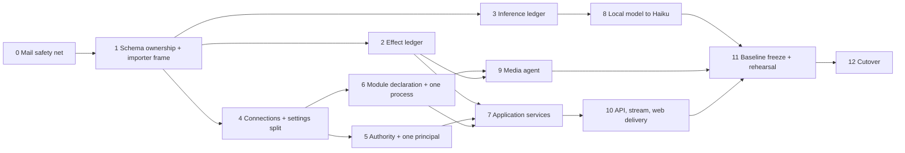

# v3 plan, November 2026

The work that turns the findings of `2026-11-architecture-review.md` into
v3. F numbers and decision numbers refer to that document. Each phase
becomes one GitHub issue after the operator approves this plan.

## Rules for the whole build

- **Branch.** All work lands on the branch `v3` through pull requests; CI
  runs on every pull request. `main` stays at v2 and receives nothing until
  cutover (decision 20).
- **v2 is frozen.** No fix, no deploy, no setting that changes the
  embedding endpoint or model on the live system.
- **Code is reshaped, not rewritten** (decision 22). A phase moves working
  behavior behind the new structure and deletes the old path in the same
  phase. No phase leaves two paths for one behavior.
- **Mail moves last inside every phase**, and only with the safety net of
  phase 0 passing before and after.
- **The importer grows with the schema.** Every phase that changes a table
  changes `atrium db import-v2` and its end-to-end test in the same pull
  request. The schema becomes the frozen v3 baseline at phase 11, not
  before.
- **Tests are end-to-end only**, through the CLI or the HTTP entry point.
  Tests that assert markup, prose or class names are deleted when their
  page is touched, not ported (F12).
- **The build is unattended.** The operator gets a report at the end of
  each phase. The work stops for the operator only at cutover (decision
  26), or when evidence contradicts a decision in the review.
- **Documents.** `context.md` and the operator documents are rewritten for
  v3 in phase 11, on the branch. `AGENTS.md` rules that name the v2
  baseline, `/api/v1` additivity and host-facing unit names are replaced by
  their v3 statements in the phase that changes the fact.

## Phases

### 0. Mail safety net

- End-to-end tests for mail routing through each stage, gate refusals
  (shadow, pause, protected folders, write caps), an unknown write outcome
  that stays blocked, and undo. They drive the real commands against a
  local IMAP fake and a temporary database.
- A replay command result: on a copy of a v2 database, re-run routing for
  the stored messages with every external call off, and report each
  message whose decision differs from the stored one. The report on the
  untouched v2 code is the baseline for every later phase.
- Done when: the tests pass on the branch point, and the replay baseline is
  recorded.

### 1. Schema ownership and the importer frame (F8)

- One owner package per table; cross-package SQL goes through the owner.
- Derived rows record what they were derived from: embeddings carry the
  content hash they were made from, memory summaries are made from the
  unclipped text.
- `atrium db import-v2` exists and carries everything decision 21 lists,
  message rows with their ids and the mail vectors with the active index
  record included, so mail routing decides on the imported copy as it did
  on v2 with no rebuild. Carried vectors are stamped with the hash of the
  message they belong to. It refuses a database that is not at the last v2
  schema version, or one whose index is mid-rebuild, and it never writes
  to the source.
- The public `sdk`, `withModules` and `module_migrations` are deleted
  (decision 9).
- Done when: an end-to-end test imports a v2 fixture database and the
  phase 0 replay on the imported copy matches the baseline.

### 2. Effect ledger (F3)

- One state machine for every external write: intent, effect, outcome
  (done, failed, partial, unknown), undo. Mail, calendar, contacts, Notion,
  media and notifications use it.
- Mail keeps its gate, its scopes and the COPY, STORE, UID EXPUNGE move.
  Unknown outcomes stay blocked until the operator resolves them.
- The importer maps the v2 action ledger and write resolutions into it
  with their states intact.
- Done when: the phase 0 tests and replay pass unchanged, and each other
  writer has an end-to-end test for an unknown outcome.

### 3. Inference ledger (F9)

- Every paid model call reserves against the run cap and the monthly
  budget before it is sent and settles after. Memory spend counts
  (decision 11). The current month's spend is imported.
- Done when: an end-to-end test shows a call refused at the budget, and a
  summarizer run with three attempts records three entries.

### 4. Connections and the settings split (F6, F7)

- One connection record per external system: credential source, test,
  health, transport, expiry. Google is one connection with several
  capabilities.
- Host values, operator choices and tuning constants are separated; tuning
  constants become code (decision 10).
- The importer maps v2 settings keys and stored credentials to the new
  records and reports every key it drops.
- Done when: every connection has a working test action through the CLI,
  and the import report lists no unmapped operator choice.

### 5. Authority and one principal (F4)

- One principal; the administrator role and login links are removed
  (decisions 6, 7). Emergency access is loopback only.
- Tool authority is checked at the effect against current thread marks,
  inside a batch as well as between steps. `search_threads` respects
  private projects. Marked threads may write unconfirmed knowledge
  (decision 8).
- The API is public: a rate limiter and bearer revocation exist
  (decision 5).
- Done when: end-to-end tests show a mid-batch mark refusing a later tool,
  a revoked bearer refused, and a rate-limited client refused.

### 6. Module declaration and one process (F5, F2)

- A module is one declaration; pages, API resources, tools, executors,
  jobs, services, settings and connections derive from it.
- One `atrium serve` owns the scheduler, the mail watch and the sync
  passes, with supervision and drain (decision 1). Jobs carry their own
  policy. The separate units, the timers and `atrium-web-local` are
  removed from the NixOS module.
- Done when: an end-to-end test starts `serve`, sees a scheduled job and a
  mail pass run, and sees a clean drain on SIGTERM with a run in flight.

### 7. Application services (F1)

- Typed operations and typed read models per module. HTML handlers, the
  API, the CLI, agent tools and jobs become adapters that call them.
  Validation, defaults and audit live in the operation.
- Order: knowledge, review and tasks, calendar and contacts, assistant,
  media, mail.
- Done when: no adapter reaches storage or a domain package directly (a
  build-time import check), and the phase 0 tests and replay pass.

### 8. Local model to Haiku (decisions 14, 27)

- The classifier call has no tools and a fixed output schema. Routing's
  last stage, flags, scans, open loops, watches, the invitation judge and
  the ops condenser use it through the inference ledger.
- The chat endpoint setting and `atrium-llm` are removed. The embedding
  server stays (decision 19).
- Embedding failure: chat send already falls back to full-text search
  after a 2 s window (`internal/kb/retrieve.go:22,275-293`). The
  `kb_search` tool gets the same window (`internal/kb/search.go:217-239`
  has none), and a skipped vector step is logged.
- Done when: the phase 0 replay, with the classifier answered by the model
  fake, matches the baseline, and an end-to-end test shows `kb_search`
  answering from full-text search with the embedding endpoint stalled.

### 9. Media agent (decisions 17, 18)

- `atrium media-agent` does filing by hardlink, the library scan,
  thumbnails and library file serving, and holds no database. Filing is
  safe to repeat. The main process reaches it as a connection.
- Public signed links are verified in the main process and streamed from
  the agent, unbuffered, with range requests. The agent accepts only the
  main process.
- The two per-library file servers leave the host configuration.
- Done when: end-to-end tests file a download through the agent twice with
  one result, and fetch a byte range through a signed link.

### 10. API, stream and web delivery (F1, F10, F11, F12, F13)

- The API reaches all 22 feature areas (decision 3). A check fails the
  build when an operation has no API route (decision 2).
- The OpenAPI document is generated from the operation types and
  committed; CI fails on drift; the Swift client generates from it
  (decision 13). The run stream has a written contract, is resumable, and
  commands carry a durable identity (decision 4).
- Push goes through one inbox with transports behind it.
- Fragments ask only for the data they show; static assets are prepared
  once and cached; `tokens.json` generates the CSS variables.
- First hour: the NixOS example sets a database key, and the default
  sign-in mode matches the bootstrap path.
- Done when: the reach figure of the review reads 22 of 22 from the
  generated schema, and the contract tests drive each area through the
  API.

### 11. Baseline freeze and rehearsal (decisions 21, 25)

- The schema is frozen as the v3 baseline. From here every schema change
  is an additive migration.
- Trial import on a copy of the live database, taken on artemis and never
  moved off it. The replay on the imported copy is compared with the
  baseline; every difference is explained or fixed.
- `context.md`, `docs/operator/behavior.md` and `docs/operator/nixos.md`
  are rewritten for v3. The host configuration change is prepared on a
  branch of the host repository.
- Done when: the rehearsal report is sent to the operator with the import
  counts per table, the dropped keys, the replay differences and the time
  the import took.

### 12. Cutover (decision 26)

Waits for the operator. In order: back up the v2 database; stop v2;
import; start v3 with mail in shadow mode; rebuild the knowledge and
Notion vectors, search indexes and the Notion copy; check health and one
chat send; merge `v3`
into `main`. The operator turns mail live. Rollback restores the v2
database and binary and loses the writes made on v3.

## Choices made in this plan

These were small enough to settle here. Each is reversible on the branch.

- The API keeps the path `/api/v1`. Nothing else consumes it, and a
  second path would be a second contract.
- Units after cutover: one application unit and one media agent unit.
- The rehearsal copy and the replay stay on artemis; no live data leaves
  the host.
